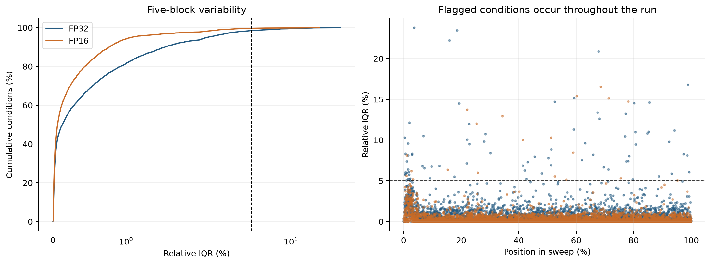
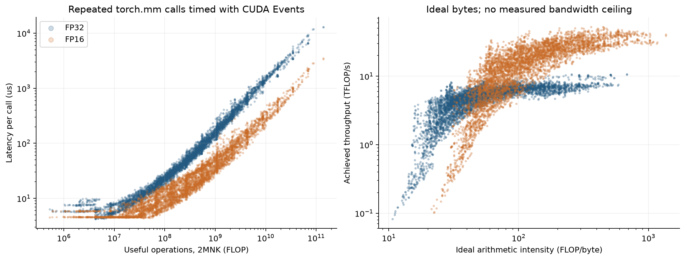
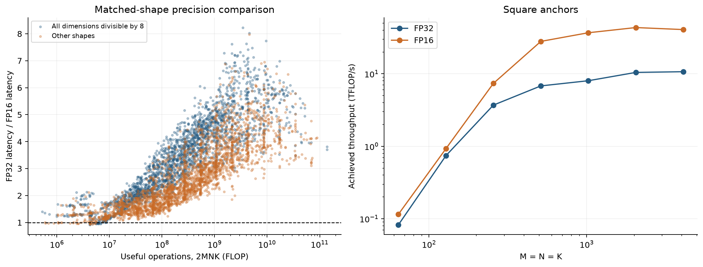
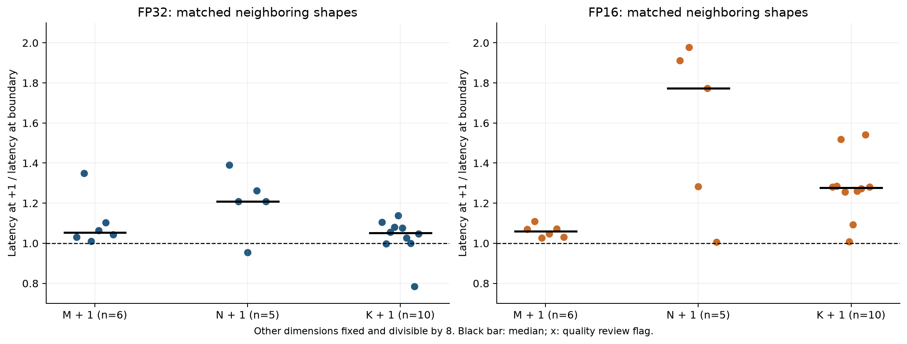

# GEMM 데이터 검증과 성능 분석

분석일: 2026-09-19. 측정일: 2026-09-17. 장비: NVIDIA RTX 4000 SFF Ada Generation.

5,000개 형상과 FP32, FP16을 조합한 10,000조건의 수집이 완료됐다. CSV의 중복, 누락, 실패 행은 없었으며, 저장된 5개 블록으로 중앙값과 IQR, 처리량을 다시 계산한 결과가 모두 일치했다. 실행 로그도 정상 종료를 나타냈다. 전체 조건의 상대 IQR 중앙값은 0.0818%였지만, 98조건은 기존 5% 기준을 넘었다.

같은 형상끼리 비교한 FP16의 속도 향상 중앙값은 2.86배였다. 연산량이 작은 구간에서는 두 정밀도의 차이가 작았고, 일부 형상에서는 FP16이 더 느렸다. 한 차원만 1 증가시킨 비교에서도 실행시간이 크게 달라졌다. 연산량과 정밀도 외에 각 차원의 크기와 정렬을 함께 봐야 한다는 결과다.

이번 분석 범위는 데이터 검증과 기술통계에 한정한다. 예측 모델 학습, 학습·검증·시험 분할, 전체 모델 조립 실험은 수행하지 않았다.

## 1. 원자료와 실행 조건

원본은 Google Drive의 [자율연구 폴더](https://drive.google.com/drive/folders/1aR-VvKbzmsCzATZQp5mScIBdNVfd9iAw)에서 확보했다. `profiling results 2/full` 6개, `pilot` 4개, `scripts` 4개, 참고 측정 3개로 총 17개 파일이다. `raw/`에 원본을 보존했고 [source_manifest.json](source_manifest.json)에 Drive 파일 ID, 크기, 수정 시각, 로컬 SHA-256을 기록했다. 다운로드한 모든 파일의 바이트 수가 Drive 목록과 일치했다. 이후 분석을 다시 실행할 때 SHA-256을 검사한다.

| 항목 | 확인된 내용 |
|---|---|
| 본측정 | [full_5000x2.csv](raw/full/full_5000x2.csv), 10,000행 |
| 형상 목록 | [full_5000x2.meta.json](raw/full/full_5000x2.meta.json), 고유 형상 5,000개 |
| 크기 범위 | M, N, K 각각 64~4096 |
| 형상 구성 | 기준 형상 12개, 로그 무작위 3,988개, 경계 주변 1,000개 |
| 전체 차원이 8의 배수인 형상 | 2,293개, 나머지 2,707개 |
| M=N=K인 형상 | 7개 |
| 소프트웨어 | PyTorch 2.14.0+cu132, CUDA runtime 13.2, CUDA Toolkit 13.4.59 |
| 정밀도 설정 | FP32 `ieee`, FP16 reduced-precision reduction 및 FP16 accumulation 비활성화 |
| 준비 실행 | 전체 예열 3초, 조건별 warmup 5회, settle 목표 500 ms |
| 측정 | 조건마다 5블록, 블록 목표 100 ms, 최대 20,000회 반복 |
| 시각 | 첫 조건 시작 14:35:48, 마지막 조건 시작 17:15:14, 한국 시간 |

형상 수집은 기준 형상 12개를 포함해 처음 4,000개를 채운 뒤 경계 형상 1,000개를 더하는 구조다. 따라서 무작위 형상만 4,000개인 것은 아니다. 원본 스크립트의 `generate_shapes(5000, 20260916)`를 CPU에서 재실행했으며, 형상과 순서가 메타데이터 및 CSV와 일치했다.

블록마다 여러 번 호출한 평균시간을 저장하고, 그 평균시간 5개의 중앙값을 조건별 latency로 사용했다. 반복 5블록은 조건 수에 더하지 않는다. IQR은 이 5개 블록 사이의 변동이며, 개별 호출 latency의 분포나 신뢰구간을 뜻하지 않는다.

## 2. 완결성과 측정 품질

| 검사 | 결과 |
|---|---:|
| 기대 조건 / 저장 조건 | 10,000 / 10,000 |
| 고유 `(M,N,K,dtype)` | 10,000 |
| 누락 / 중복 / FAIL | 0 / 0 / 0 |
| 유한한 양의 블록 시간 | 50,000 / 50,000 |
| 중앙값, 사분위수, IQR, TFLOP/s 재계산 | 모든 행 일치 |
| 로그의 조건과 측정값 대조 | 10,000행 일치 |
| 스윕 및 래퍼 종료 표시 | `completed_after_run=10000`, `EXPERIMENT: PASS` |

`exit_code.txt`는 업로드 목록에 없었다. 다만 업로드된 실행 래퍼의 SHA-256이 실행 당시 환경 로그와 일치했고, 해당 래퍼는 실험 종료 코드가 0일 때 `EXPERIMENT: PASS`를 출력한다. 따라서 실행 완료는 로그와 CSV의 일치로 확인했다. `gemm_pilot.py` 자체의 실행 당시 해시는 기록에 없으므로, 보관된 스크립트와 당시 파일의 바이트 단위 동일성까지 증명한 것은 아니다.

상대 IQR은 `100 × (q75 − q25) / median`으로 계산했다.

| 자료형 | 조건 수 | 상대 IQR 중앙값 | 95백분위 | 최대 | 5% 초과 |
|---|---:|---:|---:|---:|---:|
| FP32 | 5,000 | 0.128% | 2.33% | 23.8% | 78 |
| FP16 | 5,000 | 0.0621% | 1.08% | 16.6% | 20 |
| 전체 | 10,000 | 0.0818% | 1.80% | 23.8% | 98 |

전체의 99.02%인 9,902조건은 상대 IQR 5% 이하이다. 안정화 전 파일럿에서는 200조건 중 109조건이 5%를 넘었고 중앙값이 6.31%였다. 안정화 파일럿에서는 초과 조건이 없고 중앙값이 0.238%였다. 본측정은 대체로 낮은 변동을 유지했지만, 파일럿 통과가 모든 본측정 조건의 안정성을 보장하지는 않았다.



IQR은 극단적인 한 블록을 놓칠 수 있어 `100 × (마지막 블록 / 첫 블록 − 1)`도 계산했다. 절댓값이 5%를 넘는 조건은 176개이고, IQR 초과 조건과의 합집합은 199개다. 이 기준은 이번 분석의 추가 선별 기준이며, 첫·마지막 차이만으로 지속적인 클럭 변화나 단조로운 드리프트를 입증하지 않는다.

안정화 파일럿과 본측정에는 공통 조건이 132개 있다. 주요 환경과 측정 설정이 같은지 확인한 뒤 비교했을 때, 본측정/파일럿 latency 비율의 중앙값은 1.007, 5~95백분위 범위는 0.939~1.051이었다. 20조건은 차이의 절댓값이 파일럿 대비 5%를 넘었다. 예를 들어 1024³ FP32는 본측정이 파일럿보다 12.6% 짧았다. 한 실행 안에서 IQR이 작아도 다른 실행에서 같은 중앙값이 재현된다고 보장할 수 없다는 근거다. 원인을 특정할 온도와 클럭의 연속 기록은 없다.

재확인 목록은 중복을 제거해 218조건, 206형상으로 만들었다. 원자료에서 이 행들을 삭제하지 않았다.

| 우선순위 | 선정 조건 | 조건 수 |
|---|---|---:|
| 1 | 본측정 상대 IQR > 5% | 98 |
| 2 | 1번을 제외하고 첫·마지막 블록 차이의 절댓값 > 5% | 101 |
| 3 | 1·2번을 제외하고 파일럿과 본측정 차이의 절댓값 > 5% | 19 |

전체 목록은 [combined_review_queue.csv](tables/combined_review_queue.csv), 기존 IQR 기준만의 목록은 [iqr_gt5_conditions.csv](tables/iqr_gt5_conditions.csv)이다. 실행 간 비교는 [pilot_full_overlap.csv](tables/pilot_full_overlap.csv)에 있다. 공통 132조건 이외의 실행 간 재현성은 이번 자료로 평가할 수 없다.

## 3. FP32와 FP16 성능

속도 향상은 각 형상의 `FP32 latency / FP16 latency`로 계산했다. 두 정밀도의 전체 latency 중앙값을 나눈 값과는 다르다. 아래 요약은 수집한 형상 각각에 같은 가중치를 준 결과이며, 실제 모델의 연산 빈도에 따른 가중 평균은 아니다.

| 항목 | FP32 | FP16 |
|---|---:|---:|
| latency 중앙값 | 48.0 μs | 17.1 μs |
| latency 95백분위 | 1.32 ms | 0.285 ms |
| 처리량 중앙값 | 5.23 TFLOP/s | 15.4 TFLOP/s |
| 처리량 95백분위 | 7.61 TFLOP/s | 37.3 TFLOP/s |
| 관측 최대 처리량 | 10.7 TFLOP/s | 52.5 TFLOP/s |

FP32의 관측 최대는 4096×4096×4096, FP16의 관측 최대는 1400×976×2000에서 나왔다. 이는 이번 PyTorch 스윕에서의 최대값이며 GPU의 확정된 연산 천장은 아니다.

형상별 속도 향상의 중앙값은 2.86배, 기하평균은 2.75배, 5~95백분위 범위는 1.27~5.52배였다. 두 정밀도 모두 IQR 기준을 통과한 4,904형상만 사용하면 중앙값은 2.84배, 실행 내 추가 점검까지 통과한 4,809형상에서는 2.82배였다. 측정 변동이 큰 조건을 제외해도 전체 경향은 유지된다. 이 비교에는 실행 간 재현성 선별을 적용하지 않았다.

| 연산량 F=2MNK | 형상 수 | FP16 속도 향상 중앙값 |
|---|---:|---:|
| 10⁵ ≤ F < 10⁶ | 9 | 1.23배 |
| 10⁶ ≤ F < 10⁷ | 353 | 1.25배 |
| 10⁷ ≤ F < 10⁸ | 1,310 | 1.82배 |
| 10⁸ ≤ F < 10⁹ | 1,941 | 3.02배 |
| 10⁹ ≤ F < 10¹⁰ | 1,166 | 4.28배 |
| 10¹⁰ ≤ F < 10¹¹ | 219 | 4.69배 |
| 10¹¹ ≤ F < 10¹² | 2 | 3.76배 |

FP16이 더 느린 형상은 39개, 전체의 0.78%였으며 모두 10⁷ FLOP 미만이었다. 가장 큰 차이는 520×64×64로, FP32 4.27 μs, FP16 4.66 μs였다. FP16이 9.16% 더 오래 걸렸으며 두 조건 모두 실행 내 품질 기준을 통과했다. 작은 형상에서는 처리량 증가가 곧바로 시간 감소로 이어지지 않는 구간이 있다.





## 4. 정렬과 경계 주변의 차이

M, N, K가 모두 8의 배수인 2,293형상의 FP16 속도 향상 중앙값은 3.43배, 나머지 2,707형상은 2.40배였다. 두 집단은 크기 분포까지 동일하지 않으므로 이 차이 전체를 정렬의 효과로 해석할 수는 없다.

이를 보완하기 위해 다른 두 차원을 고정하고, 모두 8의 배수인 기준 형상에서 한 차원만 `64, 128, 256, 512, 1024, 2048` 중 하나에서 1 증가한 쌍을 찾았다. M 변화 6쌍, N 변화 5쌍, K 변화 10쌍이 두 정밀도 모두에서 존재했다. 이 42개 비교는 모두 실행 내 IQR과 첫·마지막 차이 기준을 통과했다.

| 바꾼 차원 | 정밀도별 비교 쌍 수 | FP32 latency 비율 중앙값 | FP16 latency 비율 중앙값 |
|---|---:|---:|---:|
| M → M+1 | 6 | 1.05 | 1.06 |
| N → N+1 | 5 | 1.21 | 1.77 |
| K → K+1 | 10 | 1.05 | 1.28 |

비율은 변경 후 / 변경 전이다. FP16의 1024×64×264와 1024×65×264는 연산량이 1.56% 증가했는데 시간이 5.04 μs에서 9.98 μs로 1.98배가 됐다. 136×256×4096과 136×257×4096에서는 연산량이 0.391% 증가했지만 시간이 14.7 μs에서 28.2 μs로 1.91배가 됐다. 단순한 연산량 증가만으로 설명하기 어려운 차이다.

N과 K의 경계 근처에 재현을 확인할 만한 성능 변화가 관측됐다. 다만 각 축의 비교 표본이 작고 서로 다른 형상들이므로, N의 영향이 언제나 가장 크다고 일반화하지 않는다. 측정 순서도 인접 조건을 교대로 반복하는 통제 실험은 아니었다. 커널 선택, 정렬, 타일 경계는 가능한 설명이지만, 실제 커널이나 Tensor Core 명령을 수집한 자료가 없어 원인을 확정하지 않는다. NVIDIA 문서 역시 정렬과 타일 크기에 따른 성능 변화를 설명하며, 비정렬 조건에서도 Tensor Core 사용이 가능하다고 명시한다. [NVIDIA GEMM 가이드](https://docs.nvidia.com/deeplearning/performance/dl-performance-matrix-multiplication/index.html)



## 5. 측정값을 해석할 때 남는 제한

측정 구간은 `CUDA Event → Python 반복문의 torch.mm 호출 → CUDA Event`이다. 입력 생성과 CPU↔GPU 전송은 포함되지 않지만, 출력 텐서를 미리 지정하는 `out=` 없이 매 호출에서 출력을 만든다. 따라서 단일 GPU 커널 실행시간만을 직접 분리한 측정은 아니다. 짧은 연산에서는 호스트가 다음 호출을 제출하는 속도나 출력 메모리 관리가 GPU 타임라인의 대기에 영향을 줄 수 있다. 이 영향의 크기는 현재 자료만으로 정량화하지 않았다.

같은 조건의 반복에서는 동일한 A와 B를 계속 사용한다. 따라서 캐시 재사용을 허용하는 측정이다. 그림의 연산 강도는 입력을 한 번씩 읽고 출력을 한 번 쓴다고 가정한 `Q_ideal=(MK+KN+MN)×원소 바이트 수`와 `F=2MNK`로 계산했다. 실제 DRAM 전송량과 대역폭 실측이 없으므로, 이번 그림에는 Roofline 천장이나 η를 붙이지 않았다. 실제 memory-bound 또는 compute-bound 판정도 보류한다. 연산 강도만의 판정이 메모리 계층과 구현 비용을 모두 설명하지 못한다는 점은 [NVIDIA 가이드](https://docs.nvidia.com/deeplearning/performance/dl-performance-matrix-multiplication/index.html)와도 일치한다.

`PASS`는 마지막 출력의 원소들이 유한한지 검사한 결과다. CPU FP64 정답과의 오차를 모든 형상에서 검증했다는 뜻이 아니다. `gemm_first_check.py`는 보관돼 있으나 이번에 받은 묶음에는 그 검증 결과 파일이 없었다. 별도 CUTLASS 결과는 정확성 `passed`인 8192³ 한 조건을 포함하지만, PyTorch 스윕의 모든 형상에 대한 정확성 증거가 되지는 않는다. 같은 이유로 CUTLASS의 잠정 처리량 67.3 TFLOP/s를 본측정 FP16의 확정 천장으로 사용하지 않았다.

settle 500 ms와 블록 100 ms는 사전 probe로 반복 횟수를 정하는 목표값이다. 실제 저장된 블록 시간 중앙값의 범위는 FP32 34.3~187 ms, FP16 24.4~146 ms였다. 실제 settle 소요시간은 저장하지 않았다. 또한 모든 형상에서 FP32를 먼저, FP16을 다음에 측정해 자료형 순서 효과가 완전히 상쇄된 설계는 아니다. 시작 전 GPU 상태는 있지만 실행 중 온도, 클럭, 전력과 다른 프로세스의 부하를 추적한 자료는 없다.

## 6. 다음 실측에서 확인할 항목

먼저 [218조건 재확인 목록](tables/combined_review_queue.csv)의 우선순위 1인 98조건을 다시 측정하고, 나머지 120조건을 이어서 확인하는 것이 적절하다. 한 조건 안의 5블록뿐 아니라 별도로 시작한 실행에서도 중앙값이 유지되는지 비교해야 한다. 이는 이번 분석에서 만든 제안이며 재측정 완료를 뜻하지 않는다.

경계 효과를 확인할 대표 쌍은 1024×64×264 ↔ 1024×65×264, 136×256×4096 ↔ 136×257×4096이다. 두 조건을 번갈아 측정하고 자료형 순서도 바꾸면 시간 경과와 순서의 영향을 줄여 비교할 수 있다. 대표 조건의 프로파일링과 수치 정확성 검증은 latency 측정과 별도로 수행해야 한다.

Roofline 효율까지 해석하려면 같은 장비와 명시된 연산 모드의 반복 가능한 연산 천장, 별도 메모리 대역폭 측정이 필요하다. 이 단계와 예측 모델 학습은 이번 분석에 포함하지 않았다.

## 파일과 재실행

| 파일 | 용도 |
|---|---|
| [analyze.py](analyze.py) | 원자료 해시 검사, 수치 재계산, 표와 그래프 생성 |
| [summary.json](summary.json) | 반올림 전 분석 요약과 검증 결과 |
| [condition_metrics.csv](tables/condition_metrics.csv) | 10,000조건별 계산값과 품질 표식 |
| [precision_pairs.csv](tables/precision_pairs.csv) | 같은 형상의 FP32·FP16 비교 5,000개 |
| [group_comparisons.csv](tables/group_comparisons.csv) | 연산량 구간과 정렬별 요약 |
| [matched_boundary_pairs.csv](tables/matched_boundary_pairs.csv) | 한 차원만 1 증가한 비교 42개 |
| [combined_review_queue.csv](tables/combined_review_queue.csv) | 중복을 제거한 218조건 재확인 목록 |
| `figures/*.png`, `figures/*.pdf` | 본문의 그림 4개와 공유용 PDF |

원자료와 수치 표는 계산 정밀도를 유지했다. 본문과 그림 해석에는 반올림한 값을 사용했다. 분석은 설치돼 있던 Python 3.14.3, NumPy 2.5.0, Matplotlib 3.11.0으로 수행했다. GPU나 PyTorch는 분석 재실행에 필요하지 않다.

```bash
MPLCONFIGDIR=/tmp/gemm-analysis-mpl XDG_CACHE_HOME=/tmp/gemm-analysis-cache python3 '/Users/studyhard/Claude/자율연구/analysis/2026-09-19/analyze.py'
```

정상 실행은 종료 코드 0과 검증 결과 JSON을 출력한다. `raw/`를 변경하지 않으며 파생 표, 그림, `summary.json`을 다시 만든다. 이 README의 해석 문장은 자동으로 다시 작성되지 않으므로 원자료가 달라지면 함께 재검토해야 한다.
