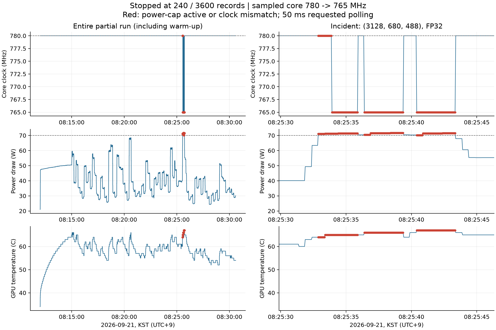
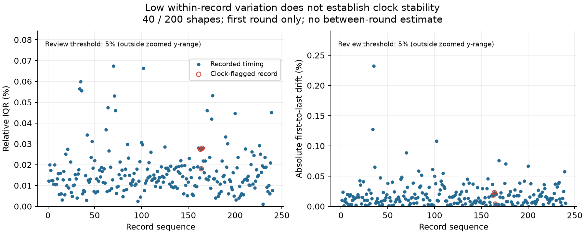

# 200형상 부분수집 검토 — 780 MHz, 2026-09-21

이번 실행은 3,600건 중 240건을 저장한 뒤 클럭 품질 검사에서 중단됐다. 200형상 중 40형상을 FP16과 FP32, 세 실행 방식으로 첫 라운드만 측정했다. 현재 판정은 `INCOMPLETE_CLOCK_VIOLATION_HOLD`다.

## 수집 상태와 원본 검증

| 항목 | 확인 결과 |
|---|---:|
| 측정 기록 | 240 / 3,600건, 누락 3,360건 |
| 형상 | 40 / 200개 |
| 완료된 세 방식 묶음 | 80 / 1,200개, 이 중 한 묶음은 클럭 REVIEW |
| 측정 블록 | 1,680 / 25,200개 |
| 최종 측정별 판정 | PASS 237건, REVIEW 3건, FAIL 0건 |
| 저장된 정확성 검사 | 240건 통과: 전체 출력 비교 6건, 표본 비교 234건 |
| 최대 상대 IQR | 0.06743% |
| 최대 절대 드리프트 | 0.23231% |
| 라운드 간 변동 | 평가 불가: 모든 기록이 round 0 |
| worker 상태 | ERROR, exit 1 |
| 클럭 해제 | 코어와 메모리 해제 명령 모두 exit 0 |

원본 ZIP의 SHA-256은 `f722419bea5b83b54894a4d0db8efdd9c680d63f6e2f1e25c14a7110c759ac20`이다. 원본 ZIP과 내부 357파일을 보존했다. 실행본 10파일, 기존 의존성 49파일을 배포본과 대조했고, 기존 분석기로 복사본에서 재생성한 15산출물이 원본과 바이트 단위로 일치한다. SQLite 기록, 계획 앞부분 240작업과 시간 분모도 대조했다. 이 검산의 PASS는 원자료와 재계산의 일치를 뜻하며 수집 전체 통과를 뜻하지 않는다. Mac에서 GPU 연산을 다시 실행하지 않았다.

## 중단 원인

문제 형상은 `(M,N,K)=(3128,680,488)`의 FP32다. 163~165번째 작업인 allocate, prealloc, Graph 모두에서 클럭 품질 문제가 확인됐다.

| 방식 | 저장된 중앙값 | 클럭 문제가 관측된 측정 블록 |
|---|---:|---:|
| allocate | 415.017 µs | 7 / 7 |
| prealloc | 415.311 µs | 7 / 7 |
| Graph | 413.169 µs | 7 / 7 |

21,287개 센서 표본 중 코어 765 MHz가 152개, 순간 SW Power Cap 활성 표본이 172개였다. 나머지 코어 표본 21,135개는 780 MHz였다. 이상 표본의 최초와 마지막 시각은 한국시간 08:25:32.874와 08:25:43.340이다. 그 사이 10.466초는 표본 시각의 범위이며 연속적인 전력 제한 지속시간으로 해석하지 않는다.

클럭 또는 순간 전력 제한 문제가 관측된 블록은 안정화 67개, 반복 수 보정 3개, 본측정 21개다. 해당 구간을 비롯한 전체 센서에서 메모리 6801 MHz와 전력 한도 설정 70 W는 유지됐다. 관측 전력은 21.00~71.63 W, 온도는 34~67°C이며 SW/HW thermal 활성 표본은 0개였다. 설정값, 전력 관측값과 전력 제한 상태는 각각 구분해 보존한다.

이전부터 남아 있던 누적 SW Power Cap 카운터의 해석 문제와 별개로, 이번에는 **순간 전력 제한 활성과 코어 클럭 하락이 함께 관측**됐다. 누적 카운터 이상은 105/1,680블록에 남아 있으며 기존 미해결 상태를 유지한다.

해당 형상은 앞서 받은 192측정 780 파일럿, 대표 조건 클럭 비교와 60측정 통합 점검의 목록에는 없었다. 이전 파일럿의 통과는 그 측정 범위의 결과로 남긴다. 이번 확장 측정으로 780 MHz가 선정한 모든 형상에서 유지된다고 가정할 수 없다는 점을 확인했다.



## 로그의 PASS와 최종 REVIEW가 다른 이유

worker는 각 작업 직후 정확성과 시간 변동으로 상태를 기록한다. 센서 로그를 포함한 품질 검사는 120작업 단위가 끝날 때 수행한다. 따라서 문제가 생긴 163~165번째 작업도 실행 로그와 원본 DB에는 PASS로 남았고, 240번째 작업 뒤 센서 검사에서 세 작업이 REVIEW로 분류되어 다음 수집을 중단했다. 최종 판정에는 `summary.json`과 `review_queue.csv`를 사용한다.

현재 `choices_and_done`은 원본 DB의 상태를 읽는다. 같은 명령으로 재시작하면 이 세 작업도 완료로 보고 건너뛴다. `--retry-failed` 역시 원본 상태가 FAIL인 작업을 대상으로 하므로 이 세 작업의 재측정을 보장하지 않는다. 원본 DB나 판정 기준을 수정해 문제를 지우지 않는다.

## 시간 변동과 해석 범위

상대 IQR과 드리프트는 5%보다 작지만, 이 결과만으로 목표 클럭 유지가 입증되지는 않는다. 클럭이 낮아진 상태에서 반복 시간이 안정적일 수도 있다.

원본 `summary.json`의 `max_between_round_range=0.0`은 조건별로 값이 하나뿐일 때 계산된 결과다. 라운드 간 변동이 0%라고 보고하지 않고 **미측정**으로 표시한다. 이번 기록에는 완성된 3라운드 조건이 없다.



완료된 40형상은 원래 계획의 첫 부분이다. 전체 200형상을 대표한다고 보거나 예정한 성능 비교 그래프의 최종 자료로 사용하지 않는다. 이번에는 원인 검토용 두 그림을 만들었으며, 전체 OI–성능 분포와 실행 방식 비교는 필요한 수집과 검증이 끝난 뒤 작성한다.

## 다음 판단

현재 실행은 그대로 보존하고, 전체 수집의 단순 이어쓰기는 보류한다. 다음 진단은 문제 형상의 FP32와 FP16, 세 실행 방식을 포함해 780 MHz에서 문제가 재현되는지 확인하고, 메모리 6801 MHz와 70 W를 유지한 더 낮은 코어 후보(예: 750 MHz)를 비교하는 것이다. 기존 큰 형상도 함께 확인해야 한다. 이는 후속 제안이며 새 클럭을 선택하거나 새 GPU 실행을 시작한 것은 아니다.

후속 실행본에는 검토 대상 재측정과 원본 PASS/센서 REVIEW의 차이를 반영하는 이어쓰기 처리가 필요하다. 현재 동결된 실행본, 배포 ZIP과 원자료는 바꾸지 않았다. 초록에는 완료된 이전 파일럿의 검증 범위와 이번 확장 수집에서 발견한 제한을 구분해 반영한다.

## 파일과 재현

- [검산 결과](validation.json), [원본 파일 해시](raw_sha256.json), [원본 ZIP](abstract_200_780_20260921_083037_8b68d7.zip)
- [블록별 이상](incident_blocks.csv), [센서 이상 표본](anomalous_samples.csv), [REVIEW 측정](reviewed_measurements.csv)
- [미수집 작업](missing_tasks.csv), [32개 그룹별 수집 범위](strata_coverage.csv)
- [클럭 진단 PDF](clock_incident.pdf), [시간 변동 PDF](timing_quality_partial.pdf)
- [검산 및 그림 생성 코드](verify_result.py)

자율연구 폴더에서 기존 시스템 Python과 matplotlib로 재현한다. 파일 복사본의 분석 결과만 재생성한다.

```bash
MPLCONFIGDIR=/private/tmp/gemm-abstract-200-mpl python3 -B analysis/abstract_200_780_result_2026-09-21/verify_result.py
```
