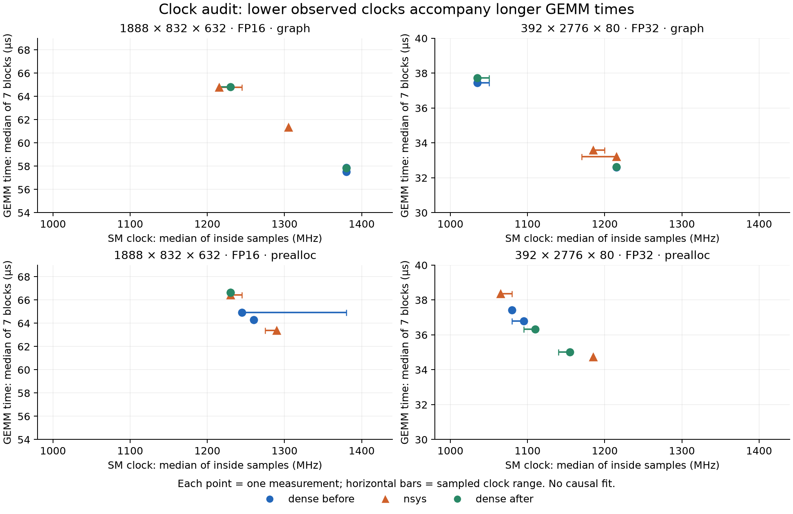

# 클럭·Nsight 진단 결과 — 2026-09-20

수집은 완료됐고, 측정 품질은 REVIEW다. 이번 두 조건의 변동은 전력 제한 상태에서의 SM 클럭 변화와 강하게 연결된다. 관측한 Nsight 블록에서는 제출 API가 늦어 생긴 내부 공백보다 커널 실행 시간 자체의 변화가 두드러졌다. 클럭을 직접 통제한 실험은 아직 하지 않아 인과관계가 완전히 확정된 것은 아니다. full은 보류한다.

사용자 원본은 `clock_audit_20260920_145534_0K3jyQ.zip`이며 SHA-256은 `499b9b64bc348b8e5967fc5926364831cb094e1749dbcd096ec00d28b4dc54e2`다. 원본 183파일을 보존하고 진단 소스 9개·v6 소스 14개·환경 5개·manifest·입력 seed·Graph 29/56회·분모·모든 블록 통계를 대조했다. 신뢰하는 로컬 분석기로 재생성한 JSON/CSV/Markdown 5개는 업로드 결과와 바이트 단위로 같았다. 시작 14:55:34부터 ZIP 내 마지막 산출물 15:13:52까지 약 18분 18초다.

40/40측정·280/280블록·Nsight 준비 범위 8개·측정 범위 56개를 확인했다. 누락·중복·FAIL은 없고 저장된 정확성 검사는 40개 모두 256원소 표본 검사이며 전체 출력 정확성 증명은 아니다. 블록 기준 PASS 38·REVIEW 2이고 round/프로세스 차이와 Nsight 경고는 별도다. 종료 코드 2와 REVIEW 표시는 정상 동작했다.

**클럭과 시간의 대응**

아래 값은 같은 프로세스에서 두 round를 비교한 것이다. 시간은 7블록 GEMM당 시간의 중앙값, 클럭은 해당 블록 host 범위 안에서 얻은 7표본의 중앙값이다. host 범위는 CUDA event의 정확한 GPU 경계와 같지 않고 센서 값에도 갱신 지연이 남는다.

| 조건·비교 | 빠른 측정 | 느린 측정 | 시간 증가 | 클럭 역비 증가 |
|---|---:|---:|---:|---:|
| FP16 (1888,832,632) Graph · dense_after | 1380 MHz / 57.84 μs | 1230 MHz / 64.81 μs | 12.05% | 12.20% |
| FP32 (392,2776,80) Graph · dense_before | 1215 MHz / 32.61 μs | 1035 MHz / 37.46 μs | 14.88% | 17.39% |
| FP32 (392,2776,80) prealloc · Nsight | 1185 MHz / 34.72 μs | 1065 MHz / 38.35 μs | 10.45% | 11.27% |

FP16 Graph의 첫 비교에서 시간×관측 클럭은 두 round 사이 약 0.13%만 달랐다. 이는 클럭 하락이 시간 증가를 설명한다는 강한 단서지만, 관측 클럭으로 모든 시간을 보정하거나 모든 형상에 같은 비례식을 적용할 근거는 아니다. Nsight에서 같은 dtype의 prealloc·Graph 모두 같은 커널 이름과 GEMM당 1개 커널 경로를 유지했다. 비프로파일 실행의 커널 경로는 직접 추적하지 않았다.

**전력 제한과 온도**

0.1초 기록을 사용한 세 프로세스의 실제 측정 168블록에서 내부 표본이 각각 1개 있었고 168개 모두 SW Power Cap=Active였다. 기록된 전력 제한은 70 W, 메모리 클럭은 6801 MHz로 유지됐다. 측정 중 온도 표본은 71~76°C였다. 다섯 프로세스의 첫/끝 표본 간 SW Power Capping 카운터 증가 합은 약 1056.9초이며 예열·안정화·측정 전체가 포함된다. SW/HW thermal 카운터 증가는 모두 0이고 수집 표본에도 thermal 활성 신호가 없었다. 이 데이터가 직접 지지하는 것은 전력 제한에 따른 클럭 조절이며, 온도가 다른 방식으로 전력·부스트에 영향을 미칠 가능성까지 배제하지는 않는다. 카운터 단위와 사유 정의는 [NVIDIA 문서](https://docs.nvidia.com/deploy/nvidia-smi/#clock-event-reasons-counters)를 확인했다.

**실제로 사이에 무엇이 있었는가**

Nsight 56블록에서 GEMM 호출 123858회와 대응 커널 123858개를 확인했다. 관측 범위에서 추가 비연관 커널·memcpy·memset은 없었다. 커널 사이 내부 간격은 다음과 같으며, 비율의 분모는 첫 GPU 작업 시작부터 마지막 작업 종료까지의 span이다.

| 조건 | round 0 커널 μs/GEMM | round 1 커널 μs/GEMM | 내부 간격 비율 r0 / r1 |
|---|---:|---:|---:|
| FP16 prealloc | 62.43 | 65.44 | 1.483% / 1.459% |
| FP16 graph | 64.61 | 61.18 | 0.253% / 0.253% |
| FP32 prealloc | 37.34 | 33.72 | 2.632% / 2.878% |
| FP32 graph | 33.09 | 33.44 | 0.377% / 0.379% |

분석 가능한 모든 내부 간격에서 다음 GPU 작업에 대응하는 CUDA 제출 API는 이미 반환한 상태였다. API 진입 전/진행 중으로 분류된 공백은 0이었다. 따라서 이번 관측 블록의 큰 변동을 늦은 CPU 제출이 만든 공백으로 설명할 근거는 없다. API 반환 후 간격의 내부 하드웨어 원인은 이 추적으로 확정할 수 없으며, 이 결론을 앞서 진단한 작은 GEMM이나 다른 조건으로 확대하지 않는다.

Nsight 경고는 8파일에 총 48개이고 주 측정 프로세스에 해당하는 CUDA/NVTX 불완전 수집 경고가 16개다. 나머지 프로세스 경고만으로 치부하지 않았다. 기대한 범위와 커널 수가 맞아도 추적 밖의 GPU 작업이나 모든 데스크톱 간섭까지 없었다는 증명은 아니다. GNOME portal·ptyxis는 허용된 프로세스로 계속 기록됐다.

**조회·프로파일러 영향과 남은 변동**

| 조건 | 1초 기록 μs | 0.1초 기록 μs | Nsight+0.1초 μs | 0.1초/1초 변화 | Nsight/0.1초 변화 |
|---|---:|---:|---:|---:|---:|
| fp16 prealloc | 65.67 | 65.79 | 64.90 | +0.19% | -1.35% |
| fp16 graph | 57.68 | 57.86 | 63.07 | +0.31% | +9.01% |
| fp32 prealloc | 36.94 | 36.56 | 36.54 | -1.04% | -0.05% |
| fp32 graph | 33.90 | 35.04 | 33.40 | +3.36% | -4.67% |

1초/0.1초 값은 각각 전후 프로세스의 2 round씩 총 4개 중앙값을 다시 중앙값으로 요약한 것이며 Nsight는 2개다. 조회 빈도 비교는 네 묶음 모두 중앙값 기준 ±3.37% 안이다. 일정한 큰 관측 비용은 보이지 않지만 동등성이나 오버헤드 0을 증명하지 않는다. FP16 Graph의 Nsight 값은 +9.01%이나 같은 때 클럭 상태도 달라졌으므로 순수 프로파일러 오버헤드로 해석하지 않는다.

프로파일러 없는 0.1초 기록 네 관측의 범위/중앙값은 FP16 Graph 12.58%, FP32 prealloc 6.60%, FP32 Graph 14.61%로 기존 5% 기준을 넘었다. FP16 prealloc은 3.56%였다. 각 round 안에서 안정해 보여도 다른 clock 상태의 round로 이동할 수 있다는 뜻이다. 블록 기준 REVIEW 두 개는 sparse_before의 FP32 Graph r0(IQR 7.92%, drift +9.24%)와 sparse_after의 FP16 Graph r0(drift +5.28%)다. 모든 값과 표식을 유지했다.

1초 기록의 112블록 중 111개는 내부 표본이 없었다. 0.1초 기록의 168블록은 모두 내부 표본이 1개라 단일 블록 카운터 차이는 전부 미정이다. 실제 조회 간격 중앙값은 약 102 ms지만 센서 갱신 주기를 뜻하지 않는다. 카운터가 약 0.5초 증가량을 한꺼번에 반영하는 계단 형태를 보였다. 예를 들어 dense_before FP32 prealloc r0의 첫/끝 내부 표본 시각 차이는 0.613초인데 카운터 증가는 약 0.9997초였다. 24개 촘촘한 측정 중 5개에서 보고된 카운터 증가가 표본 시각 범위보다 컸다. 이 값은 그대로 보존했으며 짧은 구간의 정확한 제한 시간이나 100%를 넘는 제한 비율로 사용하지 않았다. 내부 갱신 방식은 확인하지 않았다.

**다음 판단**

예열만 더 늘리거나 5% 기준을 완화하기보다, 지원 클럭을 먼저 조회하고 70 W 안에서 실제로 유지되는 보수적인 고정 클럭과 자동 클럭을 두 조건에서 비교하는 짧은 통제 실험을 권한다. 요청 클럭과 실제 클럭의 일치, 두 방식·입력·묶음·순서 교대, 종료 후 원래 설정 복원을 확인해야 한다. 고정 클럭에서는 측정 조건 자체가 바뀌므로 원래 데이터와 분리하고, 이를 본측정 조건으로 채택할지는 결과를 본 뒤 정한다. 이 검토에서는 GPU 설정 변경·새 실행·새 패키지 배포를 하지 않았다.

원본·재계산은 `raw/`, `recomputed/`, 대조는 `verification.json`·`raw_integrity.json`, 추가 수치와 그림은 `review_metrics.json`·`measurements.csv`·`trace_blocks.csv`·`trace_summary.csv`·`process_counters.csv`·`clock_latency.png/pdf`에 있다. `review.py`는 원본 해시와 재계산 일치를 다시 검사한 뒤 표와 그림을 재생성한다. 분석 품질 평가는 근거와 위 한계를 함께 제시할 수 있는 상태이며, 측정 안정성 자체의 판정은 REVIEW다.
