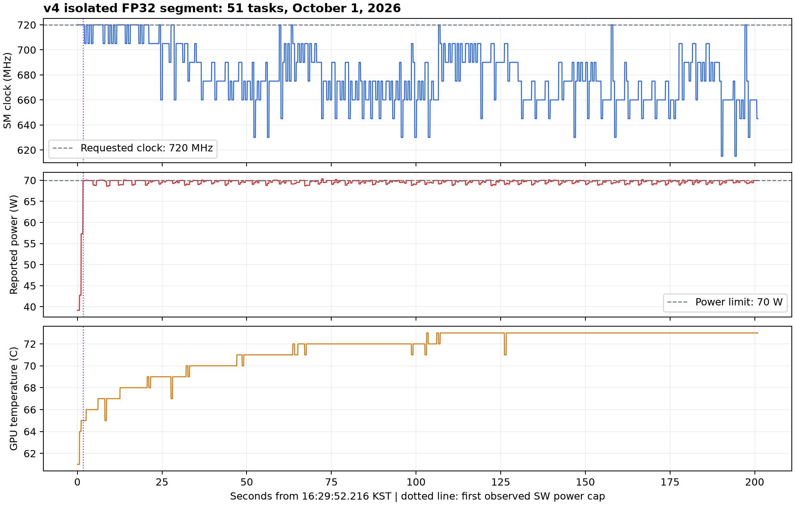

# 720 MHz 검토 대상의 클럭 제한 원인 조사

2026-10-01 반환된 v4 결과와 최초·v1·v3의 보존 자료를 비교했다. 추가 GPU 실행이나 설정 변경 없이 수행한 원인 조사이며 연구노트가 아니다.

현재 자료가 가장 강하게 지지하는 직접 원인은 **70 W 전력 한도를 지키기 위한 GPU의 SW power-cap 제어**다. 720 MHz 고정 요청은 적용됐지만 문제 FP32 작업의 부하에서 실제 클럭을 유지하지 못했다. 전력 제한의 존재는 확인됐으며, 특정 형상에서 전력을 높이는 커널 내부 동작과 연속 배치가 제한을 얼마나 강화했는지는 추가로 구분해야 한다.

## 직접 확인한 근거

장비는 NVIDIA RTX 4000 SFF Ada Generation이고 저장된 `nvidia-smi -q`에서 기본·현재·요청·최대 전력 한도가 모두 70 W다. 제품의 공식 총 보드 전력도 70 W다. 사용자가 한도를 임의로 낮춘 흔적은 없으며, 정상 지원 범위에서 한도를 더 올리는 방법은 없다. [NVIDIA 제품 사양](https://www.nvidia.com/en-au/products/workstations/rtx-4000-sff/)

실제 실행의 `set_graphics.json`은 `-lgc 720,720` 성공을 기록했다. 일반 그룹 1,749건의 15구간은 모두 720 MHz를 유지했고 전력 제한 플래그가 없다. 이 구간들의 전력 표본 최댓값은 68.01 W였다. 마지막 문제 그룹에서는 약 201초 동안 전력이 70 W 부근에 머물렀다. 전체 구간의 전력 표본 중앙값은 69.81 W, 최대는 70.34 W다. 전력 한도와 메모리 클럭 6801 MHz는 유지됐다.

NVIDIA는 SW power-cap을 설정된 전력 한도를 넘지 않도록 클럭을 조절하는 상태로 정의한다. `nvidia-smi`도 전력 제어가 요청 클럭보다 낮출 수 있음을 명시한다. 따라서 고정 명령 성공과 이후 실제 클럭 하락은 양립한다. 이번에는 플래그뿐 아니라 시간 측정 블록 안에서 실제 클럭 하락까지 관측됐다. [NVML 제한 사유 정의](https://docs.nvidia.com/deploy/nvml-api/latest/api/group__nvmlClocksEventReasons.html), [nvidia-smi 설명](https://docs.nvidia.com/deploy/nvidia-smi/index.html)

| 첫 문제 작업의 경과 | GPU 온도 | 전력 표본 | SM 클럭 |
|---|---:|---:|---:|
| 16:29:52.443 KST, 작업 시작 | 구간 시작 시 61°C | 구간 시작 시 39.16 W | 720 MHz |
| 16:29:53.867, 최초 SW power-cap 표본 | 65°C | 69.86 W | 720 MHz |
| 16:29:54.346, 최초 클럭 하락 표본 | 65°C | 69.96 W | 705 MHz |
| 16:29:55.633, 본 시간 블록 시작 | 제한이 이미 관측된 뒤 | — | — |

첫 전력 제한 표본은 작업 시작 약 1.42초 뒤의 예열 중에 나타났다. 구간 전체의 활성 사유 마스크는 `0x0`과 `0x4`뿐이며, SW·HW thermal slowdown 표본은 없었다. GPU 온도는 최대 73°C였다. 따라서 온도 상한에 도달해 작동하는 열 보호 제한을 이번 현상의 직접 원인으로 볼 근거는 없다. 온도가 소비 전력이나 제어 이력에 미치는 간접 영향까지 배제한 것은 아니다.

문제 구간의 52개 compute-process 점검에는 측정 프로세스만 있었다. 외부 CUDA 작업이 동시에 실행됐다는 근거는 없다. 다만 저장 환경에는 Display Active가 Enabled로 남아 있고 compute-process 조회는 그래픽 부하 전체를 검증하지 않으므로, 화면 출력의 전력 기여가 0이라고 단정하지 않는다.

## 분리 배치 이후 하락이 커진 이유

아래는 네 실행에서 **동일한 51개 task**를 비교한 결과다. 구간 전체 판정 대신 각 task의 본 시간 블록 내부 표본을 대조했다.

| 수집 | 직접 전력 제한 task | 직접 클럭 이탈 task | 본 시간 블록의 최저 SM | task별 온도 중앙값들의 중앙값 |
|---|---:|---:|---:|---:|
| 최초 | 50 / 51 | 24 / 51 | 690 MHz | 65°C |
| v1 | 33 / 51 | 10 / 51 | 690 MHz | 60°C |
| v3 | 48 / 51 | 25 / 51 | 675 MHz | 64°C |
| v4 분리 | 51 / 51 | 51 / 51 | 645 MHz | 72°C |

v4에서는 문제 작업이 약 201초 동안 연속 배치됐다. 코드에는 작업마다 약 3초의 연속 예열이 있고 별도 냉각 대기는 없다. 이 구간에서 예열의 CUDA event 시간 합계는 약 155.77초, 본 시간 블록은 약 37.52초였다. 따라서 본 측정 직전에만 짧게 부하가 생긴 상황이 아니다.

구간 첫 50초의 SM 표본 중앙값은 705 MHz였고 마지막 50초는 660 MHz였다. 같은 구간에서 온도 표본 중앙값은 69°C에서 73°C로 높아졌고, 전력 표본 중앙값은 계속 70 W 부근이었다. **연속 부하와 온도·전력 제어 이력이 하락을 강화했을 가능성**을 지지한다. 다만 구간 내 형상과 회차 순서도 달라지므로 냉각 대기만의 효과나 열 누설 전력의 기여를 이 로그만으로 정량 분리할 수는 없다.

앞선 결과 요약의 **615 MHz는 구간 전체 최솟값**이다. 615 MHz인 18표본은 모두 두 task의 예열에 들어간다. 본 시간 블록 내부 최솟값은 **645 MHz**이며, 이 값만으로도 목표 720 MHz 이탈은 분명하다. 615 MHz를 측정 전체에 적용하거나 성능 저하율로 환산하면 안 된다.

## 특정 형상과 FP32에 집중되는 이유

문제 형상은 모두 M·N이 수천이고 K가 64 또는 72다. 예를 들어 `(4096,4096,72)`의 FP32 출력 C 하나는 64 MiB이며, 작은 K에 비해 큰 출력을 반복 계산한다. 현재 코드는 IEEE FP32를 요구하고 TF32 사용을 허용하지 않는다. 형상·dtype에 따른 커널 선택과 계산·메모리 활동의 차이가 전력 요구량을 달리 만들 수 있다. NVIDIA의 GEMM 설명도 M·N·K, 데이터 크기와 타일 선택이 실행 특성을 바꾼다고 설명한다. [NVIDIA GEMM 설명](https://docs.nvidia.com/deeplearning/performance/dl-performance-matrix-multiplication/index.html)

현재 결합 자료에서 같은 6형상의 FP16 72task는 모두 개별 품질 PASS이며 본 시간 블록에 직접 전력 제한·클럭 이탈이 없다. FP32 72task 중 51개는 직접 이상이 있고, 나머지 21개는 보존된 개별 PASS 기록이다. 이 비교는 dtype/실행 경로 차이를 조사할 근거지만 실행 시점과 순서가 같지 않아 dtype의 인과 효과를 확정하는 대조실험은 아니다.

v4의 문제 task는 allocate·prealloc·Graph 각 17개이고, 세 방식 모두 17개 전부에서 직접 전력 제한과 클럭 이탈이 나타났다. Graph 묶음 수는 4·6·8이며 v3와 같은 task의 값도 그대로다. 따라서 Graph 묶음 수 변경이나 allocate 방식 하나의 문제로 설명되지는 않는다.

정확한 cuBLAS 커널명, SM 연산·DRAM/L2 활동, 전압과 전력 rail 자료는 이번 반환본에 없다. 특정 커널의 에너지 효율, 메모리 활동, 온도 이력 중 무엇이 얼마나 기여했는지는 아직 가설이다. FLOP 수나 K 크기만으로 전력을 설명하거나 메모리 병목을 확정하지 않는다.

## 후속 비교: 왜 이 형상에 집중되는가

사용자의 후속 질문에 따라 같은 M=N=4096에서 K=127인 FP32 비잠금 9task를 대조했다. 9개 모두 개별 PASS이며 본 시간 블록에 직접 전력 제한·클럭 이탈이 없다. task별 전력 표본 중앙값들의 중앙값은 63.42 W, 온도 요약은 61°C다. [비교 근거](neighbor_k127.json)

| 같은 M=N=4096의 보존 자료 | task 수 | 전력 요약 | 온도 요약 |
|---|---:|---:|---:|
| K=127, FP32, PASS | 9 | 63.42 W | 61°C |
| K=72, FP32, PASS | 6 | 67.92 W | 58.5°C |
| K=72, FP32, REVIEW | 12 | 69.94 W | 72.5°C |

전력과 온도는 task 내부 표본의 중앙값을 다시 task 간 중앙값으로 요약했다. 서로 다른 회차·시점·순서와 main/controls가 섞인 참고 비교이며, K나 온도만 바꾼 통제 실험은 아니다. REVIEW 자료의 전력에는 이미 낮아진 클럭의 영향도 들어가므로 원래 720 MHz에서 요구했을 전력을 역산하지 않는다.

두 형상의 출력은 모두 FP32 64 MiB다. K=72의 알고리즘 연산량은 약 2.416 GFLOP, K=127은 약 4.261 GFLOP로 1.76배지만 보존 자료의 전력 순서는 반대다. 논리적 입출력 최소량 기준 연산 집약도는 각각 약 34.78, 59.79 FLOP/byte다. 이 계산은 실제 DRAM 전송량이나 병목 판정이 아니다.

큰 M·N은 많은 출력 타일을 만들고 작은 K는 타일당 누적 연산을 짧게 한다. 그래서 더 긴 K와 비교하면 출력 쓰기·타일 처리의 비중과 선택되는 커널이 달라질 수 있다. cuBLAS는 알고리즘 선택을 위한 휴리스틱을 사용하고 cuBLASLt는 문제 크기 등으로 커널을 선택한다. 이번 torch.mm이 실제로 택한 커널은 저장되지 않았으므로 구체적인 API 경로나 커널명을 확정하지 않는다. [cuBLAS 알고리즘 선택](https://docs.nvidia.com/cuda/cublas/index.html)

현재 가장 설득력 있는 가설은 해당 FP32 실행 경로가 70 W에 가까운 부하를 만들고, 연속 부하·온도 이력 등이 남은 전력 여유를 줄여 제한이 발생한다는 것이다. 같은 형상에도 PASS 기록이 있어 형상만으로 항상 발생하는 현상은 아니다. 또 정렬된 `(4096,4096,72)`도 포함되므로 홀수·비정렬 차원 하나로 공통 원인을 설명할 수 없다. 커널의 연산·메모리 활동을 확인하기 전에는 특정 타일 크기, 레지스터 spill, 메모리 병목을 원인으로 단정하지 않는다.

## 센서와 판정의 범위

이번 원자료는 `power.draw`를 50 ms 간격으로 조회했으며 `power.draw.instant`와 `power.draw.average`를 동시에 기록하지 않았다. NVML은 Ampere 이후 일부 예외를 제외한 GPU의 `GetPowerUsage`를 1초 평균으로 정의하고 평균·순간 필드를 따로 제공한다. 조회 간격은 센서 해상도가 아니므로 69 W대 표본과 SW power-cap이 함께 있어도 모순이라고 단정할 수 없다. 현재 드라이버에서 `power.draw` 별칭의 실제 갱신 특성과 순간값은 이번 자료만으로 별도 검증하지 않았다. [NVML 전력 조회 정의](https://docs.nvidia.com/deploy/nvml-api/latest/api/group__nvmlDeviceQueries.html#nvmlDeviceGetPowerUsage)

활성 표본 3,718/3,777은 관측된 표본 개수이며 전력 제한 시간 비율로 환산하지 않는다. 기존 누적 카운터의 갱신 해석 문제도 그대로 미해결이다. 직접 사유 플래그와 실제 SM 하락을 함께 사용했으므로 누적 카운터만의 이상으로 이번 판정이 만들어진 것은 아니다.

최종 검토 54개 중 51개가 이번 직접 이상 task다. 나머지 3개는 새 시간값과 회차를 비교해 추가된 과거 정상 기록이며, 그 3개에서 새로 클럭 하락이 관측된 것은 아니다.

## 다음 원인 분리의 최소 범위

먼저 대표 FP32 형상 1~2개에서 같은 720/6801 MHz·70 W·입력·측정 방식과 예열을 유지하고, 작업 사이 충분한 회복 대기가 있는 배치와 연속 배치를 비교하는 진단이 적절하다. 시작 온도와 순서를 통제하고 평균·순간 전력, SM, 모든 제한 사유, 팬 속도와 프로세스를 함께 남겨야 한다. 지원 여부를 확인한 센서만 사용한다. 이 자료는 기존 연구 측정과 분리한다.

그 비교 뒤에도 형상별 차이 설명이 필요하면 별도 프로파일링으로 커널과 연산·메모리 활동을 확인한다. 냉각 대기가 720 MHz PASS를 보장하지는 않는다. 실제 첫 작업도 65°C의 예열 중 제한에 걸렸기 때문이다. 공통 클럭 자체를 낮출 필요가 있다면 전체 비교 조건을 어떻게 유지할지 먼저 정하고, 일부 낮은 클럭 자료를 기존 720 MHz 자료에 섞지 않는다.

이 문서는 진단 제안까지이며 새 GPU 실행본 제작·측정 시작·전력/클럭 변경을 수행하지 않았다.

## 재현과 보존

원자료는 기존 결과 폴더를 읽기 전용으로 열었다. `investigate.py`는 기존 `clock_audit_v1/telemetry.py`를 재사용해 최초·v1·v3·v4의 비잠금 144task씩 총 576기록을 대조하고, 시간 블록의 직접 플래그가 기존 quality 판정과 같은지 assert로 검증한다. 잠금 시험 시간값은 읽어 내보내지 않는다. 구간 전체 센서는 품질 조사에만 쓴다.

수치 근거는 [diagnosis.json](diagnosis.json), 최저 클럭의 구간 분류는 [phase_check.json](phase_check.json), 도표의 원시 시계열은 [isolated_timeline.csv](isolated_timeline.csv), 실행 코드는 [investigate.py](investigate.py)에 있다. 실행 명령은 연구 폴더에서 `MPLCONFIGDIR=/tmp/clock-cause-mpl XDG_CACHE_HOME=/tmp/clock-cause-cache python3 -B analysis/clock_limit_investigation_2026-10-01/investigate.py`다.
