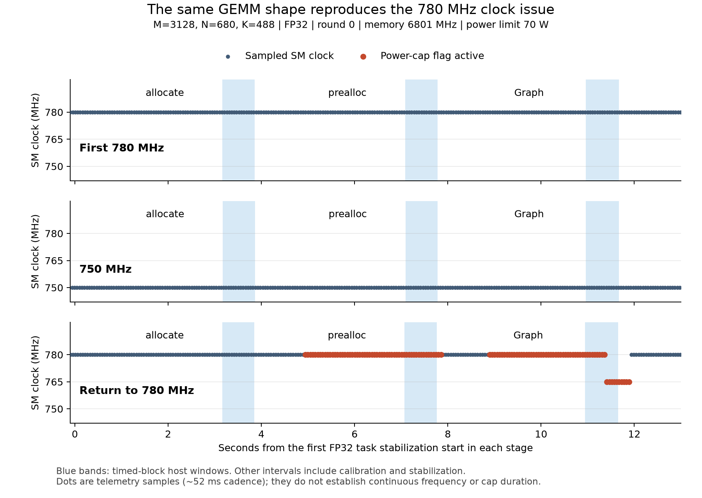

# 780→750→780 MHz 재검증 결과

780 MHz에서 같은 형상의 순간 전력 제한과 765 MHz 하락이 다시 관측됐다. 750 MHz는 이번 세 형상의 시간·관측 클럭 기준을 통과했다. 108측정은 모두 완료했으며, 전체 판정은 REVIEW다. 750 MHz의 전체 200형상 검증 완료를 뜻하지 않는다.

## 단계별 결과

| 단계 | 측정별 PASS / REVIEW | 코어 관측값 | 전력 제한 활성 표본 | 최대 상대 IQR | 최대 라운드 범위/중앙값 |
|---|---:|---|---:|---:|---:|
| 처음 780 MHz | 36 / 0 | 780 MHz 6136개 | 0개 | 0.037% | 0.68% |
| 750 MHz | 36 / 0 | 750 MHz 6139개 | 0개 | 0.037% | 0.71% |
| 마지막 780 MHz | 34 / 2 | 780 MHz 6127개, 765 MHz 10개 | 114개 | 0.041% | 0.71% |

- 구성: 세 형상 `(3128,680,488)`, `(4096,4096,4096)`, `(64,64,64)` × FP32/FP16 × allocate/prealloc/Graph × 두 라운드 × 세 단계. 총 108/108측정, 756블록, 36묶음이며 누락·중복 0건이다.
- 저장된 정확성 검사 108건은 모두 통과했다. 전체 출력 비교 36건과 표본 비교 72건이다. 정확성 자체를 Mac에서 새 GPU 연산으로 재검사한 것은 아니다.
- 전체 18,412개 센서 표본에서 메모리 6801 MHz와 설정 전력 한도 70 W가 유지됐다. SW/HW thermal 제한 활성 표본은 0개다.
- 최대 상대 IQR 0.041%, 절대 드리프트 0.058%, 라운드 범위/중앙값 0.71%다. 처음/마지막 780 MHz의 두 라운드 중앙값 변화 절댓값 최대는 0.38%다. 시간 안정성 기준 5%는 통과했지만 클럭 유지 판정은 별도다.

## 재현된 문제

마지막 780 MHz 단계의 `(3128,680,488)` FP32, 첫 라운드에서 다음 두 기록이 REVIEW다. 두 번째 라운드와 처음 780 MHz 단계에서는 같은 현상이 관측되지 않았다.

| 방식 | 본측정 블록 | 본측정 내부 전력 제한 활성 표본 | 본측정 내부 765 MHz 표본 |
|---|---:|---:|---:|
| prealloc | 7/7블록에 활성 표본 | 13개 | 0개 |
| Graph | 7/7블록에 활성 표본 | 14개 | 5개 |

전체 worker 센서에서는 전력 제한 활성 114개와 765 MHz 표본 10개가 관측됐다. 이상 표본의 처음과 마지막은 KST 14:48:57.019와 14:49:03.959이며 시각 범위는 6.94초다. 이것을 연속 전력 제한 시간으로 환산하지 않는다. 일부 표본은 안정화·보정 등 본측정 밖에 있다.

이전 200형상 부분수집에서 문제가 생긴 형상·FP32 입력 seed·Graph당 GEMM 5개와 일치한다. 이번에는 원래 163번째 작업까지의 전체 부하 이력을 재현하지 않고도 문제가 관측됐다. 반복 발생의 세부 원인, 온도·순서·프로세스 상태의 기여는 이번 설계에서 분리하지 못한다. 열 제한 표본은 없으므로 과열로 단정하지 않는다.



[그림 PDF](clock_incident_comparison.pdf). 파란 띠는 본측정 블록의 호스트 시간 범위, 붉은 점은 순간 전력 제한 활성 표본이다. GPU Event의 정확한 시작·종료와 호스트 범위를 동일시하지 않는다.

## 750 MHz 해석과 다음 단계

- 750 MHz에서 36측정이 시간·관측 클럭 기준을 통과했고, 6,139표본 모두 750 MHz였다. 순간 전력 제한 활성 표본도 0개다. 같은 정도의 최대 온도 68°C가 마지막 780 MHz 단계에서도 관측됐지만 온도를 독립적으로 통제한 비교는 아니다.
- 18개 형상·정밀도·방식의 두 라운드 중앙값을 짝지으면 750 MHz 시간은 처음 780 MHz보다 약 0.04~0.15% 짧고 변화율 중앙값은 약 −0.09%다. 이 작은 순차 비교 차이를 750 MHz의 성능 우위나 클럭별 인과 효과로 해석하지 않는다.
- 문제 FP32 형상은 이전 200형상 부분수집보다 이번 780 MHz 두 단계에서 약 2.0~2.5% 느리다. seed·Graph 묶음·저장된 정확성 결과는 일치하지만 실행 간 상태의 원인은 확정하지 않았다. 서로 다른 실행을 하나의 반복 측정처럼 합치지 않는다.
- 다음 권고는 750 MHz에서 동일 200형상으로 범위를 넓혀 새 실행을 하는 것이다. 750 MHz를 전체 형상에서 검증됐다고 선언하거나 본수집을 자동 재개하지 않는다. 이전 780 MHz 240건은 별도로 보존하며 750 MHz 결과와 섞어 이어쓰지 않는다. 전 대상 10,000조건의 세 방식 재측정 계획은 유지한다.

## REVIEW와 종료 상태

- 전체 측정별 판정은 PASS 106건, REVIEW 2건, FAIL 0건이다. 세 worker는 모두 exit 0이고 수집은 COMPLETE다. 최상위 exit 2는 완료 후 검토 상태이며 지난 200형상 실행의 exit 1 중단과 다르다.
- 누적 SW Power Cap 카운터 해석 미해결도 별도로 남았다. 관련 블록은 처음 780에서 16개, 750에서 13개, 마지막 780에서 20개로 총 49/756블록이다. 이 카운터의 증가를 전력 제한 지속시간으로 환산하지 않는다. 750의 시간·관측 클럭 통과와 전체 REVIEW를 구분한다.
- 코어·메모리 고정 해제 명령은 모두 exit 0이다. 전후 GPU 스냅샷 시각은 14:35:03~14:51:14 KST로 약 16분 11초다. 특정 유휴 클럭으로 돌아갔다는 별도 보증으로 해석하지 않는다.

## 원자료와 검산

- 원본 ZIP: `clock_recheck_20260921_143452_YZ9HN5.zip`
- SHA-256: `274e47dcaaed7aabd6312c931e91130d29ca853bc757bc89b1e66f4dea7b74ab`
- 234파일을 원본 그대로 보존했다. 소스 7파일과 의존 42파일을 배포본에 대조했으며, 기존 분석기로 재생성한 7산출물의 바이트 일치와 summary 값 일치를 확인했다.
- 입력·순서·정확성 범위·Graph 분모·블록 산술·고유 시각·클럭 설정·해제·종료 코드를 검산했다. 원자료의 정확성 검사 기록을 확인했으며 새 GPU 실험은 실행하지 않았다.
- 검산: [validation.json](validation.json), 전체 수치: [review_metrics.json](review_metrics.json), 재현 코드: [review.py](review.py).
- 표: [단계별](stage_metrics.csv), [클럭별 시간](clock_sensitivity.csv), [문제 블록](incident_timed_blocks.csv), [이상 표본](incident_samples.csv), [실행 간 같은 문제 형상](same_problem_cross_run.csv).

로컬 재검산 명령:

```bash
python3 -B analysis/clock_recheck_result_2026-09-21/review.py
```
