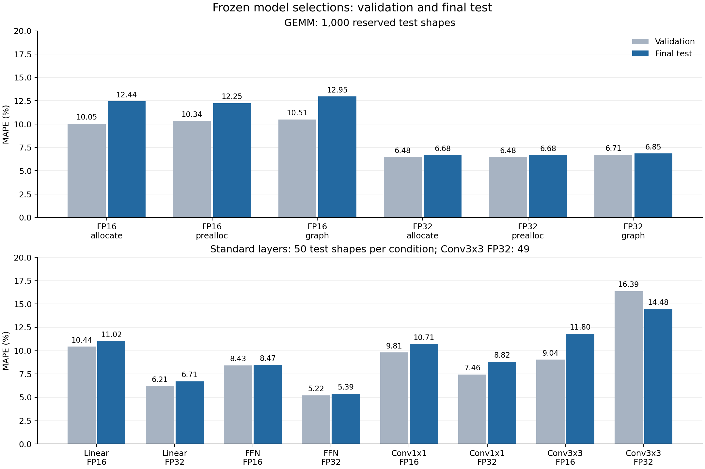

# GEMM 및 레이어 최종 test 평가

2026-11-11에 사용자가 승인한 동결 모델의 최종 평가를 완료했다. 확대 GEMM의 test MAPE는 FP16 12.25~12.95%, FP32 6.68~6.85%다. 표준 레이어의 test MAPE는 5.39~14.48%이며, validation에서 GEMM prior 활용 방법이 선택된 일곱 조건 모두 해당 방법별 직접 예측 기준선보다 낮은 test MAPE를 보였다.

평가에는 기존 가중치, 특징, 학습량, 모델 선택과 품질 제외 규칙을 그대로 적용했다. 결과는 세 seed에서 각각 구한 지표의 평균이다. MAPE는 형상별 절대상대오차의 평균이며, p90는 형상별 절대상대오차의 90백분위수다. 모든 시간 정답은 기존 세 회차의 중앙값을 따른다.

## 확대 GEMM

예약된 1,000형상, 두 정밀도, 세 실행 방식의 6,000조건을 평가했다. 원측정은 18,000건이다. 여섯 선택 구성의 학습량은 모두 11,498형상이다. FP16은 MLP(32,32), FP32는 Random Forest를 사용했다.

| 정밀도 | 실행 방식 | 학습 목표 | validation MAPE | test MAPE | test p90 |
|---|---|---|---:|---:|---:|
| FP16 | Output allocation | log(T/L) | 10.05% | 12.44% | 26.77% |
| FP16 | Preallocated output | log(T/L) | 10.34% | 12.25% | 25.66% |
| FP16 | CUDA Graph replay | log T | 10.51% | 12.95% | 26.93% |
| FP32 | Output allocation | log(T/L) | 6.48% | 6.68% | 14.74% |
| FP32 | Preallocated output | log(T/L) | 6.48% | 6.68% | 14.75% |
| FP32 | CUDA Graph replay | log(T/L) | 6.71% | 6.85% | 15.13% |

`T`는 실행시간, `L`은 기존 Roofline 기반 최소시간이다. 직접 시간 학습과 정규화 학습의 같은 학습기·자료량 비교도 동결된 가중치로 평가했다. 전체 지표와 seed 범위는 [GEMM 요약표](summary/gemm_expanded.csv), 세부 형상 예측과 부분집합 지표는 [평가 폴더](gemm_expanded)에 있다.

기존 3,345형상 최선 모델과 비교한 test MAPE 변화는 다음과 같다. 두 자료량의 모델은 각각 개발 자료에서 선택된 구성이다.

| 정밀도 | 실행 방식 | 기존 모델 test MAPE | 확대 모델 test MAPE | 변화, %p |
|---|---|---:|---:|---:|
| FP16 | Output allocation | 12.25% | 12.44% | +0.193 |
| FP16 | Preallocated output | 12.26% | 12.25% | -0.015 |
| FP16 | CUDA Graph replay | 12.87% | 12.95% | +0.080 |
| FP32 | Output allocation | 6.85% | 6.68% | -0.165 |
| FP32 | Preallocated output | 6.85% | 6.68% | -0.167 |
| FP32 | CUDA Graph replay | 7.07% | 6.85% | -0.220 |

FP16의 확대 모델과 기존 모델은 test에서 비슷한 오차를 보였다. FP32는 세 실행 방식에서 0.17~0.22%p 낮아졌다. 형상 단위 paired bootstrap의 95% 구간은 FP32 Graph에서 -0.385~-0.041%p이며, 나머지 다섯 비교는 0을 포함한다. validation에서 관찰한 개선과 test에서 관찰한 개선을 이 범위로 해석한다.

## 표준 레이어

각 레이어·정밀도에서 50형상을 평가했다. Conv3×3 FP32는 수집 단계에 기록한 정확성 실패 한 형상을 제외한 49형상이다. 전체 test 수집은 5,382측정, 세 회차 집계 후 PASS는 1,794조건이며, 시간값이 없는 정확성 제외 조건 여섯 개를 별도로 보존했다.

| 레이어 | 정밀도 | 동결된 예측 방식 / 학습기 | validation MAPE | test MAPE | test p90 |
|---|---|---|---:|---:|---:|
| Linear | FP16 | 잔차 보정 / RF | 10.44% | 11.02% | 21.25% |
| Linear | FP32 | 잔차 보정 / Ridge | 6.21% | 6.71% | 15.33% |
| FFN | FP16 | 잔차 보정 / RF | 8.43% | 8.47% | 16.28% |
| FFN | FP32 | 잔차 보정 / RF | 5.22% | 5.39% | 11.45% |
| Conv1×1 | FP16 | 잔차 보정 / RF | 9.81% | 10.71% | 22.19% |
| Conv1×1 | FP32 | prior 특징 추가 / RF | 7.46% | 8.82% | 15.70% |
| Conv3×3 | FP16 | 직접 예측 / MLP(64,64) | 9.04% | 11.80% | 23.74% |
| Conv3×3 | FP32 | 잔차 보정 / RF | 16.39% | 14.48% | 27.52% |

계획 학습량은 모든 전체 선택 구성에서 200형상이며 FFN FP32의 실제 공통 학습량은 198개다. GEMM prior 활용이 선택된 일곱 조건의 직접 예측 기준선 대비 MAPE 감소폭은 0.47~4.22%p다. 이 비교는 방법별로 validation에서 선택한 학습기와 자료량을 포함한다. Linear의 직접 예측 기준선은 100형상, 잔차 보정은 200형상으로 학습했다.

일곱 비교 중 다섯 조건의 형상 단위 95% bootstrap 구간이 0보다 작다. FFN FP16과 Conv1×1 FP32의 구간은 0을 포함한다. Conv1×1 FP32는 MAPE가 9.29%에서 8.82%로 낮아졌고 p90는 15.15%에서 15.70%로 높아졌다. Conv3×3 FP32는 직접 예측의 MAPE 18.70%·p90 36.84%에서 동결된 잔차 보정의 14.48%·27.52%로 낮아졌다.

Conv3×3 FP16의 전체 선택은 validation에서 고정한 직접 예측이다. 모든 방법별 결과는 [레이어 요약표](summary/layers.csv)에 원래 선택 식별자와 함께 보존했다.

## 명시적 분해 레이어

| 레이어 | FP16 test MAPE / p90 | FP32 test MAPE / p90 |
|---|---:|---:|
| Linear | 11.12% / 20.73% | 6.68% / 14.31% |
| FFN | 9.00% / 19.02% | 5.59% / 11.04% |
| Conv1×1 | 6.91% / 14.22% | 9.79% / 23.15% |
| Conv3×3 | 6.67% / 13.63% | 5.64% / 11.32% |

분해 Conv 네 조건은 기존 구성 연산별 예측 합을 사용했다. Conv1×1은 200형상의 구성 레이블 600개, Conv3×3은 800개로 학습한 결과다. [구현별 실측 진단](layers/test_implementation_diagnostics.csv)에는 표준·분해 실행시간과 구성 실측 합을 함께 저장했다.

## 실행 방식 간 보정

기존 RQ4의 독립 A/C 분할과 11월 4일 동결 가중치를 사용했다. Source는 별도 2,652형상 allocate 모델이며, 아래의 학습량은 목표 실행 방식의 보정 형상 수다.

| 정밀도 | 목표 방식 | 동결된 보정 / 형상 수 | 무보정 test MAPE | 보정 test MAPE | 보정 test p90 |
|---|---|---|---:|---:|---:|
| FP16 | Preallocated output | 상수 비율 / 100 | 12.41% | 12.30% | 25.69% |
| FP16 | CUDA Graph replay | 잔차 보정 / 300 | 16.30% | 12.96% | 27.78% |
| FP32 | Preallocated output | 잔차 보정 / 100 | 6.90% | 7.47% | 15.86% |
| FP32 | CUDA Graph replay | 잔차 보정 / 100 | 8.88% | 7.78% | 16.63% |

FP16 Graph에서 보정 후 MAPE가 3.34%p, FP32 Graph에서 1.10%p 낮아졌다. FP32 Preallocated output은 0.58%p 높아졌고, 변화의 95% bootstrap 구간은 +0.435~+0.718%p다. 목표 실행 방식과 정밀도에 따라 보정 효과가 달랐다. [기존 GEMM 및 RQ4 요약표](summary/gemm_legacy_and_transfer.csv)에 seed별 범위도 정리했다.

## 형상 분리와 불확도

test 시간을 열기 전, 확대 GEMM 학습·validation 13,109형상과 예약 test의 정확한 중복 0개를 확인했다. 한 축 ±8 검사에서는 test `(216,304,80)`과 기존 학습 `(224,304,80)` 한 쌍을 찾았다. 이 사실과 보조 집계 규칙은 [사전 검증 기록](preflight.json)에 고정했다.

주 결과는 원래 예약한 1,000형상 전체다. 인접 형상 한 개를 뺀 999형상의 MAPE는 FP16 12.25~12.95%, FP32 6.69~6.85%다. 여섯 조건에서 전체 결과와의 차이는 최대 0.0059%p였다. [인접 형상 제외 보조 지표](summary/gemm_non_near_sensitivity.csv)에 각 조건을 보존했다.

paired bootstrap은 같은 형상에서 세 seed의 절대백분율오차를 평균한 뒤 형상을 2,000회 재표집했다. seed 세 개를 독립 형상 세 개로 세지 않는다. [구간 추정 표](summary/paired_group_bootstrap.csv)는 동결된 구성끼리의 차이를 나타내며 여러 비교에 대한 동시 신뢰구간 보정은 적용 전이다. 레이어 조건별 test 크기는 49~50형상이다.

## 보존과 검증

기존 평가기의 합성 자료·해시·시험 분리 검사 47개가 통과했다. 최신 GEMM을 기존 평가기에 연결할 때에는 저장된 모델 객체와 특징을 그대로 담은 평가용 파일을 만들었고, test 열람 전 validation 예측 57,996개가 정확히 재현됐다. 11월 4일 기존 GEMM 선택과 RQ4 가중치, v5 레이어 선택 파일은 그대로 유지했다.

최종 독립 검산에서는 원자료 정답, 저장 모델의 예측, MAPE·p90·상대 RMSE·MAE와 평가 대상을 대조했다. 확대 GEMM 36,000개, 기존 GEMM/RQ4 60,000개, 레이어 16,758개 예측이 정확히 재현됐고 원본 파일 523개의 해시가 일치했다. 확대 GEMM 36개와 기존 GEMM/RQ4 60개 평가 항목에는 비교 기준선과 세 seed가 포함된다. 레이어는 동결된 112선택, 336 seed별 평가 항목, 고유 가중치 288개다. 예측 실패는 모든 평가 항목에서 0건이다.

| 기록 | 위치 |
|---|---|
| 평가 전 승인·입력·형상 점검 | [preflight.json](preflight.json) |
| 확대 GEMM 평가용 동결 | [frozen_selection.json](prepared_gemm_expanded/frozen_selection.json) |
| 원자료·예측·해시 독립 검산 | [independent_verification.json](independent_verification.json) |
| 레이어 평가 완료와 입력 근거 | [evaluation_completed.json](layers/evaluation_completed.json) |
| 표와 그림 해시 | [summary/manifest.json](summary/manifest.json) |
| 전체 산출물 해시 | [artifact_manifest.json](artifact_manifest.json) |

레이어 선택 동결 SHA-256은 `beed9b4314c3f258f0fcd6f86d19b15d271fac2d1abe705875aa50a94e99cbd4`다. 확대 GEMM 원래 선택 SHA-256은 `e295d8e3585f3e3b9b360d0ab097240b57872b2efd6c6284bd76abf794185042`다. 평가 이후에도 이 모델과 선택을 유지한다. 후속 모델 개선은 별도 개발 이력과 새로운 독립 평가 자료로 검증한다.

평가 범위는 단일 GPU의 GEMM, 네 레이어와 실행 방식 간 보정이다. 전체 신경망 end-to-end 검증, 추가 GPU 일반화와 비용 손익분기점 분석은 별도 작업으로 남아 있다.

## 비교 그림과 재검산



[벡터 PDF](summary/final_mape.pdf) · [PNG](summary/final_mape.png)

완료 결과는 아래 명령으로 재검산할 수 있다. 원래 `evaluate` 명령은 시험 접근 기록으로 재실행을 차단한다.

```bash
cd /Users/studyhard/Claude/자율연구
OMP_NUM_THREADS=1 OPENBLAS_NUM_THREADS=1 MKL_NUM_THREADS=1 VECLIB_MAXIMUM_THREADS=1 \
analysis/integrated_rq14_2026-10-28/.venv/bin/python -B \
  analysis/final_test_2026-11-11/verify_results.py
```
