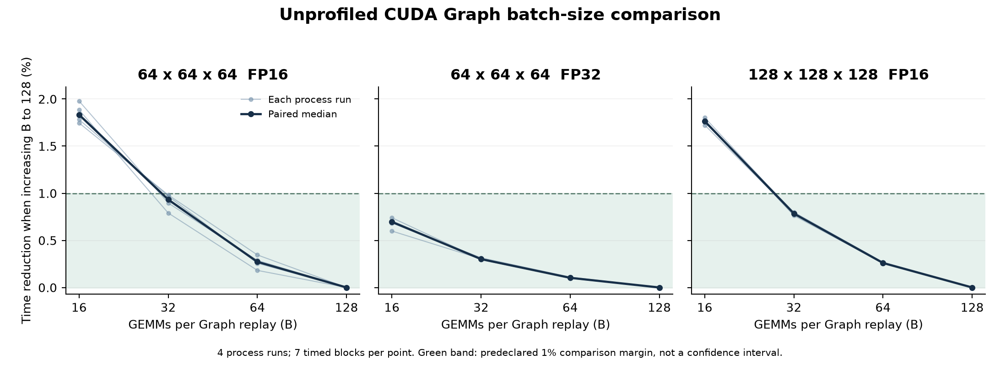

# Graph 묶음 수 비교 결과 — 2026-09-19

**48개 측정·336블록의 수집과 검산을 완료했다. 이번에 확인한 작은 GEMM 세 조건에는 64회 묶음을 공통 설정으로 유지할 것을 권한다.** 64→128회로 늘릴 때 같은 프로세스끼리 비교한 시간 감소는 모두 0.35% 이하였고, 기존 5% 안정성 기준과 사전 지정 1% 묶음 비교 기준을 통과했다. GPU의 제출 영향이 정확히 0이라는 뜻은 아니다.

## 확인한 자료

- 결과 ZIP: `graph_batch_20260919_211455_Y9h4lA.zip`
- ZIP SHA-256: `88a8b912c34c46f298970bebe7269d8407d9f8c84b071e9acad5629ae99da5d4`
- 원본 173개 파일을 `raw/`에 보존하고 개별 hash를 `raw_sha256.json`에 저장했다. 분석 전후 모두 동일하다.
- 실행 소스 7개를 배포 ZIP 및 신뢰하는 로컬 파일과 byte 단위로 대조했다. v5 기준 소스 13개, 프로토콜, 네 프로세스의 환경 signature도 일치한다. 첨부 소스는 실행하지 않았다.
- 실제 작업 순서가 manifest와 같으며 48개 task에 누락·중복이 없다. 모든 종료 코드는 0이다.
- 수치 검사 48개 통과. 64³ 두 정밀도의 32개 측정은 출력 4,096원소 전체, 128³ FP16의 16개 측정은 256개 표본을 검사했다.
- 측정 구간의 기록상 GEMM 호출은 14,298,592회다. 이는 replay 수 × Graph당 GEMM 수를 합친 값이며 profiler로 센 커널 수가 아니다.
- 기존 분석기로 재계산한 JSON·CSV·Markdown이 업로드된 파일과 같다. 별도 계산으로 정규화 분모, 중앙값·IQR·drift, 안정화 시간 합, 모든 쌍 비교와 후보 선정을 다시 확인했다.
- telemetry는 21:14:57.890~21:30:10.399(한국 시간), 약 15분 13초 동안 913개 행을 기록했다. 최대 기록 간격은 1.02초다. ZIP 전송 시간을 포함하지 않는다.

## 안정성

| 항목 | 최댓값 또는 최솟값 | 기존 기준 |
|---|---:|---:|
| 블록 간 상대 IQR 최댓값 | 0.0700% | 5% 이하 |
| 첫·끝 블록 절대 변화 최댓값 | 0.0586% | 5% 이하 |
| 같은 묶음의 실행 간 범위/중앙값 최댓값 | 0.736% | 5% 이하 |
| 가장 짧은 측정 블록 | 94.7 ms | 80 ms 이상 |
| 가장 짧은 관측 안정화 시간 | 3.003 s | 3.000 s 이상 |

48개 측정 모두 timing flags가 비어 있고 12개 형상·정밀도·묶음 조합의 실행 간 변동도 통과했다. 첫 블록·불리한 실행을 제외하거나 기준을 완화하지 않았다.

## 묶음 수와 시간

Nsight를 끈 CUDA Event 시간이다. 프로세스마다 7개 블록의 GEMM당 시간 중앙값을 구한 뒤, 네 프로세스 중앙값의 중앙값을 표에 표시했다. 표는 반올림했으며 비교 판정은 원래 정밀도로 계산했다.

| 조건 | 16회 | 32회 | 64회 | 128회 | 1% 기준 최소 후보 |
|---|---:|---:|---:|---:|---:|
| 64³ FP16 | 1.76 μs | 1.74 μs | 1.73 μs | 1.72 μs | 32회 |
| 64³ FP32 | 5.05 μs | 5.03 μs | 5.02 μs | 5.02 μs | 16회 |
| 128³ FP16 | 1.93 μs | 1.91 μs | 1.90 μs | 1.89 μs | 32회 |

최소 후보는 그 크기와 더 큰 모든 묶음 사이의 모든 쌍에서, 같은 프로세스끼리의 변화가 네 번 모두 ±1% 안에 들어오는 가장 작은 크기다. 128회는 더 큰 대조가 없으므로 단독 후보로 승인하지 않는다.

| 조건 | 64→128회 시간 변화의 중앙값 | 네 프로세스의 변화 범위 |
|---|---:|---:|
| 64³ FP16 | −0.272% | −0.345% ~ −0.181% |
| 64³ FP32 | −0.103% | −0.110% ~ −0.0967% |
| 128³ FP16 | −0.260% | −0.268% ~ −0.257% |

FP16 두 조건의 16→128회 변화 중앙값은 각각 −1.83%, −1.76%다. 16회에는 아직 묶음 수에 대한 민감도가 관측됐다. 32회는 사전 지정 기준을 통과하지만, 64³ FP16의 32→128회 최대 감소는 0.982%로 1% 경계에 가깝다. **64회는 세 조건의 공통 설정으로 쓸 수 있고, 128회와의 차이가 기준보다 충분히 작다는 점에서 최소 후보 32회보다 여유가 있다.**

각 선은 같은 프로세스 내 비교다. 녹색 영역은 사전 지정 1% 비교 기준이며 통계적 신뢰구간이 아니다. 그림의 감소율은 `100 × (1 − 128회 시간 / 해당 묶음 시간)`으로 계산했다. [PDF 그림](batch_convergence.pdf)도 보존했다.

## 해석과 다음 단계

관측값은 묶음 수를 늘릴수록 조금씩 줄었다. 이번 결과는 시간이 완전히 일정해졌거나 CPU 영향이 사라졌음을 입증하지 않는다. **64회를 128회로 늘리는 조치의 추가 효과가 이번 세 조건에서 작다**는 근거다. 이를 잔여 제출 대기의 절대 비율이나 전체 측정 오차 상한으로 바꾸지 않는다. CUDA Graph 시간에는 GPU 커널·보조 작업·내부 간격이 포함된다.

57개 프로세스 검사에서 차단 대상은 없었다. GNOME portal·터미널 등 데스크톱 클라이언트를 기록 후 허용했고, 실행 환경 로그에는 그래픽 프로세스도 보인다. 다른 프로세스의 GPU 활동 전체를 추적한 실험은 아니므로 외부 간섭 부재를 확정하지 않는다. 전체 telemetry의 온도·clock·전력 범위에는 예열과 조건 전환도 포함돼 특정 시간 변화의 원인으로 사용하지 않았다.

이번 작은 GEMM의 묶음 수 진단은 마무리할 수 있다. 세 조건의 Graph는 **64회 묶음**을 공통 권고 설정으로 남긴다. 이 권고를 모든 큰 형상에 64회를 강제로 적용하거나 전체 형상의 수렴을 확인한 것으로 확대하지 않는다.

다음 본측정 프로토콜에서는 합의한 대로 같은 조건의 일반 prealloc 시간과 Graph 시간을 각각 저장해야 한다. 이번 ZIP은 Graph 묶음 비교만 수행했으며 새 prealloc 결과를 함께 수집한 것은 아니다. 기존 v5 full 계획은 Graph가 일부 대조 조건에만 포함돼 있으므로, 전체 조건에 두 지표를 수집하려면 계획·검증 경로를 반영한 별도 버전이 필요하다. 이번 분석에서는 v5·배포 코드·원자료를 수정하거나 full을 실행하지 않았다.

검산 재현: `python3 -B analysis/graph_batch_v1_2026-09-19/review.py`. 전체 정밀도 검증 수치는 [verification.json](verification.json), 재계산 결과는 [recomputed/analysis.json](recomputed/analysis.json)에 있다. 업로드 REPORT의 두 번째·세 번째 비교표에는 헤더가 없어 Markdown 표시가 깨질 수 있으나 JSON·CSV의 값과 계산에는 영향이 없다. 원본은 그대로 보존했다.
