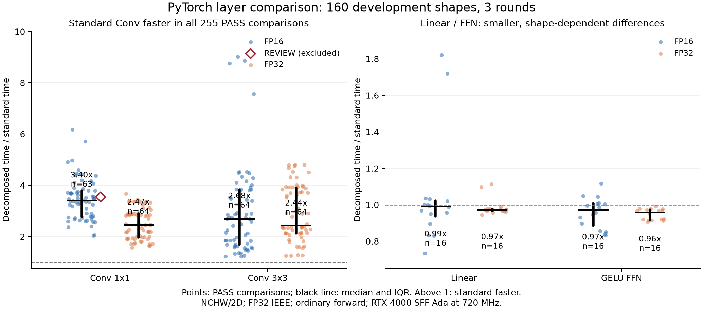

# 표준 PyTorch 레이어와 explicit GEMM 경로 비교 결과

검산일은 2026-10-07이다. GPU 수집은 2026-10-06 14:33경 시작해 16:41:16 KST에 완료됐다. 160형상 × FP16/FP32 × 두 구현 × 세 회차의 **1,920측정이 모두 저장됐다**. 개별 측정은 1,920 PASS이며, 형상·dtype별 비교는 **319 PASS / 1 REVIEW**다. 실행 오류는 없고 전체 품질 gate는 REVIEW를 유지한다.

현재 Conv 분해 구현은 품질을 통과한 255개 Conv 비교 모두에서 표준 레이어보다 느리다. 종류·dtype별 시간 비율 중앙값은 2.44~3.40이다. Linear와 FFN은 차이가 작거나 형상에 따라 방향이 바뀐다. 이 결과는 구현 경로 비교를 검증한 것이며 기존 레이어 예측 명세 전체의 타당성이나 예측 정확도를 검증한 것은 아니다.

## 원자료와 재현

- 원본: [반환 ZIP](../../layer_compare_20261006_143314_5Z1acE_5e654885.zip)
- SHA-256: `1bb1cb9989b179ebe408f25cca715f332ad99b3e6dc1f306ee1c342e3c2c0b7d`
- ZIP CRC PASS, 파일 4,327개. 결과 해시 4,326개와 내장 소스 해시 127개를 대조했다. 내장 소스는 알려진 `layer_compare_v2` 배포본과 일치한다.
- [독립 검산 기록](verification.json), [재계산 summary](recomputed/summary.json), [형상별 CSV](recomputed/comparison.csv), [종류별 통계](group_summary.csv), [보류 조건](review_conditions.json).

`raw/`에 안전하게 압축을 풀고 원본 summary와 소스를 보존했다. 별도 `recomputed/`에서 집계했으며 원래 summary의 모든 JSON 값과 CSV 바이트가 정확히 일치했다. 검산 전후 원자료 해시를 다시 대조했다. records/correctness 입력은 저장 공간 절약을 위해 raw 파일과 hard link로 연결되어 있으므로 두 위치의 입력 JSON을 수정하지 않는다.

[verify_result.py](verify_result.py)는 CUDA를 실행하지 않는다. 원시 블록의 event 시간/반복 수, 7블록 통계, 관측 settling 3초, 정확성·출력 배치·seed·준비 weight 크기와 환경 signature를 검산한다. 원래 타이머와 센서 판정을 재사용했다. 센서 시각을 한 번 색인한 후 원래 `window`에 필요한 구간 및 전후 표본을 넘겼으며, 실제 블록 32개의 전체 스캔 결과와 모든 필드가 같음을 확인했다. 본측정 13,440개 블록을 재검사했다. 당시 health snapshot은 전체 수집 전 상태이므로 health의 측정·비교·gate를 대조하고, 당시 sensor 길이와 미완료/미복원 상태는 보존했다.

연구 폴더에서 재현한다. 검산은 표준 라이브러리로 실행되며 그림에는 기존 NumPy/Matplotlib이 필요하다.

```sh
python3 -B analysis/layer_compare_v2_result_2026-10-07/verify_result.py
python3 -B analysis/layer_compare_v2_result_2026-10-07/plot_result.py
```

## 수집과 품질

worker complete=true, worker exit 0, collection COMPLETE, missing 0이다. launcher의 exit 2와 `PILOT REVIEW: COMPLETE`는 아래 한 조건의 품질 보류를 뜻한다. 이전 v1의 시각 자료형 오류와 다르며 `failure.json`도 없다. 대표 48측정·8비교의 health gate는 PASS였고 나머지 1,872측정까지 진행했다.

저장된 전후 정확성 JSON 1,920개가 모두 PASS다. 두 구현의 전체 출력 비교와 유한값 검사는 통과했고, CPU FP64 수학 참조는 고정된 출력 샘플에 적용됐다. FP64 대비 최대 `error/(atol+rtol*abs(reference))`는 FP16 0.443, FP32 0.0429로 기준 1 아래다. 이는 저장된 GPU 검사 결과의 검산이며 이 분석에서 새로운 GPU/CPU 순전파를 실행한 것은 아니다.

센서 146,404표본에 전력·열 제한 활성 표본은 없으며 온도는 35~65°C, power draw는 20.89~64.96W, power limit는 70W였다. SM은 전체 표본에서 720MHz다. memory는 global preheat 중 14:34:08.165 KST의 한 표본에서 6800MHz로 보고됐고 나머지는 6801MHz다. 이 표본은 최초 조건 settling(14:36:18.918 KST) 전이며 본측정 블록에는 클럭 이탈이 없다. 요청 센서 간격은 50ms, 관측 간격 중앙값은 52ms·최대 116ms다. polling 간격을 물리 센서의 시간 해상도로 해석하지 않는다. graphics/memory 클럭 해제 명령은 모두 exit 0이며 특정 idle 클럭을 검증한 것은 아니다.

## 속도 결과

비율은 각 형상·dtype에서 **분해 시간 / 표준 시간**이다. 각 구현의 3회차 시간 중앙값으로 비율을 만들고, 아래에는 PASS 형상들의 비율 중앙값을 썼다. 1보다 크면 표준 구현이 빠르다. 실제 모델의 호출 빈도나 FLOPs로 가중한 수치가 아니다. REVIEW 조건은 주요 집계에서 제외한다.

| 레이어 | dtype | PASS 비교 수 | 비율 중앙값 | 비율 범위 | 표준이 빠른 비교 | 시간 차이 중앙값, 분해−표준 (µs) |
|---|---|---:|---:|---:|---:|---:|
| Conv 1×1 | FP16 | 63 | 3.404 | 2.028~6.181 | 63/63 | +22.37 |
| Conv 1×1 | FP32 | 64 | 2.469 | 1.570~3.671 | 64/64 | +21.84 |
| Conv 3×3 | FP16 | 64 | 2.683 | 1.226~9.016 | 64/64 | +68.12 |
| Conv 3×3 | FP32 | 64 | 2.438 | 1.246~4.795 | 64/64 | +94.43 |
| Linear | FP16 | 16 | 0.991 | 0.734~1.821 | 6/16 | −0.19 |
| Linear | FP32 | 16 | 0.973 | 0.944~1.113 | 2/16 | −1.19 |
| GELU FFN | FP16 | 16 | 0.972 | 0.832~1.117 | 6/16 | −2.77 |
| GELU FFN | FP32 | 16 | 0.959 | 0.904~0.992 | 0/16 | −10.01 |



[그림 PDF](latency_ratio.pdf). 점은 개별 PASS 비교, 검은 선은 중앙값과 사분위 범위이며 신뢰구간이 아니다. 빈 마름모는 주요 집계에서 제외한 REVIEW 조건이다. 두 패널의 y축 범위는 다르다.

Conv 3×3 FP16의 최대 비율은 B=4, H=W=64, Cin=256, Cout=127에서 관측됐다. 표준 447.7µs, 분해 4036.9µs로 9.016배다. 같은 입력·채널의 Conv 1×1은 74.47µs와 460.3µs로 6.181배다. 이는 두 개발 형상의 관측이며 최대 격차를 일반적인 전체 모델 배율로 적용하지 않는다.

Linear·FFN의 비율 중앙값은 분해 구현이 약 1~4% 짧다는 방향이다. 다만 FP16 Linear에서 표준이 1.821배 빠른 조건도 있어 중앙값만으로 모든 형상에 같은 구현을 선택할 수 없다. 비율이 1에서 ±5% 이내인 비교는 Linear FP16 10/16, FP32 13/16, FFN FP16 8/16, FP32 9/16이다. ±5%는 여기서 차이의 규모를 설명하는 구간일 뿐 새 품질 기준이나 통계적 동등성 검정은 아니다.

추가 최대 allocated memory의 분해/표준 비율 중앙값은 Conv 1×1 FP16/FP32 각각 2.50, Conv 3×3 FP16 4.13·FP32 10.58, Linear/FFN 1.00이다. 이 값은 입력과 두 weight 배치가 이미 상주한 상태에서 한 번의 warmed forward가 추가하는 peak이며 별도 weight packing의 상주 크기는 CSV에 따로 남았다. 프로세스 전체 메모리, reserved 메모리나 DRAM 전송량의 비율은 아니다.

## REVIEW 한 조건

`lc_789c4e94ca271ccc`, Conv 1×1 FP16, B=4, H=W=16, Cin=16, Cout=31이다. 표준의 세 회차 중앙값은 7.124 / 7.509 / 7.501µs다. `(최대−최소)/중앙값`이 **5.135%**로 고정된 5% 기준을 조금 넘었다. 분해 경로의 동일 지표는 0.541%다. 각 회차의 블록 IQR·drift·센서·정확성은 PASS다.

이 비교의 시간 비율 3.548은 별도 보류 자료에만 남긴다. 허용 기준을 바꾸거나 PASS로 승격하지 않았다. 모든 비교를 PASS로 확보하려면 이 형상·dtype의 두 경로 세 회차만 표적 재측정하면 된다. 현재 추가 GPU 실행은 하지 않았다.

## 연구에 적용할 판단

두 경로 모두 PyTorch를 사용한다. 표준은 `nn.Conv2d` / `nn.Linear` / Linear–exact GELU–Linear이고 분해는 PyTorch의 `unfold`, 실제 배치 복사와 `mm`를 조합한다. 표준 Conv 경로와 같은 비용 구조를 전제할 수 없다는 사용자 우려는 이번 Conv 관측에서 확인된다. 어느 커널 알고리즘이나 복사가 격차의 몇 %를 만들었는지는 이 실험으로 분리되지 않는다.

실용적인 표준 레이어 시간 예측을 목표로 삼는다면 Conv의 실측 대상은 `nn.Conv2d`로 별도 정의하고 GEMM·배치 비용 기반 추정이 그 표준 시간에 얼마나 맞는지 평가해야 한다. 현재 explicit 경로를 연구 대상으로 유지한다면 결과와 제목에 그 구현 범위를 명시해야 한다. 기존 제출본과 잠금 시험은 보존하고 이 결정을 명세에 반영하기 전 후보 상태로 둔다. 이후 큰 격차·작은 격차의 개발 형상에서 구성 연산을 분리하면 보정 모델이 필요한 이유와 규모를 확인할 수 있다.

측정 범위는 contiguous NCHW/2D, bias 없음, IEEE FP32, inference ordinary call, prepared weight·초기 autotune 제외, actual unfold/copy 포함, cuDNN benchmark=true다. channels_last·TF32·compile·CUDA Graph·backward는 이번 비교 대상이 아니다. 160형상은 정렬 경계와 인접 탐색용 개발 목록이며 실제 네트워크 분포를 대표한다고 검증하지 않았다. 기존 validation/holdout/locked 시험의 동일·한 축 ±8 인접 구성 GEMM은 제외했다. `Delta_assembly`나 예측 오차로 이 비율을 치환하지 않는다.
