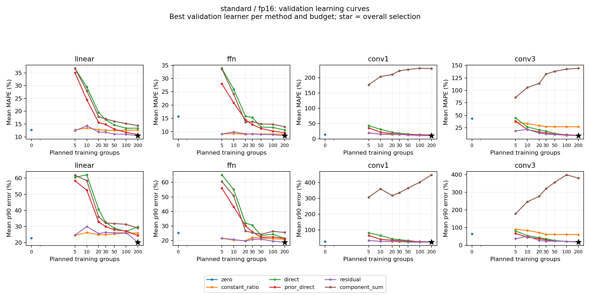
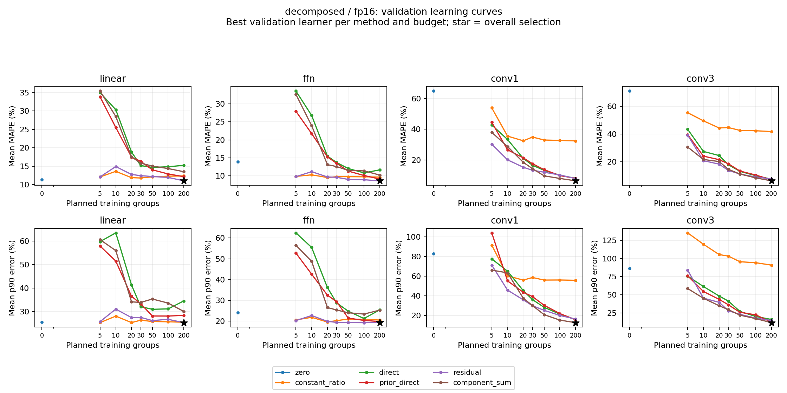

# 레이어 학습·validation 분석 결과 (2026-11-11)

표준 forward의 8개 레이어·정밀도 조건 중 7개에서 GEMM prior를 활용한 방법이 가장 낮은 validation MAPE를 보였다. Linear와 FFN, Conv1×1에서는 prior를 활용한 예측이 선택됐고, Conv3×3 FP16에서는 MLP64 직접 예측이 선택됐다. 가장 큰 오차가 남은 조건은 표준 Conv3×3 FP32로, MAPE 16.39%, p90 오차 38.36%다.

학습과 validation 분석을 완료하고 선택 모델 288개를 동결했다. 독립 검산에서 validation 예측 344,736개와 저장 모델의 예측 재현이 통과했다. 아래 수치는 세 seed의 validation 결과 평균이며, 이 validation에서 방법·학습기·자료량을 선택했다. 최종 test는 잠금 상태다.

## 표준 forward 결과

MAPE와 p90는 낮을수록 좋다. p90는 각 seed에서 구한 오차 90백분위수의 평균이다. `residual`은 GEMM prior 대비 log 비율을 학습하고, `prior_direct`는 정적 특징에 log prior를 추가한다.

| 레이어 | 정밀도 | 선택 방법 | 학습기 | 실제 학습 형상 | MAPE | p90 |
|---|---|---|---|---:|---:|---:|
| Linear | FP16 | residual | RF | 200 | 10.44% | 20.24% |
| Linear | FP32 | residual | Ridge | 200 | 6.21% | 13.83% |
| FFN | FP16 | residual | RF | 200 | 8.43% | 18.85% |
| FFN | FP32 | residual | RF | 198 | 5.22% | 12.40% |
| Conv1×1 | FP16 | residual | RF | 200 | 9.81% | 22.71% |
| Conv1×1 | FP32 | prior_direct | RF | 200 | 7.46% | 14.38% |
| Conv3×3 | FP16 | direct | MLP64 | 200 | 9.04% | 18.50% |
| Conv3×3 | FP32 | residual | RF | 200 | 16.39% | 38.36% |

방법별 최선 직접 예측과 비교하면 다음과 같다. Linear의 직접 예측은 k=100에서 선택돼, 전체 최선 k=200과 학습량이 다르다.

| 레이어·정밀도 | direct 최선 k | direct MAPE | 전체 최선 MAPE | 감소폭 |
|---|---:|---:|---:|---:|
| Linear FP16 | 100 | 13.38% | 10.44% | 2.95%p |
| Linear FP32 | 100 | 9.69% | 6.21% | 3.48%p |
| FFN FP16 | 200 | 10.58% | 8.43% | 2.15%p |
| FFN FP32 | 200 | 7.85% | 5.22% | 2.63%p |
| Conv1×1 FP16 | 200 | 11.90% | 9.81% | 2.09%p |
| Conv1×1 FP32 | 200 | 7.92% | 7.46% | 0.46%p |
| Conv3×3 FP16 | 200 | 9.04% | 9.04% | 0.00%p |
| Conv3×3 FP32 | 200 | 16.93% | 16.39% | 0.54%p |

같은 학습기와 같은 k를 맞춘 표준 forward 224개 격자 비교에서도 residual은 196개(87.5%), prior_direct는 178개에서 direct보다 낮은 평균 MAPE를 보였다. 이 집계는 여러 학습기·자료량을 포함한 격자 비교의 요약이다. 조건별 차이와 세 seed의 범위는 [선택 비교표](summary/selected_comparisons.csv)와 [동일 조건 비교표](summary/matched_prior_direct.csv)에 보존했다.

MAPE를 우선하는 선택 기준에 따라 꼬리 오차와 교환 관계가 생긴 조건도 있다. Conv3×3 FP32의 residual은 direct보다 MAPE가 0.54%p 작고, p90는 35.40%에서 38.36%로 커졌다. Conv1×1 FP16도 p90가 22.17%에서 22.71%로 커졌다. 반대로 Conv3×3 FP16은 direct의 MAPE 9.04%가 prior 계열 최선 9.29%보다 낮고, p90는 18.50%로 prior 계열의 17.61%보다 높다. 선택은 사전에 동결한 MAPE 우선순위를 따른다.

## 자료량과 비교 기준

공통 GEMM prior는 11,498형상으로 학습한 FP16 MLP32와 FP32 RF다. 같은 dtype·seed의 prior를 모든 레이어 학습기가 공유한다. RF, Ridge, MLP32, MLP64를 세 seed와 계획 자료량 5·10·20·30·50·100·200형상에서 비교했다.

| 방법 | 예측 방식 | 레이어 학습 레이블 |
|---|---|---|
| zero | 논리적 GEMM 시간 예측의 합 | 0개 |
| constant_ratio | prior에 학습 자료의 기하평균 비율을 곱함 | 형상당 전체 시간 1개 |
| direct | 정적 특징으로 전체 log 시간을 예측 | 형상당 전체 시간 1개 |
| prior_direct | 정적 특징과 log prior로 전체 log 시간을 예측 | 형상당 전체 시간 1개 |
| residual | log(전체 시간/prior)를 학습하고 prior에 곱함 | 형상당 전체 시간 1개 |
| component_sum | 구성 연산별 시간 모델의 예측을 합함 | Linear 1개, FFN·Conv1 3개, Conv3 4개 |

zero는 공통 prior를 그대로 사용하고 constant_ratio는 학습기와 무관한 같은 상수 보정식을 사용하므로, 이 두 방법의 선택표에 적힌 learner명은 반복 격자의 식별자로 읽는다.

표준·분해·필요한 구성 연산이 모두 PASS인 공통 형상을 모든 방법에 적용했다. FFN FP32 train은 기존 GELU 품질 제외 두 형상 때문에 198개이고, Conv3 FP32 validation은 기존 정확성 제외 한 형상 때문에 49개다. 나머지 조건은 train 200개·validation 50개다. 제외 이력은 [수집 검증 보고서](../layer_full_result_2026-11-10/README.md)와 동결된 input audit에 유지했다.

표준과 분해를 합한 전체 최선 16조건은 모두 계획 k=200에서 선택됐다. FFN FP32의 실제 학습량은 198개다. 이번 정확도 우선 선택에서는 수집한 최대 자료량이 가장 좋은 결과를 냈다. 작은 k에서의 prior 효과는 학습곡선과 동일 조건 비교표로 따로 확인할 수 있다.

## 분해 forward와 구현 차이

| 레이어 | 정밀도 | 선택 방법·학습기 | 실제 학습 형상 / 레이블 | MAPE | p90 |
|---|---|---|---:|---:|---:|
| Linear | FP16 | residual RF | 200 / 200 | 11.05% | 25.36% |
| Linear | FP32 | residual RF | 200 / 200 | 6.44% | 13.60% |
| FFN | FP16 | residual Ridge | 200 / 200 | 8.63% | 19.47% |
| FFN | FP32 | residual RF | 198 / 198 | 4.75% | 12.23% |
| Conv1×1 | FP16 | component_sum RF | 200 / 600 | 6.40% | 12.76% |
| Conv1×1 | FP32 | component_sum RF | 200 / 600 | 10.91% | 22.61% |
| Conv3×3 | FP16 | component_sum MLP64 | 200 / 800 | 6.06% | 11.62% |
| Conv3×3 | FP32 | component_sum RF | 200 / 800 | 3.93% | 9.48% |

분해 Conv 네 조건에서는 구성 연산별 예측을 합한 방법이 선택됐다. 같은 200형상에서도 실제 레이블은 600개 또는 800개다. 구현별 시간의 validation 중앙값 비율은 다음과 같다.

| 레이어 | 분해/표준 FP16 | 분해/표준 FP32 | 구성 실측 합/분해 FP16 | 구성 실측 합/분해 FP32 |
|---|---:|---:|---:|---:|
| Linear | 0.9611 | 0.9627 | 1.0000 | 1.0000 |
| FFN | 0.9810 | 0.9671 | 0.9984 | 0.9999 |
| Conv1×1 | 2.9825 | 2.1203 | 0.9994 | 1.0009 |
| Conv3×3 | 2.0841 | 2.0200 | 0.9997 | 0.9998 |

Conv의 명시적 분해 경로는 표준 Conv2d보다 중앙값 기준 약 2.02~2.98배 오래 걸렸다. 구성 실측 합은 분해 전체 시간과 중앙값 기준 약 1.00배로 맞는다. 따라서 구성 연산 합으로 분해 경로를 설명하는 결과와 표준 forward를 예측하는 결과를 나눠 해석해야 한다. 이 비율은 구현 경로의 차이를 나타내며, 형상별 최소·최대값은 [구현 비율 표](summary/validation_implementation_ratios.csv)에 남겼다.

## Conv3×3 FP32의 큰 오차

표준 Conv3×3 FP32 선택 모델의 세 seed MAPE 범위는 16.31~16.45%다. 형상별 평균 절대백분율오차가 큰 다섯 형상이 전체 오차 합의 38.20%를 차지하며, 이 다섯 형상에서는 세 seed 모두 실제 시간보다 크게 예측했다.

| batch / Cin / Cout / H / W | 실측 시간 | 평균 예측 | 평균 절대백분율오차 |
|---|---:|---:|---:|
| 8 / 32 / 32 / 20 / 24 | 29.76 µs | 60.66 µs | 103.85% |
| 8 / 79 / 31 / 20 / 24 | 49.45 µs | 87.35 µs | 76.63% |
| 1 / 96 / 160 / 28 / 28 | 57.31 µs | 82.31 µs | 43.62% |
| 1 / 16 / 16 / 56 / 56 | 22.71 µs | 32.42 µs | 42.80% |
| 2 / 64 / 368 / 12 / 12 | 46.10 µs | 64.47 µs | 39.85% |

[49형상의 오차 목록](conv3_fp32_validation_errors.csv)은 같은 형상에서 세 seed의 절대백분율오차를 평균해 정렬했다. 이 관측은 후속 오류 분석 대상을 정하는 근거다. GPU 커널 선택이나 메모리 동작이 원인인지 확인하려면 해당 실행 경로의 추가 진단이 필요하다.

## 비용과 검증

CPU 학습·선택·가중치 저장 구간의 wall time은 789.398초, 약 13분 9초다. 기록된 모델 fit 호출 합계는 715.358초다. GPU 통제 수집 비용은 실패 세 시도를 포함해 133,109.178초이며, CPU 학습 시간과 따로 기록한다.

전체 최선 모델 조합의 회고적 고유 레이블 예산은 집계 레이블 5,994개, 세 회차 원측정 17,982건이다. 전체 개발 탐색에서 열람한 자료는 품질 REVIEW 두 조건을 포함해 집계 8,994개·원측정 26,982건이며, PASS 집계는 8,992개다. 레이블 예산과 실제 수행한 묶음 수집 비용을 각각 보고한다. 공통 GEMM source의 비교 가능한 전체 준비 비용이 없어 손익분기점은 UNKNOWN으로 유지했다.

독립 검증에서 동결 산출물 307개의 해시, seed별 지표 6,912개, 집계 2,304개와 선택 112개가 일치했다. validation 예측 344,736개의 정답·MAPE·p90·공통 형상·실제 학습량을 검산했고, 저장 모델 288개에서 14,364개 예측이 정확히 재현됐다. 예측 실패는 0건이다. GEMM prior의 개발 형상 13,109개와 레이어 1,200사례 사이의 동일·한 축 ±8 충돌도 0개다.

MLP 수렴 경고는 후보 탐색에서 135회, 방법별 선택 모델 재학습에서 20회 기록됐다. 전체 최선 16조건은 후보 탐색과 최종 저장 단계 모두 경고 0건이다. 방법별 MLP 결과의 경고와 epoch 정보는 [경고 목록](summary/convergence_warnings.csv)에 보존했다.

## 산출물과 다음 단계

[선택 비교표](summary/selected_comparisons.csv), [전체 학습곡선 표](report/learning_curves.csv), [독립 검증 결과](independent_verification.json), [비용 표](report/label_budgets.csv), [동결된 선택](../layer_full_fit_2026-11-10_v5/prepared_layer_full/selection_frozen.json)을 저장했다. 선택 freeze SHA-256은 `beed9b4314c3f258f0fcd6f86d19b15d271fac2d1abe705875aa50a94e99cbd4`다. 기존 수집본·동결 분석 코드를 유지하고 준비된 v5 실행본을 사용했다.

다음 단계는 동결한 모델로 최종 test를 평가하는 것이다. 현재 단계의 RQ3 근거는 공통 GEMM prior가 표준 forward 7조건에서 선택됐다는 점과 동일 자료량 비교에서도 잔차 보정이 자주 유리했다는 점이다. RQ2 근거는 Conv의 표준 경로와 명시적 분해 경로 사이에서 확인한 큰 시간 차이다. Conv3 FP32의 큰 꼬리 오차, 최대 자료량에서 선택된 결과와 구성합의 추가 레이블 비용을 함께 유지해 해석한다. 최종 test의 시간 레이블과 예측 오차는 후속 평가 대상으로 남겼다.

## 학습곡선

각 점은 해당 방법·k에서 validation MAPE가 가장 낮은 학습기의 결과이며, 같은 곡선 안에서도 학습기가 바뀔 수 있다. 별표는 전체 최선이다. PNG 네 장의 범례·축·레이아웃을 확인했고 같은 그림을 PDF로도 저장했다.



[표준 FP16 PDF](report/validation_standard_fp16.pdf) · [표준 FP32 PNG](report/validation_standard_fp32.png) · [표준 FP32 PDF](report/validation_standard_fp32.pdf)



[분해 FP16 PDF](report/validation_decomposed_fp16.pdf) · [분해 FP32 PNG](report/validation_decomposed_fp32.png) · [분해 FP32 PDF](report/validation_decomposed_fp32.pdf)

## 재현

실제 학습 로그는 [training.log](training.log)에 있다. 동결한 실행 폴더의 재학습은 새 실행 폴더와 별도 이력으로 구분한다. 완료 결과의 독립 검산은 다음 명령으로 수행한다.

```bash
cd /Users/studyhard/Claude/자율연구
export OMP_NUM_THREADS=1 OPENBLAS_NUM_THREADS=1 MKL_NUM_THREADS=1 VECLIB_MAXIMUM_THREADS=1
analysis/integrated_rq14_2026-10-28/.venv/bin/python -B \
  analysis/layer_full_development_2026-11-11/independent_verify.py
```

추가 요약은 [summarize_validation.py](summarize_validation.py), 기본 표와 그림은 기존 `analysis/layer_full_fit_2026-11-10_v5/report.py`를 사용했다. 원 결과 JSON·CSV와 가중치는 `analysis/layer_full_fit_2026-11-10_v5/prepared_layer_full`에 보존했다.
