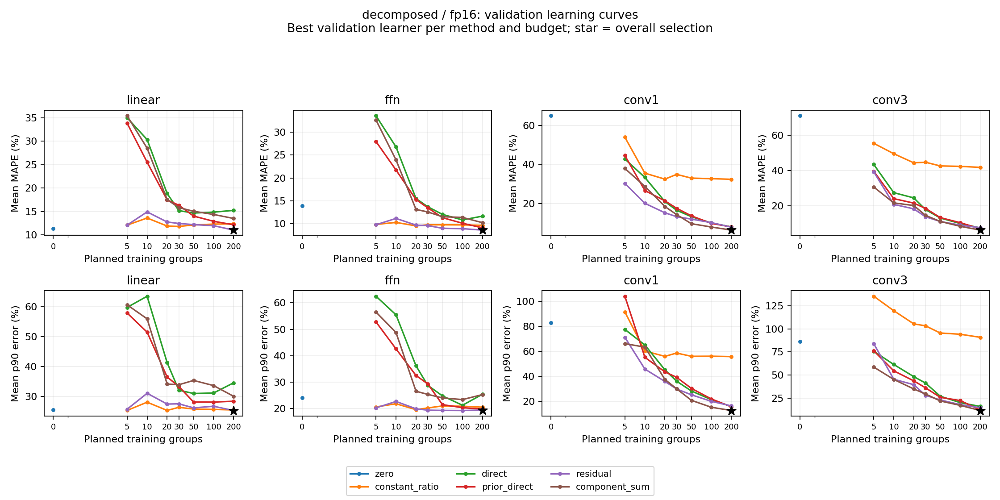
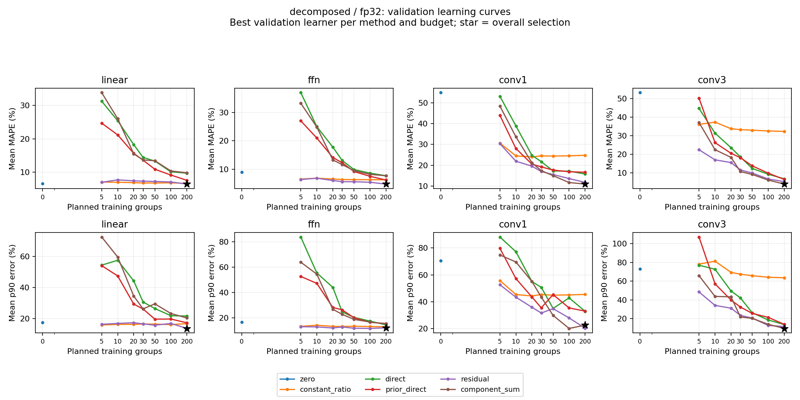
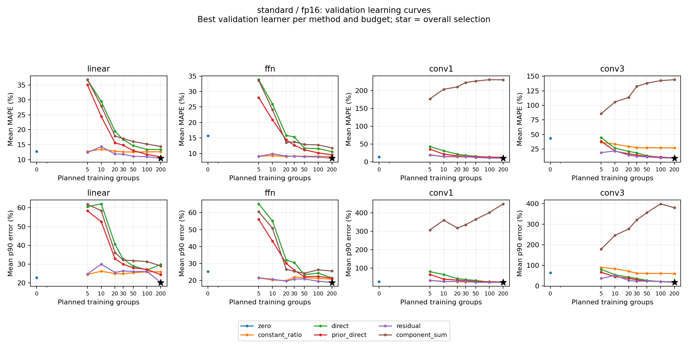
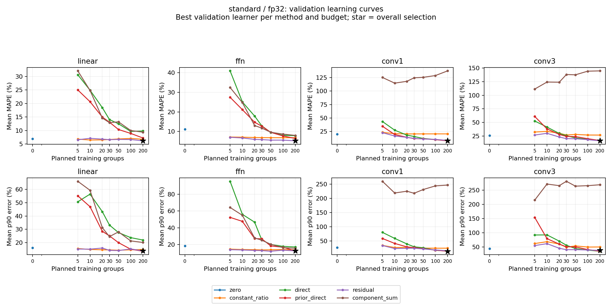

# Layer prediction results

Frozen run: `/Users/studyhard/Claude/자율연구/analysis/layer_full_fit_2026-11-10_v5/prepared_layer_full`.

Development results use the predeclared validation cohort. Each curve point is the lowest validation MAPE learner within one method and budget; p90 uses that same learner. Black stars show the overall frozen selection.

Aggregate configurations: 2304. Configurations with prediction failures: 0. Failed configurations remain in the CSV and are excluded from selection and curves.

## Result tables

- [All validation learning curves](learning_curves.csv)
- [Selected recipes](selected_summary.csv)
- [Collection costs](collection_costs.csv)
- [Distinct label budgets](label_budgets.csv)
- [CPU fit costs](fitting_costs.csv)

## Cost interpretation

Observed controlled-collection wall across recorded attempts: 133109.178 seconds. Verified sum for all listed attempts: 133109.17767499853.

Retry attempts and shared setup are included in collection ledgers. Wrapper setup, ZIP packaging and campaign idle gaps remain outside the recorded sum. Test collection is listed separately. Selected-recipe label budgets are retrospective and distinct from the full development search access. A smaller label budget does not remove the measured bundled collection cost.

Common GEMM source cost: UNKNOWN. Break-even status: UNKNOWN. CPU fit time and GPU collection wall are kept separate.

## Validation figures

[PDF](validation_decomposed_fp16.pdf)

[PDF](validation_decomposed_fp32.pdf)

[PDF](validation_standard_fp16.pdf)

[PDF](validation_standard_fp32.pdf)

## Final evaluation

Final evaluation is pending. This report reads frozen development outputs only.
