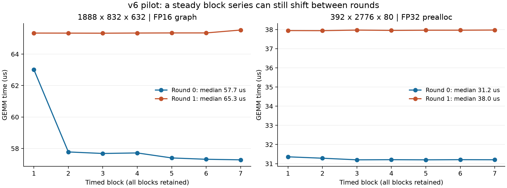

# v6 파일럿 검토: 수집 완료, 두 조건의 변동 재확인 필요

192작업·96쌍·1,344블록을 모두 수집했고 저장된 정확성 검사도 전부 통과했다. 두 방식을 별도로 저장하는 v6 수집 코드와 결과 파일은 정상이다. 다만 두 조건에서 round 간 5% 기준을 넘는 변동이 남았다. 현재 판단은 전체 측정 보류다. 이 두 조건에서 클럭 상태와 시간 변화가 함께 나타나는지 먼저 확인한다.

## 원본과 검산

사용자 ZIP은 `pilot_v6_20260920_112624_b5ed79.zip`, SHA-256은 `082d6f113aabf70391f79984673c50b988aa2e89ddca518c85d5bc6cefce9e4b`다. 원본 45파일을 별도 보존했다. 첨부된 Python을 실행하지 않고 로컬 v6 소스와 배포 ZIP의 14개 실행 소스 hash를 대조했다. manifest·작업 순서·입력 seed·GPU 환경이 일치한다.

SQLite integrity와 빈 WAL, DB/JSONL 192행의 일치, 결과 digest를 확인했다. 안정화·보정·측정 블록의 분모, GEMM당 시간, 7블록 통계, 처리량, flags와 round 변동을 재계산했다. 로컬 코드가 재생성한 CSV·JSON·HTML 10개가 업로드 파일과 byte 단위로 같았다. 원본 파일은 바꾸지 않았다.

| 항목 | 확인 결과 |
|---|---|
| 수집 | 192/192작업, 96/96쌍, 1,344블록, 누락·중복 0 |
| 저장된 정확성 검사 | 전체 출력 검사 16개·256원소 표본 검사 176개, 모두 통과 |
| 작업 상태 | PASS 191, REVIEW 1, FAIL 0 |
| 블록 상대 IQR | 최대 1.97%, 전부 5% 이내 |
| 첫·끝 블록 변화 | 최대 절댓값 9.10%, Graph 1작업 검토 필요 |
| round 재현성 | 형상·dtype·방식 96묶음 중 94묶음 통과, 2묶음 REVIEW |
| Graph 묶음 유지 | 형상·dtype 48조건에서 유지, 1~64회; 검증한 작은 세 조건은 모두 64회 |
| 실행 시간 | 예열 포함 약 15분 32초 |
| 종료 | 세션 FINISHED, 실험 exit 2, tee exit 0, 래퍼도 EXPERIMENT: REVIEW로 표시 |

정확성은 저장된 검사 결과와 허용오차·표본 범위를 확인한 것이다. 원래 입력 tensor 전체가 저장된 것은 아니므로 이 로컬 검산에서 GEMM 수치 계산을 다시 실행한 것은 아니다. 측정 기록의 GEMM 호출 합은 11,584,209회이며 profiler가 센 커널 수와 구분한다.

## 남은 두 조건

형상 순서는 `(M, N, K)`다. 아래 round 변동률은 `(큰 중앙값−작은 중앙값) / 두 중앙값의 중앙값`이다. 첫 round 대비 증감률과 분모가 다르다.

| 조건 | round 0 | round 1 | round 변동률 |
|---|---:|---:|---:|
| (1888, 832, 632), FP16, Graph | 57.7 μs | 65.3 μs | 12.5% |
| (392, 2776, 80), FP32, prealloc | 31.2 μs | 38.0 μs | 19.5% |

첫 조건의 Graph는 두 round 모두 재생당 GEMM 29회를 사용했다. round 0의 7블록은 약 63.0, 57.8, 57.7, 57.7, 57.4, 57.3, 57.3 μs로 내려가 첫·끝 변화가 −9.10%다. round 1은 약 65.3 μs 부근에 모였다. 묶음 수가 달라서 발생한 차이는 아니다. 일반 prealloc의 두 round는 약 65.1·66.7 μs였다.

두 번째 조건의 prealloc은 각각의 7블록 안에서는 안정하지만, 서로 다른 시간 수준에 모였다. Graph는 37.9·38.4 μs, 묶음은 두 번 모두 56회였다. 따라서 round 0에서 Graph가 prealloc보다 느리게 나온 차이를 바로 Graph 고유 비용으로 해석하면 안 된다.

블록 내 REVIEW 1개와 round REVIEW 2묶음을 서로 독립된 세 문제로 더하지 않는다. 첫 조건에 두 표식이 겹친다. 두 종류의 표식을 합치면 4작업이 검토 대상이다. 블록을 삭제하거나 기준을 완화하지 않았다.

## 클럭·전력 기록이 보여주는 단서

FP32 prealloc (392, 2776, 80)의 round 0 측정 중 11:19:56.827 KST에 SM 클럭 1,320 MHz가 기록됐다. round 1 측정 중 11:26:08.023에는 1,065 MHz였다. 각 측정 구간에 들어오는 telemetry 표본은 1개씩이다. 빠른 실행에서 높은 클럭이 기록됐다는 연관성은 확인되지만, 한 표본으로 구간 전체의 클럭을 대표할 수는 없다.

FP16 Graph (1888, 832, 632)의 round 0 측정 구간에는 telemetry 표본이 없다. 바로 앞 11:14:07.648은 1,230 MHz, 바로 뒤 11:14:08.649는 1,395 MHz였다. 뒤 표본을 측정 구간 안의 값으로 표시하지 않았다. round 1 측정 구간 안의 표본은 1,230 MHz다. 이 조건에서도 클럭 전환이 시간 변화와 관련됐을 가능성이 있지만 현재 해상도로 시점을 확정할 수 없다.

GPU의 실행 전후 `SW Power Capping` 누적 카운터는 약 586초 증가했고 SW/HW Thermal Slowdown 카운터 증가는 0이었다. NVIDIA는 전자를 전력 제한 때문에 요청 클럭보다 낮게 동작한 누적 시간으로 정의한다. 따라서 전력 제한에 따른 클럭 조절이 이번 실행 동안 실제로 있었다고 볼 수 있다. 다만 이 값은 예열과 모든 조건을 합친 누적값이므로 두 REVIEW의 직접 원인이나 특정 조건의 비중으로 환산하지 않는다. [NVIDIA nvidia-smi 문서](https://docs.nvidia.com/deploy/nvidia-smi/#clock-event-reasons-counters)

telemetry는 931표본, 간격 중앙값 약 1초다. 이는 약 0.7초인 각 측정 구간과 약 0.1초인 블록 안의 상태 변화를 포착하기에 부족하다. 두 차단 검사에서는 GNOME portal·터미널과 첫 조회의 Python이 기록됐고 수집은 차단 없이 끝났다. 제한된 조회만으로 실행 내내 GPU 간섭이 없었다고 결론내리지 않는다.

이번 파일럿에는 Nsight trace가 없다. 커널 경로 변화·작업 간격·다른 stream의 간섭 여부는 이 파일만으로 확인할 수 없다. 위 사실은 클럭·전력 상태를 다음 진단의 우선 대상으로 삼을 근거이며 원인 확정은 아니다.

## 작은 GEMM의 두 지표

각 값은 같은 조건의 두 round 중앙값을 다시 중앙값으로 요약했다. 원래 두 round 값은 CSV에 모두 남아 있다.

| 조건 | 일반 prealloc | Graph 64회 | 시간 감소 |
|---|---:|---:|---:|
| 64³ FP16 | 4.05 μs | 1.72 μs | 57.4% |
| 64³ FP32 | 6.35 μs | 5.06 μs | 20.5% |
| 128³ FP16 | 4.05 μs | 1.90 μs | 53.2% |

작은 GEMM에서 실행 방식에 따라 시간이 크게 달라지는 현상이 새 파일럿에서도 관측됐다. 두 지표를 별도로 보존하는 방침은 유효하다. 이 감소율은 순수 CPU 대기 비율이나 측정 오차율이 아니다. Graph의 시간에도 내부 작업 간격·재생 간격·GPU 클럭 상태가 영향을 줄 수 있다.

## 다음 단계

전체 78,952작업을 시작하기 전에 위 두 형상·dtype에서 양쪽 방식을 함께 재확인한다. 입력·Graph 묶음 29/56회·5% 기준을 유지하고, 순서를 교대하며 준비부터 측정까지 클럭·전력 제한 사유를 더 촘촘히 기록하는 짧은 진단이 필요하다. 더 잦은 조회 자체의 영향도 일반 실행과 비교한다.

같은 구간의 Nsight Systems trace로 커널 경로와 제출 간격을 대조하되, profiler 시작 뒤 안정화하고 프로파일러 없는 전후 실행과 비교하는 기존 v4 원칙을 적용한다. 전력·클럭 설정 변경이나 안정화 시간 증가는 원인과 효과를 확인한 뒤 별도 프로토콜로 판단한다. 통과한 블록만 남기는 재측정은 하지 않는다.

이번 검토는 원자료 분석과 판단까지 완료했다. 추가 GPU 진단 패키지, 측정 코드 수정, GPU 재실행, full 실행은 하지 않았다. 결과 파일과 검산 코드는 이 폴더에 보존했다.

## 파일

- `verification.json`: 원본·소스·환경·통계 검증과 수집/품질 판정.
- `between_round.csv`: 형상·dtype·방식 96묶음의 비교.
- `all_blocks_with_setup.csv`: 안정화·보정·실제 측정의 모든 블록.
- `telemetry_alignment.json`: 각 측정 구간 안/직전/직후 표본을 구분한 기록.
- `small_cases.csv`: 작은 세 조건의 두 지표.
- `review_blocks.png`, `review_blocks.pdf`: 검토 대상의 7블록을 모두 표시한 그림.
- `recomputed/`: 원본 DB 복사본에 로컬 보고 코드를 적용한 결과.
- `raw/`, `raw_sha256.json`: 원본 보존본과 hash.
- `review.py`, `plot_review.py`: 재검산·그림 생성 코드.
