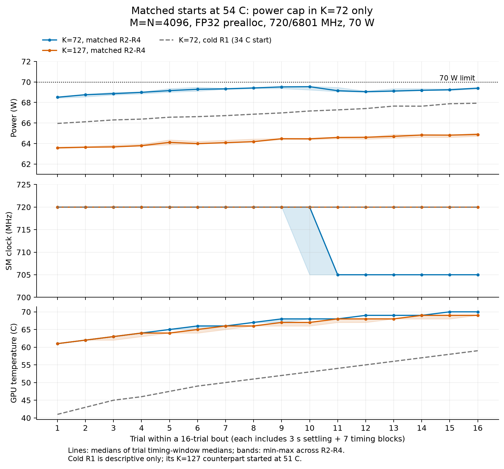

# K72·K127 전력 제한 진단 결과

검토일은 2026-10-02이며 실제 수집은 2026-10-01 저녁이다. 두 형상은 M=N=4096, FP32 IEEE, prealloc이고 SM 720 MHz·메모리 6801 MHz·기존 전력 한도 70 W를 사용했다.

수집은 128회와 별도 프로파일 4개 모두 완료됐다. 같은 54°C에서 시작한 2~4라운드에서는 K72의 전력이 K127보다 약 5 W 높았고 K72에만 SW power-cap과 실제 SM 클럭 하락이 나타났다. 별도 프로파일에서 커널 이름과 실행 구성은 같았다. 현재 근거는 **형상에 따른 연산·메모리 활동의 차이가 전력 여유를 줄이고, 반복 부하·열 이력이 제한을 드러낸다**는 설명을 지지한다. 메모리 활동이 추가 전력의 전부를 설명한다거나 온도만이 원인이라고 확정한 것은 아니다.

## 완료와 검산

| 항목 | 확인 결과 |
|---|---|
| 일반 측정 | 128/128, 누락 0 |
| 프로파일 | Systems 2개, Compute 2개 완료 |
| 정확성 | 본 측정 128회와 전후 검사까지 총 144개 저장 검사 통과. 큰 행렬은 256점 CPU FP64 대조와 출력 전체 유한성 검사 |
| 시간 측정 | 매회 3000 event-ms 이상 안정화, 7블록·총 896블록. 시간 분산 기준 초과 없음 |
| 소스 | 배포했던 상위 7파일·의존 110파일과 해시 일치 |
| 센서 | 12단계, 총 15,951표본. 포함 필드 결측 없음, 최대 관측 간격 약 0.136초 |
| 환경 | 12 worker의 GPU·드라이버·PyTorch/CUDA·정밀도·환경 서명 일치 |
| 복구 | 그래픽·메모리 클럭 해제 명령 모두 수락 |
| 반환 요약 | 기존 분석기의 재계산과 원본 `summary.json` 정확 일치. 별도 시각 비교로 128회의 본 측정 구간·플래그·최저 클럭 교차 검산 |
| 반환 상태 | `collection=COMPLETE`, `gate=REVIEW`, launcher 종료 코드 2 |

`counts.PASS=128`은 정확성 등의 기본 성공 집계다. 전력 제한과 클럭 이탈까지 없는 품질 PASS 128건을 뜻하지 않는다. 진단 실행본은 정상 수집에도 해석 대기 의미의 REVIEW를 사용한다. 기존 전수 측정의 최종 검토 54건과 채택 판정은 변경하지 않았다.

센서 수집 구간은 10월 1일 20:43:06~20:57:24 KST, 약 14분 18초다. launcher·환경 준비와 최종 압축 시간은 이 구간 밖이다. 원본 ZIP SHA-256은 `719cb872d36026494713637f447c79bd609fb4d40de064ca356476ac75246b29`다. 원본·추출본의 718파일을 보존하고 재계산은 별도 `recomputed/`에서 수행했다.

## 시작 온도를 맞춘 비교

1라운드는 K72가 34°C, K127이 51°C에서 시작해 17°C 차이가 났다. 실행본이 이를 `START_TEMPERATURE_UNMATCHED`로 표시했다. 형상 간 비교의 주된 근거는 두 형상 모두 54°C에서 시작한 2~4라운드로 한정했다. 각 형상은 16회씩 3묶음이며, 48개의 독립 실험 세션은 아니다.

| 본 측정 구간, 2~4라운드 | K72 | K127 |
|---|---:|---:|
| 측정 수 | 48 | 48 |
| 전력 표본 중앙값의 측정 간 중앙값 | 69.19 W | 64.39 W |
| SW power-cap 표본이 있는 측정 | 48/48 | 0/48 |
| SM 720 MHz 미만 표본이 있는 측정 | 19/48 | 0/48 |
| 본 측정 최저 SM 클럭 | 705 MHz | 720 MHz |
| 측정 지연시간 중앙값 | 0.500801 ms | 0.835771 ms |
| 열 제한 활성 표본 | 0 | 0 |

같은 라운드·같은 반복 번호끼리 전력을 뺀 차이의 중앙값은 5.005 W, 범위는 4.18~5.53 W다. 표의 두 독립 중앙값을 뺀 4.80 W와 집계 정의가 다르다.

K72의 첫 SW power-cap은 부하 시작 후 약 1.38~3.43초, 60~61°C에서 관측됐다. 실제 705 MHz 표본은 약 37.41~41.41초 뒤, 모두 68°C에서 처음 나타났다. 전력 제한 플래그가 켜진 시점과 50 ms 요청 간격의 표본에서 목표 클럭 하락을 포착한 시점은 구분해야 한다. 같은 온도 부근의 K127은 약 64~65 W, 720 MHz를 유지했다.

2·3라운드에서는 K127을 먼저, 4라운드에서는 K72를 먼저 실행했는데 형상 간 차이가 유지됐다. 단순히 두 번째 실행이라서 생기는 현상으로 설명하기 어렵다. 팬 속도는 두 형상에서 비슷한 범위로 변했지만 시작 시 GPU 온도를 맞추었다고 방열판·전원부 등 모든 열 상태가 같아졌다고 가정하지 않는다.

34°C에서 시작한 첫 K72 묶음은 16회 모두 제한·클럭 하락 없이 끝났고 본 측정 전력 중앙값은 66.92 W였다. 반복 후 온도는 약 59°C까지 올라갔다. 낮은 시작 온도·초기 이력에서 현상이 사라지는 사례지만 한 번의 최초 묶음이므로 온도 하나의 독립 인과 효과로 단정하지 않는다.

그림은 각 반복의 본 측정 구간 중앙값을 2~4라운드에 걸쳐 다시 중앙값으로 묶은 선과 최소~최대 범위다. 회복 후 첫 측정에도 기존 3초 안정화가 있으므로 첫 점의 실제 온도는 시작 온도 54°C보다 높다. 회색 점선은 짝 비교에서 제외한 낮은 온도의 첫 K72 묶음이다. 측정 사이 정확성 검사·프로세스 검사·저장의 간격은 묶음별 중앙값 약 26~27 ms로, 완전히 끊기지 않는 부하는 아니다.

## 실제 커널과 활동 지표

Systems의 각 20호출과 Compute의 각 1호출에서 두 형상은 모두 `ampere_sgemm_128x64_nn`으로 기록됐다. Systems SQLite 원자료와 커널 요약 CSV의 이름·20개 실행 수·시간 합이 일치한다.

| 실행 구성 | K72·K127 공통 |
|---|---|
| Grid | (32, 64, 1), 2048 blocks |
| Block | (128, 1, 1) |
| 스레드당 레지스터 | 122 |
| 정적 공유 메모리 | 12,544 bytes/block |
| Compute의 총 공유 메모리 | 13,568 bytes/block, 드라이버 사용량 포함 |
| SM당 waves 지표 | 10.67 |

따라서 이번 프로파일은 ‘K72에서 이름과 구성이 다른 커널이 선택됐다’는 설명을 뒷받침하지 않는다. 같은 커널도 K에 따라 반복 횟수와 내부 경로·접근 비중이 달라질 수 있다. 일반 128회 전부를 추적한 것은 아니므로 모든 시점의 커널 경로까지 확인했다고 확대하지 않는다.

Compute 지표는 다음과 같다. 일반 측정 값과 합치지 않은 별도 프로파일의 관측이다.

| 지표 | K72 | K127 |
|---|---:|---:|
| GPU duration | 502.912 µs | 837.952 µs |
| DRAM 전송률 | 51.46 GB/s | 30.93 GB/s |
| DRAM 처리율 지표 | 31.57% | 18.97% |
| L2 처리율 지표 | 41.53% | 31.61% |
| SM 처리율 지표 | 73.30% | 73.82% |
| FMA 파이프 지표 | 55.49% | 58.68% |
| load/store 파이프 지표 | 67.03% | 64.06% |
| 정수 ALU 파이프 지표 | 16.40% | 12.54% |
| 활성 warp 비율 | 32.35% | 32.45% |

처리율은 각 계수기의 정규화된 활동 지표이며 단위별 전력 비중이 아니다. 특히 SM 처리율 하나를 전체 FLOP 활용률로 바꾸지 않는다. 정의와 replay의 영향은 [NVIDIA Nsight Compute Profiling Guide](https://docs.nvidia.com/nsight-compute/ProfilingGuide/index.html)를 따른다.

DRAM 전송률은 K72가 약 1.66배다. 두 형상은 모두 한 GEMM의 결과 C가 4096×4096×4 bytes, 즉 논리적으로 64 MiB이다. K72는 호출당 연산이 짧아 같은 크기의 결과를 더 짧은 주기로 생성한다. 높은 메모리 처리율과 추가 전력의 연관을 설명하는 후보가 된다. 논리적 출력 크기 64 MiB는 실제 DRAM 전송량과 같지 않으며, 이 관측만으로 전체 전력 차이 5 W를 DRAM에 배분할 수 없다. FMA 지표는 오히려 K127이 높으므로 연산량이나 FMA 활성만으로 전력 순서를 설명하기 어렵다.

Systems의 커널 사이 평균 간격은 K72 약 1.29 µs, K127 약 1.37 µs다. 추적한 20커널 구간에서 커널 시간 합/구간 폭은 각각 99.75%, 99.84%였다. 이 짧은 프로파일에서는 큰 GPU 유휴 간격이 차이를 설명하는 모습이 없다. CPU 분기 예측이나 GPU 분기 divergence를 계측한 결과는 아니므로, 그 원인을 증명한 것으로 해석하지 않는다.

## 확정 범위와 남은 문제

확인한 직접 현상은 K72에서 반복되는 SW power-cap과 뒤이어 나타나는 705 MHz 표본이다. 열 제한 플래그는 전 단계에서 0이며, 이는 온도가 전력 소비에 영향을 주지 않는다는 뜻은 아니다. NVIDIA는 SW power-cap을 전력 제어에 의한 클럭 제한으로 정의한다. 이번 센서의 순간 전력도 일반 K72 묶음에서 최대 약 69.74 W였으므로 70 W 초과 스파이크 자체를 직접 포착했다고 말하지 않는다. 평균 전력은 최근 1초 평균이고 instantaneous 값도 마지막 센서 측정치이지 호출마다 관측한 파형이 아니다. [NVIDIA SMI](https://docs.nvidia.com/deploy/nvidia-smi/index.html)

형상·반복 이력에 따라 현상이 달라진다는 근거는 확보했다. 전력 차이의 세부 원인인 메모리 동작·주소 계산·전압·누설 전력의 기여는 아직 분리하지 못했다. `voltage.graphics` 조회는 지원되지 않았다.

Compute는 형상당 한 번, 각 10 replay pass를 수집했다. `--cache-control none` 경고가 있고 K127의 L2 적중률은 100.11%로 출력됐다. 이 값은 유효한 확률로 사용하지 않으며 임의로 100%로 고치지도 않는다. NVIDIA가 설명하는 다중 pass 간 계수기 변동에 따른 범위 초과 가능성과 맞지만, 이번 오차의 정확한 발생 원인까지 확정한 것은 아니다. 처리율 차이는 설명 후보를 좁히는 보조 근거로 두고, 정확한 캐시 적중률이나 단위별 전력 결론은 보류한다. [Nsight Compute의 범위 초과 지표 설명](https://docs.nvidia.com/nsight-compute/ProfilingGuide/index.html)

다음 실험이 필요하다면 전수 재측정보다 두 형상에 한정해 회복 조건과 캐시 제어 방식을 명시하고, 필요한 DRAM/L2 계수기를 적은 pass로 반복 확인하는 편이 직접적이다. 열 이력 효과와 출력·메모리 활동 효과를 별도 비교해야 하며, 새 실행본 제작이나 GPU 실행은 이번 결과 검토에서 진행하지 않았다.

## 근거 파일

- `findings.json`: 검산 상태·라운드별 요약·최초 제한/클럭 하락·프로파일 비교.
- `trial_comparison.csv`: 128회 각각의 본 측정 전력·클럭·온도·플래그와 실제 측정 사이 간격.
- `ncu_metrics.json`: 두 Compute 프로파일의 696개 열과 단위. 원래 수치 보존.
- `power_shape_comparison.png`, `power_shape_comparison.pdf`: 비교 그림.
- `verify_and_analyze.py`, `verification.log`: 검산·분석·그림 생성 코드와 결과. 원자료 보존, summary 정확 재현, 128구간 독립 검산 등의 assert 포함.
- `raw_hashes.json`, `raw/`, 원본 ZIP: 받은 증거와 모든 추출 파일 해시.
- `recomputed/`: 원본과 분리한 기존 분석기 재계산 사본.
