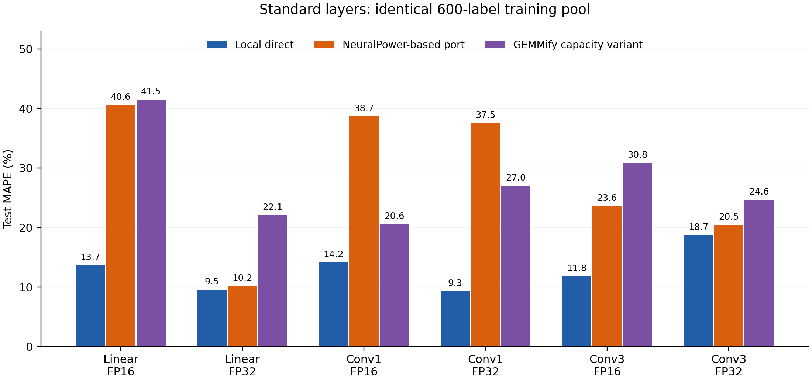

# 선행연구 비교 검토·수정 결과 — 2026-11-11

구현 점검, NeuralPower 교차검증 수정 및 재학습, 동일 학습 자료 비교, NeuSight 공개 연산 자료 실행, 보고서 삽입문 작성을 완료했다. 최종 사용할 NeuralPower 수치는 이 폴더에 있다. 이전 [v1](../prior_model_comparison_2026-11-11/README.md)은 검토 이력으로 보존한다.

현재 GPU·측정 경계에서 공통 학습 풀을 사용한 본 연구 direct의 표준 레이어 MAPE는 여섯 조건 모두 NeuralPower 포트와 두 GEMMify 재구현보다 낮았다. NeuralPower 대비 형상 bootstrap 구간이 양수인 조건은 네 개다. Linear FP32와 Conv3 FP32의 우열은 불확실하며, 분해 Conv3 FP32에서는 NeuralPower가 direct보다 낮은 MAPE를 보였다. 기존 GEMM prior 활용 전체 선택과의 비교는 준비비가 다른 별도 표로 제시한다.

## 구현을 확인한 범위

| 비교 계열 | 실행한 구현과 현재 환경에 맞춘 부분 | 이번 확인 | 논문 결과 재현의 범위 |
| --- | --- | --- | --- |
| NeuralPower | 원 FC·Conv 다항 특징의 Python 포트, raw-ms Lasso, 그룹 CV. FP16/FP32 별도 학습. 주 결과의 하한은 train 최소시간이며 0.105 ms 원 하한도 보존 | 개발 형상 750개·양의 계수 네 묶음에서 저자 예측식과 3,000회 대조, 최대 상대차 6.15×10⁻¹⁶. fold별 스케일러를 독립 Pipeline 탐색과 대조 | 원 MATLAB 학습기 전체 수치 일치는 미확인. 고정 공개 저장소에 저자 학습 자료·계수 파일이 없어 원 논문 정확도 재현은 보류 |
| GEMMify | 논문의 M,N,K와 Decision Tree 격자 재구현. leaf 2~6 원 격자와 상한 해제 변형을 함께 보고 | 750개 형상의 차원 대응 확인. 원문 Table I의 depth/feature/leaf 격자 대조 | 저자 실행 코드·원 학습 자료를 확보하지 못해 현재 자료에서 방법을 재구현한 범위 |
| Paleo | 저자 forward 분석 코드의 compute+memory 시간, 실측 연산·대역폭 보정. FP16 자료 폭 확장 | Linear 250형상×2정밀도에서 FLOPs·bytes·ms 단위를 독립 식과 대조한 500건 일치 | 현재 하드웨어 보정 및 구현 경로에 적용한 분석 기준선 |
| NeuSight | 저자 코드·공개 FP32 가중치·metadata와 GPU profile. 현재 Linear/FFN에 적용 | 저자 공개 LINEAR/BMM/GELU 자료 22,083건 재실행, 66개 scalar 원 forward 대조, 예측 실패 0건 | 공개 가중치의 연산 단위 실행 확인. 논문 전체 신경망 집계 점수는 별도 검증 범위 |

NeuralPower의 기존 스케일러는 outer train 전체에 맞춘 뒤 내부 CV에 사용됐다. 수정본은 각 내부 학습 fold에 스케일러를 따로 맞춘다. 100개 alpha 격자는 비교 조건 유지를 위해 outer train에서 계산한 기존 규칙을 사용한다. 학습 목표, 형상 부분집합, seed, 수렴 기준, 최종 전체 train refit은 유지했다. 이는 교차검증 전처리 수정과 민감도 분석이며 MATLAB과의 완전한 학습 일치 주장으로 사용하지 않는다. [scikit-learn 전처리·CV 지침](https://scikit-learn.org/stable/common_pitfalls.html), [MATLAB lasso 정의](https://www.mathworks.com/help/stats/lasso.html)

GEMMify의 Conv 차원은 M=batch×output_height×output_width, N=output_channels, K=input_channels×kernel_height×kernel_width다. 현재 stride 1·same-padding 자료에서 입력·출력 공간 크기가 같다. 원 leaf 격자의 큰 오차를 감추지 않고 상한 해제 변형과 나란히 제시한다. 이 변형은 추가 민감도 결과다.

## 평가와 비용의 공통 조건

각 정밀도·실행 경로에서 Linear·Conv1·Conv3 train 각 200개, 합계 600개의 레이블을 모든 학습형 비교 방법에 제공했다. 본 연구 direct는 레이어별 200개를 사용한다. NeuralPower는 Linear 200개와 Conv 통합 400개, GEMMify는 통합 600개를 사용한다. 각 방법·seed의 레이블 키 합집합이 정확히 같은지 12개 풀에서 확인했다. 개별 회귀기의 학습 레이블 수와 모델 수는 다르다.

Validation은 FP16 총 150개, FP32 총 149개이며 test도 각각 150개와 149개다. 조건별 50형상, Conv3 FP32는 기존 정확성 제외를 반영한 49형상이다. 세 seed 결과를 평균했다. 각 direct 학습기는 기존 validation의 k=200 후보에서 선택하고 원 validation 예측과 일치를 검산했다. NeuralPower는 내부 MSE CV, GEMMify는 내부 MAPE CV로 설정을 정한다. 학습기 종류·하이퍼파라미터 탐색량·손실함수는 방법별 설정을 유지했다.

이 실험은 기존 test 결과 공개 후 수행한 추가 비교다. [수정 프로토콜](protocol.json)을 저장하고 새 validation 선택과 가중치를 [동결](rerun/frozen.json)한 뒤 기존 test를 재평가했다. 독립된 새 blind test로 해석하는 대신, 같은 자료에서 구현·전처리·학습 풀을 점검한 기술적 비교로 보고한다.

| 비용 항목 | 산정 기준 |
| --- | --- |
| 동일 풀의 local 학습 | 정밀도·경로별 train 600개 + validation 150/149개. 세 seed에서 같은 full pool을 재사용 |
| 개별 레이어 비교 | direct 200, NeuralPower Linear 200/Conv 400, GEMMify 600 train 레이블 |
| 본 연구 prior 활용 전체 선택 | 기존 GEMM 학습 자료 및 구성 연산 레이블을 별도 준비비로 계상 |
| Paleo | 기존 하드웨어 천장 보정 자료를 공유 준비비로 계상 |
| NeuSight | 공개 사전학습 가중치 비용은 외부 비용 미상으로 기록 |
| 이번 추가 실행 | CPU에서 레이어 204모델, GEMM 18모델 fit. 새 GPU 측정 0건 |

총 GPU 수집시간과 기존 모델의 데이터 효율은 [별도 비용 장부](../cost_data_efficiency_2026-11-11/README.md)에 있다. 이번 레이블 차이를 GPU 수집시간 절감률로 바꾸지 않는다.

## 동일 학습 풀의 표준 레이어

MAPE(%), 세 seed 평균. 모든 열이 k=200의 동일 train 풀이다.

| 조건 | 본 연구 direct | NeuralPower 포트 | GEMMify 원 격자 | GEMMify leaf 상한 해제 |
| --- | --- | --- | --- | --- |
| Linear FP16 | 13.67 | 40.57 | 136.71 | 41.46 |
| Linear FP32 | 9.54 | 10.18 | 156.65 | 22.07 |
| Conv1×1 FP16 | 14.16 | 38.66 | 276.51 | 20.55 |
| Conv1×1 FP32 | 9.29 | 37.52 | 430.38 | 27.04 |
| Conv3×3 FP16 | 11.80 | 23.63 | 51.04 | 30.85 |
| Conv3×3 FP32 | 18.70 | 20.46 | 189.15 | 24.64 |

그림은 가독성을 위해 direct·NeuralPower·GEMMify 상한 해제 변형을 표시하며, 원 격자 결과는 위 표에 함께 남겼다. [PDF](figures/equal_pool_standard.pdf), [MAPE·p90 전체 CSV](tables/equal_pool_test.csv), [풀 일치 검사](tables/equal_pool_identity.csv)

NeuralPower MAPE에서 direct MAPE를 뺀 차이에 대해 형상 단위로 짝을 맞춰 5,000회 bootstrap했다. 각 형상의 오차를 세 seed 평균한 뒤 재표집했다. 표준 Linear FP32는 0.64%p [−2.49, 4.01], Conv3 FP32는 1.76%p [−3.54, 6.82]다. 나머지 네 조건의 95% percentile 구간은 양수다. GEMMify 상한 해제 변형과의 Conv3 FP32 차이 구간도 [−1.69, 13.62]로 0을 포함한다. 이 구간은 고정 seed와 현재 형상의 기술적 불확실성이며 다중비교 보정을 적용하지 않았다. [짝비교 전체](tables/equal_pool_paired_intervals.csv)

## 동일 학습 풀의 분해 레이어

| 조건 | 본 연구 direct | NeuralPower 포트 | GEMMify 원 격자 | GEMMify leaf 상한 해제 |
| --- | --- | --- | --- | --- |
| Linear FP16 | 15.68 | 36.53 | 316.60 | 83.90 |
| Linear FP32 | 9.18 | 10.85 | 233.29 | 42.04 |
| Conv1×1 FP16 | 9.21 | 16.34 | 174.24 | 27.12 |
| Conv1×1 FP32 | 18.65 | 19.14 | 245.25 | 29.22 |
| Conv3×3 FP16 | 7.20 | 10.25 | 59.04 | 28.64 |
| Conv3×3 FP32 | 8.83 | 6.30 | 109.06 | 33.20 |

분해 Conv3 FP32에서는 NeuralPower 6.30%, direct 8.83%이며 차이 −2.52%p의 구간은 [−3.86, −1.15]다. 이 조건은 NeuralPower가 우세한 사례로 보고한다. 기존 구성합 전체 선택의 5.64%와 NeuralPower의 차이는 0.66%p [−0.99, 2.30]이며 우열을 확정하기 어렵다. 구간에 0이 들어간다는 사실을 동등성의 증거로 사용하지 않는다.

## 기존 전체 선택과의 별도 비교

아래 기존 전체 선택에는 GEMM prior와 구성 레이블의 준비비가 포함된다. NeuralPower는 validation에서 선택한 k를 적용한다. 위 600개 고정 풀 비교와 구분한다.

| 조건 | 기존 전체 선택 | 수정 NeuralPower 선택 | Paleo 보정 |
| --- | --- | --- | --- |
| Linear FP16 | 11.02 | 41.04 | 52.63 |
| Linear FP32 | 6.71 | 11.67 | 31.72 |
| Conv1×1 FP16 | 10.71 | 38.66 | 67.76 |
| Conv1×1 FP32 | 8.82 | 37.52 | 56.69 |
| Conv3×3 FP16 | 11.80 | 26.97 | 75.98 |
| Conv3×3 FP32 | 14.48 | 20.46 | 46.26 |

기존 전체 선택 대비 수정 NeuralPower의 표준 여섯 조건 차이는 4.96~30.02%p이며 기술적 95% 구간이 모두 양수다. 정확도 순위와 준비비·측정 효율은 서로 다른 주장으로 보고한다. [수정 짝비교](tables/overall_vs_revised_np_intervals.csv)

## GEMM 수정 결과

공통 train 11,498형상·validation 1,611형상·test 1,000형상, 세 seed 평균 MAPE(%).

| 정밀도·실행 방식 | 본 연구 동결 선택 | NeuralPower 포트 |
| --- | --- | --- |
| FP16 allocate | 12.44 | 31.19 |
| FP16 prealloc | 12.25 | 31.19 |
| FP16 graph | 12.95 | 33.12 |
| FP32 allocate | 6.68 | 19.48 |
| FP32 prealloc | 6.68 | 19.47 |
| FP32 graph | 6.85 | 20.23 |

여섯 조건의 NeuralPower 대비 MAPE 차이는 12.79~20.16%p다. 형상 bootstrap 구간은 모두 양수다. [원값](tables/gemm_revised.csv), [짝비교](tables/gemm_revised_paired_intervals.csv)

## 이전 수치의 수정

| 경로·조건 | 이전 k → 수정 k | 이전 MAPE | 수정 MAPE |
| --- | --- | --- | --- |
| standard Linear FP16 | 20 → 20 | 40.51 | 41.04 |
| standard Conv3×3 FP16 | 30 → 30 | 26.40 | 26.97 |
| standard Conv1×1 FP16 | 200 → 200 | 26.83 | 38.66 |
| decomposed Linear FP16 | 20 → 20 | 38.52 | 39.02 |
| decomposed Conv1×1 FP16 | 200 → 200 | 13.72 | 16.34 |
| decomposed Conv3×3 FP16 | 200 → 200 | 9.65 | 10.25 |
| standard Linear FP32 | 30 → 30 | 11.90 | 11.67 |
| standard Conv1×1 FP32 | 200 → 200 | 36.84 | 37.52 |
| standard Conv3×3 FP32 | 200 → 200 | 20.52 | 20.46 |
| decomposed Conv1×1 FP32 | 200 → 100 | 18.50 | 18.32 |
| decomposed Linear FP32 | 30 → 200 | 13.98 | 10.85 |
| decomposed Conv3×3 FP32 | 200 → 200 | 6.23 | 6.30 |

분해 Conv3 FP32의 기존 direct validation MAPE 목표 6.7815%에 도달하는 최소 NeuralPower 설정은 **k=100, Conv 통합 train 200개/seed**로 바뀌었다. 세 seed train 합집합은 346개이며 validation 49개를 더하면 **395개**다. 앞선 k=30·통합 60개/seed·개발 합집합 193개라는 수치는 수정 전 결과로 남긴다. 기존 direct의 개발 예산 249개보다 새 NeuralPower 예산이 크므로 앞선 레이블 절감 해석도 갱신한다. p90 13.6100%까지 함께 맞추면 k=200·Conv 통합 400개/seed·개발 합집합 449개가 필요하다. MAPE 10·15·20% 및 15/30 보조 기준도 재집계했다. [같은 정확도 예산](tables/neuralpower_equivalent_accuracy.csv)

## NeuSight의 공개 자료 실행

저자 공개 test CSV와 원 device profile을 사용했다. LINEAR 8,254건, BMM 13,461건, GELU 368건이다. 단위 변환과 학습 metadata의 최근접 tile 선택을 원 코드와 대조했다. 공개 test의 실제 시간은 RTX 자료의 학습·선택에 사용하지 않았다.

| 공개 test GPU | 학습 metadata에 GPU 포함 | LINEAR MAPE (n) | BMM MAPE (n) | GELU MAPE (n) |
| --- | --- | --- | --- | --- |
| NVIDIA A100 80GB PCIe | 미포함 | 43.93% (1040) | 2.92% (2487) | 자료 없음 |
| NVIDIA A100-PCIE-40GB | 포함 | 5.11% (1040) | 5.63% (2281) | 3.92% (65) |
| NVIDIA H100 80GB HBM3 | 미포함 | 29.00% (1040) | 22.83% (2477) | 자료 없음 |
| NVIDIA L4 | 미포함 | 37.01% (1040) | 33.12% (2092) | 10.53% (63) |
| Tesla P100-PCIE-16GB | 포함 | 14.47% (1040) | 4.98% (2004) | 2.76% (61) |
| Tesla P4 | 포함 | 226.18% (974) | 15.08% (72) | 0.20% (54) |
| Tesla T4 | 포함 | 23.68% (1040) | 28.12% (1976) | 1.34% (61) |
| Tesla V100-PCIE-32GB | 포함 | 12.04% (1040) | 15.03% (72) | 1.13% (64) |

P4 LINEAR의 MAPE 226.18%를 포함해 전 장치를 보고한다. 원 forward와의 수치 일치는 확인됐지만 이 큰 오차의 원인 및 논문 점수와의 차이는 추가 분석 대상이다. 따라서 공개 가중치의 실행 검증과 원 논문 성능 재현을 구분한다. [전체 MAPE·p90·실패 수](neusight_public_metrics.csv), [22,083개 예측](neusight_public_predictions.csv), [자료·해시](sources/download_verified.json)

현재 RTX 환경에서 NeuSight의 FP32 표준 Linear/FFN MAPE는 34.71/44.39%, 분해 Linear/FFN은 39.28/49.01%다. 이 값은 공개 FP32 가중치의 새 GPU·클럭·소프트웨어 환경 전이 성능이다. 원 LINEAR 학습 연산의 bias=True와 현재 bias=False 차이, FFN을 두 LINEAR와 GELU의 합으로 계산한 경계가 포함된다. 본 연구의 현지 학습 모델과 비교할 때 전이 조건을 함께 제시한다.

## 검증과 제출 파일

원 입력 700개와 v1 산출물 483개의 해시가 유지됐다. 새 예측 127,338개의 지표를 다시 계산했고 저장 모델 222개의 validation 예측 43,350개를 재현했다. NeuSight 공개 자료 22,083건도 별도로 재계산했다. train/validation/test 레이블 키의 정확한 교집합은 0개다. [검증](verification.json), [특징·단위 검사](source_contracts.json), [CV 독립 검사](fold_scaling_self_check.json)

새 레이어 fit 204회 wall 67.814초·fit 합계 65.799초, GEMM fit 18회 wall 3.373초·fit 합계 2.531초다. NeuralPower 수렴 경고는 0회다. 기존 direct를 재현한 분해 Linear FP16의 MLP64 한 seed에서 3,000epoch 도달 경고 1회가 있었고, 원 validation 예측과 일치했다. 같은 고정 설정을 유지했다. [레이어 진단](rerun/diagnostics.json), [GEMM 진단](gemm/diagnostics.json)

보고서에 바로 넣을 문장과 표는 [선행연구 비교 삽입본](../../RE_보고서_2026-11-11/선행연구_비교_삽입본_2026-11-11.md)에 정리했다. 새 GPU 수집·새 blind test·전체 신경망 검증은 이번 완료 범위에서 제외한다. 원 논문 점수의 완전 재현이 필요한 경우 저자 자료와 환경 확보가 남는다.

## 원문과 구현 출처

- NeuralPower: [논문](https://proceedings.mlr.press/v77/cai17a.html), [고정 원 코드 d9e28fd](https://github.com/enyac-group/NeuralPower/tree/d9e28fd05f5c96cffe4691adb50be5ff2f813d27).
- GEMMify: [AICAS 2025 논문](https://doi.org/10.1109/AICAS64808.2025.11173087), [저자 공개 원문](https://hal.science/hal-05127830v1).
- Paleo: [프로젝트·논문](https://talwalkarlab.github.io/paleo/), [고정 원 코드 984bbf5](https://github.com/TalwalkarLab/paleo/tree/984bbf5d2942f28b8599db4374c0ad788efe0f6e).
- NeuSight: [논문](https://arxiv.org/html/2407.13853v3), [고정 원 코드·자료 6945927](https://github.com/scai-tech/NeuSight/tree/6945927d9afcca2b9daf021f8395e53edc5b4eef).
