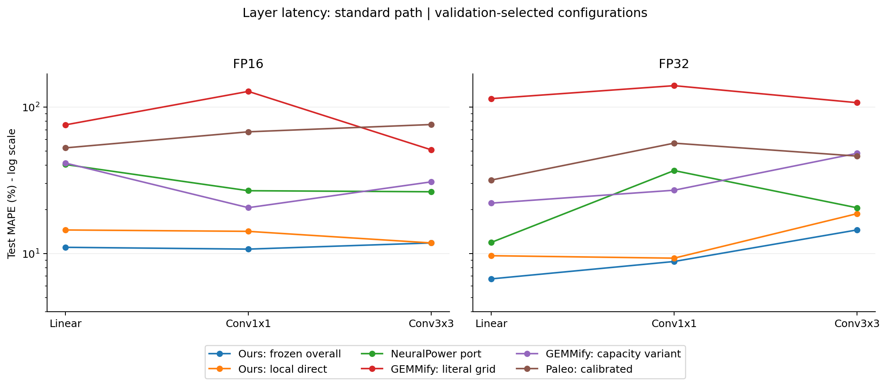
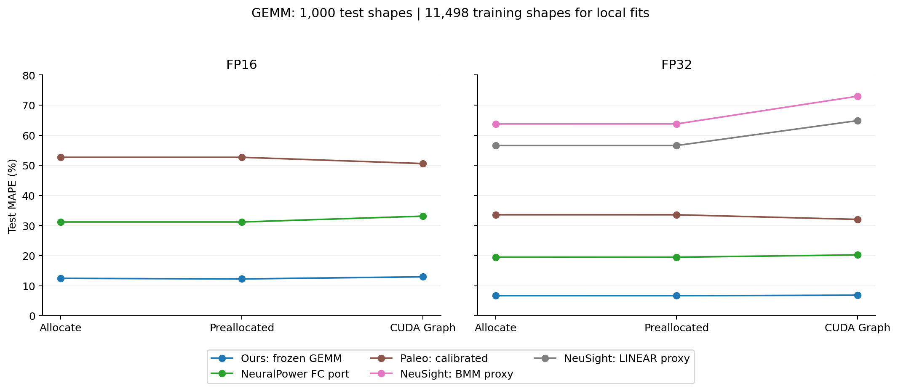
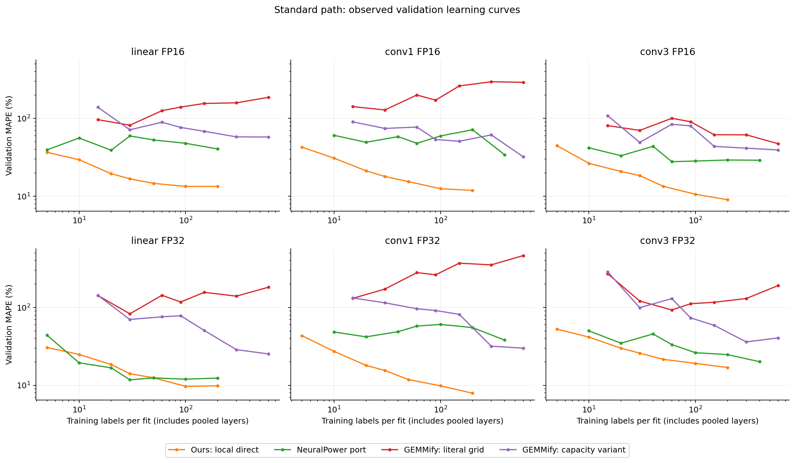

# 선행연구 모델 재현·비교 (2026-11-11)

NeuralPower, GEMMify, Paleo, NeuSight를 기존 GEMM·레이어 자료에 적용해 비교했다. 같은 test 형상에서 기존 동결 모델의 MAPE가 표준 Linear·Conv1×1·Conv3×3의 두 정밀도 6조건 모두에서 비교 모델보다 낮았다. GEMM에서도 기존 모델은 FP16 12.25~12.95%, FP32 6.68~6.85%로, 같은 11,498형상으로 재학습한 NeuralPower FC 포트의 31.17~33.11%, 19.47~20.23%보다 낮았다.

이 결과의 범위는 **RTX 4000 SFF Ada, 고정 클럭, 현재 형상 분포와 구현에 대한 추가 비교**다. 기존 최종 test 결과가 공개된 뒤 시작한 실험이며, 새 모델의 특징·탐색 범위를 먼저 고정하고 train/CV/validation으로 구성 선택을 마친 다음 저장된 test 레이블로 평가했다. 기존 측정값·동결 모델·최종 test 산출물 700개 파일은 해시가 모두 일치한다. [비교 정책](protocol.json), [레이어 선택 동결](runs/v1/selection_frozen.json), [GEMM 선택 동결](gemm/v1/selection_frozen.json), [검증 결과](verification.json)

## 재현한 방법과 근거

| 방법 | 이번 구현 | 평가 범위 | 해석 범위 |
| --- | --- | --- | --- |
| NeuralPower | 저자 코드의 다항 특징과 Lasso를 Python으로 이식해 현재 train 자료로 재학습 | FP16·FP32 Linear/Conv1/Conv3, GEMM | 특징의 수치·순서는 저자 예측 코드와 일치. 학습기는 MATLAB에서 scikit-learn으로 변경 |
| GEMMify | FC·Conv를 M,N,K로 변환하고 논문에서 선택한 Decision Tree를 재학습 | FP16·FP32 Linear/Conv1/Conv3 | 논문 기반 재구현. 저자 실행 저장소를 확보하는 경로는 확인 대기 |
| Paleo | 저자 `FlopsProfiler` 원 코드와 기존 하드웨어 실측 P/B 사용 | FP16·FP32 Linear/Conv1/Conv3, GEMM | GEMM 기반 FLOP/메모리 분석 경로. FP16 바이트 폭·처리량 확장 포함 |
| NeuSight | 저자 forward 코드·공개 FP32 가중치·학습 메타데이터의 타일 조회 사용 | FP32 Linear, FFN, GEMM | 공개 사전학습 모델의 새 GPU 전이 비교. BMM/LINEAR→GEMM 및 FFN 합산 적용 포함 |

NeuralPower는 Cai 등의 ACML 2017 논문과 공개 구현을 사용했다. FC는 2차 단항식·교차항과 연산량 곱의 21개 특징, Conv는 선택된 일곱 차원의 3차 다항식과 특별항 여덟 개의 127개 특징을 사용한다. 원래의 절대시간(ms) 회귀와 CV 평균제곱오차 기준을 유지했다. [논문](https://proceedings.mlr.press/v77/cai17a.html), [공개 코드](https://github.com/enyac-group/NeuralPower/tree/d9e28fd05f5c96cffe4691adb50be5ff2f813d27)

GEMMify는 AICAS 2025 논문의 FC·Conv 통합 M,N,K 표현과 Decision Tree를 구현했다. 논문 Table I의 `Maximum leaf nodes [2-6]`를 그대로 적용한 결과를 `gemmify_dt`로 기록하고, leaf 상한을 해제한 용량 민감도 결과를 `gemmify_capacity`로 별도 기록했다. 깊이는 None/5/10/15/20, 특징 선택은 None/sqrt/log2이고, 5-fold 그룹 CV로 MAPE를 최소화한다. 각 split에서 같은 Conv 형상의 1×1·3×3 레이블을 한 fold에 묶었다. [논문 DOI](https://doi.org/10.1109/AICAS64808.2025.11173087), [저자 공개본](https://hal.science/hal-05127830v1), [보존 원문](/Users/studyhard/Claude/AcEVault/sources/GEMMify_AICAS2025_원문.pdf)

Paleo는 ICLR 2017 모델의 원 forward 분석 코드를 사용했다. 계산시간과 메모리시간을 **합산**하는 원식을 유지하며, cuDNN 휴리스틱을 사용하는 대신 원 코드의 GEMM 경로를 사용한다. 기존 실측 보정값 FP32 6.14 TFLOP/s, FP16 35.02 TFLOP/s, 대역폭 262.3 GB/s와 PPP=1을 적용했다. 바이트→GiB 변환과 시간 단위는 별도 수식으로 검사했다. [프로젝트·논문](https://talwalkarlab.github.io/paleo/), [공개 코드](https://github.com/TalwalkarLab/paleo/tree/984bbf5d2942f28b8599db4374c0ad788efe0f6e)

NeuSight는 ASPLOS 2025 논문의 공개 LINEAR/BMM/VEC 가중치를 CPU에서 실행했다. 원 모델이 사용하는 타일·wave 계산과 MLP를 유지했고, 가장 가까운 학습 메타데이터의 타일을 찾는 절차도 원 코드와 대조했다. 기본 입력은 48 SM, 8,847.36 GFLOP/s, 20 GB, 272.04 GB/s, L2 40 MiB다. GPU의 고정 720 MHz, 메모리 6,801 MHz를 반영했다. L2는 보존된 CUTLASS·Nsight 장치 조회의 41,943,040바이트를 근거로 했다. 처리량·대역폭을 기존 실측값으로 바꾼 `empirical` 민감도도 함께 보존했다. [논문](https://arxiv.org/html/2407.13853v3), [공개 코드와 가중치](https://github.com/scai-tech/NeuSight/tree/6945927d9afcca2b9daf021f8395e53edc5b4eef)

모델별 원 코드·라이선스·고정 commit·출처 URL은 [sources](sources/)와 [저장소 목록](sources/repositories.json)에 있다. NeuSight 가중치와 메타데이터 12개는 Git blob SHA-1과 크기를 대조한 뒤 SHA-256도 저장했다. [다운로드 검증](sources/neusight_download_verified.json)

## 같은 자료를 사용한 비교 절차

레이어는 기존 공통 PASS 집합과 group 단위 분할을 그대로 사용했다. 각 조건의 계획 train은 200형상, validation/test는 각각 50형상이다. FFN FP32 train은 기존 품질 제외를 반영해 198형상, Conv3 FP32 validation/test는 기존 정확성 제외를 반영해 각각 49형상이다. 이전 수집의 Conv3 FP32 정확성 제외 36원측정과 FFN FP32의 구성 연산 품질 제외를 승계했다. 개발 전체는 두 실행 경로를 합쳐 3,994레이블이며, 현재 레이어 test 레이블은 798개다. [품질·수량 기록](quality_coverage.json), [이전 test 보고서](../final_test_2026-11-11/README.md)

레이어 자료량 k=5/10/20/30/50/100/200, seed=20261104/05/06을 사용했다. 같은 dtype·실행 대상에서 NeuralPower는 Linear k개를 따로 학습하고 Conv1/Conv3의 2k개를 함께 학습한다. GEMMify는 세 레이어 3k개를 함께 학습한다. **개별 모델의 실제 레이블 수는 k, 2k, 3k로 다르며, k=200에서 세 레이어를 모두 다루는 공유 자료 풀은 각 dtype·경로당 600개다.** pooled 학습에 쓰인 다른 레이어 레이블도 비용에 포함했다.

NeuralPower의 스케일러는 해당 outer train 부분집합에만 맞춘다. LassoCV는 최대 10개 그룹 fold, 100개 정규화 강도, p>n일 때 최소/최대 lambda 비율 0.01, 그 외 1e-4를 사용한다. 스케일러와 alpha 경로는 outer train 전체에서 계산한다. MATLAB과의 일치 검증은 특징 생성과 예측 수식에 적용했고 CV는 scikit-learn 포트를 사용했다. 수렴 기준 1e-5, 최대 반복 100,000에서 경고는 0회였다.

원 NeuralPower 예측 코드의 하한 0.105 ms는 현재 작은 연산보다 길다. 주 결과는 train에서 관측한 최소시간을 하한으로 쓰는 포트이고, 동일 회귀 가중치에 원 하한을 적용한 `neuralpower_original_floor` 결과도 모두 남겼다. 원 코드의 별도 runtime/shape 필터 대신 동일 PASS 집합을 유지했다. 이 변경은 학습 전 [protocol.json](protocol.json)에 기록했다.

각 비교 모델은 세 seed 평균 validation MAPE, p90, 실제 학습 레이블 수, k 순으로 선택했다. 비정상 예측이 하나라도 있는 구성은 선택에서 제외한다. 모델별 선택 결과와 k=200 결과를 모두 평가했다. 기존 모델은 이미 동결된 전체 최선과 local direct 선택을 그대로 사용했다. 각 방법의 모델 구조·탐색 횟수·공통 source 준비비가 다른 비교이므로 정확도 표와 레이블·비용 표를 함께 읽어야 한다.

GEMM은 기존 train 11,498, validation 1,611, test 1,000형상을 사용했다. NeuralPower FC 포트는 dtype 두 개와 allocate/preallocated/Graph 세 방식별로 전량을 학습했고, seed=20261028/29/30의 training-only CV로 정규화 강도를 정했다. 추가 자료량 탐색 없이 11,498형상 예산을 사전에 고정했다. [GEMM 정책](gemm/v1/protocol.json)

## 표준 레이어 test 결과

표는 MAPE(%), 세 seed 평균이다. Paleo와 NeuSight는 결정론적 공개 모델 한 개의 결과다. 기존 선택은 전체 방법의 동결 최선이며, Conv3 FP16은 direct가 선택된 조건이다. NP는 NeuralPower 포트, GEMMify 확장은 leaf 상한을 해제한 민감도다.

| 조건 | 기존 동결 선택 | 기존 local direct | NP | GEMMify 원 격자 | GEMMify 확장 | Paleo |
| --- | ---: | ---: | ---: | ---: | ---: | ---: |
| Linear FP16 | 11.02 | 14.48 | 40.51 | 75.56 | 41.46 | 52.63 |
| Linear FP32 | 6.71 | 9.66 | 11.90 | 114.14 | 22.07 | 31.72 |
| Conv1 FP16 | 10.71 | 14.16 | 26.83 | 127.93 | 20.55 | 67.76 |
| Conv1 FP32 | 8.82 | 9.29 | 36.84 | 139.99 | 27.04 | 56.69 |
| Conv3 FP16 | 11.80 | 11.80 | 26.40 | 51.04 | 30.85 | 75.98 |
| Conv3 FP32 | 14.48 | 18.70 | 20.52 | 107.15 | 48.32 | 46.26 |



[전체 지표·선택 k·실제 학습 레이블 수](tables/layer_selected_test.csv), [k=200 보조 결과](tables/layer_k200_test.csv), [그림 PDF](figures/layer_standard.pdf)

NeuralPower의 표준 Linear 선택 k는 FP16 20, FP32 30이다. 표준 Conv1은 두 정밀도 모두 k=200, 실제 pooled 학습 레이블 400개다. Conv3는 FP16 k=30/60레이블, FP32 k=200/400레이블이다. GEMMify 확장은 Conv3 FP32에서 k=100/300레이블, 나머지 다섯 조건에서 k=200/600레이블이다. 표의 차이에는 각 모델의 validation 선택 자료량도 포함된다.

형상별 절대 상대오차를 seed 평균한 뒤 같은 형상을 짝지어 5,000회 bootstrap했다. 차이는 `비교 모델 MAPE − 기존 동결 선택 MAPE`로 정의했다. 표준 NeuralPower 6조건의 차이는 5.19~29.49%p이고, 각 조건의 기술적 95% percentile 구간이 모두 0보다 크다. 예를 들어 Linear FP32는 5.19%p [2.34, 8.30], Conv3 FP32는 6.04%p [0.96, 11.34]다. 이 구간은 고정 seed의 형상 표본 불확실성이며, seed 재학습·다중비교 보정은 포함 범위 밖이다. [조건별 짝비교](tables/layer_paired_bootstrap.csv)

## 분해 경로와 NeuSight

| 분해 조건 | 기존 동결 선택 | 기존 local direct | NP | GEMMify 원 격자 | GEMMify 확장 | Paleo |
| --- | ---: | ---: | ---: | ---: | ---: | ---: |
| Linear FP16 | 11.12 | 14.52 | 38.52 | 190.21 | 83.90 | 50.81 |
| Linear FP32 | 6.68 | 9.18 | 13.98 | 157.07 | 42.04 | 28.88 |
| Conv1 FP16 | 6.91 | 9.21 | 13.72 | 116.69 | 27.12 | 89.64 |
| Conv1 FP32 | 9.79 | 18.65 | 18.50 | 148.37 | 36.02 | 75.94 |
| Conv3 FP16 | 6.67 | 7.20 | 9.65 | 57.18 | 28.64 | 87.23 |
| Conv3 FP32 | 5.64 | 8.83 | 6.23 | 88.35 | 33.20 | 68.91 |

분해 Conv3 FP32에서는 NeuralPower가 기존 local direct보다 낮은 test MAPE를 보였다. 기존 구성합 선택과의 차이는 0.59%p이고 95% 구간은 [-1.05, 2.20]이므로 두 모델의 우열은 이 표본에서 불확실하다. 이 비교는 NeuralPower의 pooled 전체시간 레이블 400개와 구성합 모델의 형상당 여러 구성 레이블을 사용하는 조건이다. [분해 그림](figures/layer_decomposed.png), [PDF](figures/layer_decomposed.pdf)

NeuSight의 공개 LINEAR는 bias=True인 연산으로 학습했고, 현재 Linear는 bias=False다. FFN은 LINEAR+GELU+LINEAR의 예측시간을 합산했다. 공개 FP32 가중치와 현재 CUDA/PyTorch 환경 및 새 GPU 사이의 전이 성능으로 다음 결과를 해석한다.

| 경로·FP32 조건 | 기존 동결 선택 MAPE | NeuSight 클럭 입력 | NeuSight 실측 입력 |
| --- | ---: | ---: | ---: |
| 표준 Linear | 6.71 | 34.71 | 53.48 |
| 표준 FFN | 5.39 | 44.39 | 56.37 |
| 분해 Linear | 6.68 | 39.28 | 60.97 |
| 분해 FFN | 5.59 | 49.01 | 63.87 |

NeuSight의 FP16과 native Conv는 이번에 확보한 공개 가중치의 지원 범위 밖이다. Paleo·GEMMify·NeuralPower의 FFN 전체 레이어 포트도 이번 표에서 비워 두었다. 표준·분해 Conv의 실제 실행시간은 구현 경로가 달라서, Paleo를 분해 경로에 적용한 행은 이식 범위를 살피는 보조 비교다.

## GEMM test 결과

GEMM의 NeuralPower FC 포트와 기존 선택 모델은 조건마다 동일한 train 11,498형상을 사용했다. Paleo는 기존 실측 보정값, NeuSight는 공개 사전학습 가중치를 사용한다. 표는 MAPE(%)다.

| 조건 | 기존 동결 GEMM | NeuralPower FC | Paleo | NeuSight BMM | NeuSight LINEAR |
| --- | ---: | ---: | ---: | ---: | ---: |
| FP16 allocate | 12.44 | 31.17 | 52.67 | 지원 범위 밖 | 지원 범위 밖 |
| FP16 preallocated | 12.25 | 31.17 | 52.67 | 지원 범위 밖 | 지원 범위 밖 |
| FP16 Graph | 12.95 | 33.11 | 50.59 | 지원 범위 밖 | 지원 범위 밖 |
| FP32 allocate | 6.68 | 19.48 | 33.57 | 63.75 | 56.57 |
| FP32 preallocated | 6.68 | 19.47 | 33.57 | 63.75 | 56.58 |
| FP32 Graph | 6.85 | 20.23 | 32.03 | 72.96 | 64.86 |



NeuSight의 BMM은 B=1로, LINEAR는 행렬 크기를 대응시켜 unbatched `torch.mm`에 적용한 두 proxy다. allocate/preallocated/Graph가 만드는 실행 경계 차이를 새로 학습하는 구조는 이 공개 모델에 포함되지 않아 같은 예측을 세 실행 방식의 실제시간과 각각 비교했다. 클럭 입력을 주 표에 사용하고 실측 입력 결과는 CSV에 남겼다. 원 NeuralPower 0.105 ms 하한을 적용하면 GEMM MAPE는 129.53~339.04%다. [전체 MAPE·p90·민감도](tables/gemm_test.csv), [짝비교 구간](tables/gemm_paired_bootstrap.csv), [PDF](figures/gemm_test.pdf)

## 같은 정확도와 자료량

사용자가 정한 기존 direct 최선 validation MAPE를 주 목표로 유지했다. 보조 목표는 MAPE 10/15/20%, 기존 MAPE 15%·p90 30%, direct MAPE·p90 동시 충족이다. 아래 숫자는 공통 6조건 중 관측 격자에서 목표에 도달한 조건 수다.

| 대상·방법 | direct MAPE | MAPE 10% | MAPE 15% | MAPE 20% | MAPE 15%·p90 30% |
| --- | ---: | ---: | ---: | ---: | ---: |
| 표준 NeuralPower | 0/6 | 0/6 | 1/6 | 1/6 | 1/6 |
| 분해 NeuralPower | 1/6 | 1/6 | 3/6 | 4/6 | 2/6 |
| 표준·분해 각각 GEMMify 두 변형·Paleo | 0/6 | 0/6 | 0/6 | 0/6 | 0/6 |

분해 Conv3 FP32의 NeuralPower는 k=30, 실제 pooled 학습 60레이블에서 validation MAPE 6.75%로 direct 목표 6.78%를 충족했다. 세 seed 합집합 train 144레이블과 해당 validation 49개를 합하면 L=193, 세 회차 원측정은 579건이다. 같은 목표의 기존 direct는 L=249였다. direct의 p90 13.61%도 함께 맞추려면 k=200, pooled 학습 400레이블이 필요했다. 최소 예산 k=30 행의 근거는 validation이며, 앞의 test 표는 정확도 우선으로 선택된 k=200의 결과다.



곡선의 x축은 **모델 한 번의 실제 학습 레이블 수**로, pooled 레이어까지 포함한다. 기존 local direct 곡선은 각 k에서 validation으로 학습기를 선택했다. 원래 연구의 공통 GEMM prior를 사용하는 방법에는 별도 source 준비비가 있다. [분해 학습곡선](figures/learning_decomposed.png), [전체 목표별 결과](tables/layer_equivalent_accuracy.csv), [선택 구성의 세 seed 레이블 합집합](tables/layer_selected_label_recipes.csv), [기존 비용 분석](../cost_data_efficiency_2026-11-11/README.md)

## 비용과 재현 기록

| 이번 CPU 작업 | 최종 fit 호출 수 | 관측 wall 초 | fit 호출 합계 초 | 기록된 예측 호출 초 |
| --- | ---: | ---: | ---: | ---: |
| 레이어 전체 탐색·선택·저장 | 336 | 87.774 | 76.008 | 0.375 |
| GEMM 전체 학습·저장 | 18 | 13.820 | 1.927 | 2.114 |

각 fit 호출 안의 CV 후보 학습은 fit 시간에 포함된다. 위 wall은 학습 스크립트가 기록한 구간이며, 다운로드·환경 설치·독립 검증·보고서 작성과 별도 test 평가 시간은 포함 범위 밖이다. 원 코드 로딩·타일 표 준비 등의 비용은 wall과 세부 호출 합계의 차이에 포함된다. CPU 호출의 관측값이므로 모델 추론속도 순위로 해석할 때는 별도 반복 벤치마크가 필요하다. [비용 표](tables/cpu_observed_calls.csv), [호출별 진단](runs/v1/fit_diagnostics.json)

이번 추가 비교는 이미 확보된 레이블을 재사용했다. NeuSight의 공개 가중치 준비비는 `EXTERNAL_UNKNOWN`, Paleo의 P/B 보정은 기존 공유 준비비로 기록한다. 기존 연구의 GEMM source 개발 예산 26,218레이블과 실제 수집 장부는 [비용 분석](../cost_data_efficiency_2026-11-11/README.md)에 연결했다. 새 방법의 local 학습 레이블 0개와 전체 준비비 0원을 구분해 읽을 수 있도록 원가 범위를 표에 보존했다.

검증은 원 특징값·Paleo 시간 단위·NeuSight 원 tile/forward와의 일치, train 경계·중복 거부의 5개 검사, 저장 모델 354개 재로딩, validation 예측 66,672개 재현, 전체 비교 예측 203,389개의 지표 재계산, validation 선택 68개 검산, train/validation/test 정확한 중복 0개 확인으로 구성했다. 입력 700개와 원 출처 42개 파일의 SHA-256도 일치했다. [단위 검사 로그](logs/tests_001.log), [검증 JSON](verification.json), [검증·표·그림 코드](report.py)

기존 Python 3.14 환경의 numpy/scipy/scikit-learn을 사용하고, NeuSight용 torch/pandas는 이 폴더의 `runtime/`에 따로 설치했다. 버전은 [환경 기록](runtime_environment.json), 추가 패키지는 [고정 목록](runtime_requirements.txt)에 남긴다. [최종 파일 manifest](artifact_manifest.json)와 [추가 원출처 해시](additional_inputs.json)로 결과와 코드의 대응을 확인할 수 있다.

기존 workspace에서 저장 모델·지표 검증과 그림 재생성:

```sh
cd /Users/studyhard/Claude/자율연구
export OMP_NUM_THREADS=1 OPENBLAS_NUM_THREADS=1 MKL_NUM_THREADS=1 VECLIB_MAXIMUM_THREADS=1
export MPLCONFIGDIR=/private/tmp/prior-model-mpl
export PYTHONPATH=analysis/prior_model_comparison_2026-11-11/runtime
analysis/integrated_rq14_2026-10-28/.venv/bin/python -B analysis/prior_model_comparison_2026-11-11/test_adapters.py
analysis/integrated_rq14_2026-10-28/.venv/bin/python -B analysis/prior_model_comparison_2026-11-11/report.py
```

새 레이어 학습 재현은 `compare.py train --run v2` 후 `compare.py evaluate --run v2`로 별도 실행 디렉터리를 만든다. 현재 보고서 코드는 보존된 `v1`을 읽는다. GEMM의 `gemm_compare.py`는 기존 `gemm/v1`이 있으면 종료하도록 되어 있어, 새 재현 시에는 이 분석 폴더의 복사본에서 새 출력 경로를 지정한다. source·protocol·이전 결과를 먼저 보존한 뒤 실행한다.

## 연구 서술에 사용할 범위

현재 자료에서 기존 동결 모델과 기존 local direct가 일반적인 다항 회귀·M,N,K 트리보다 표준 레이어 예측에 유리했다. 기존 선택과 NeuralPower의 GEMM 비교는 같은 train/test 형상을 사용한 결과이며, 레이어 비교는 pooled 학습 레이블 수와 기존 prior 준비비를 함께 제시할 수 있다. NeuSight 결과는 공개 가중치의 GPU·클럭·소프트웨어 전이 사례로 설명한다. 분해 Conv3 FP32에서는 NeuralPower도 작은 레이블 예산과 낮은 오차를 얻었다.

논문의 서로 다른 GPU·데이터셋에서 발표된 오차 수치를 직접 순위에 섞는 비교와 원 논문의 실험 전체 재현은 이 결과의 적용 범위 밖이다. 이번 비교의 실증 단위는 GEMM과 지원되는 레이어이며, 전체 신경망 end-to-end 검증은 사용자가 정한 현재 범위에서 제외했다.
