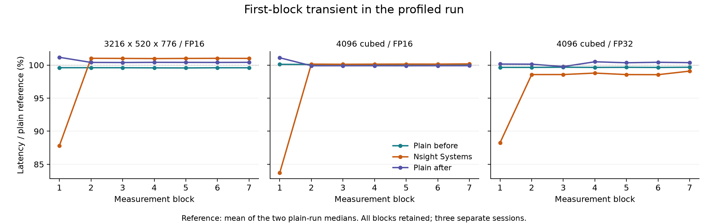

# 실제 측정 블록 Nsight 진단 결과 — 2026-09-19

수집은 완료됐다. 작은 GEMM에서는 Nsight 실행의 관측 영향이 컸고, 라이브러리가 한 번의 GEMM 호출에 여러 GPU 작업을 실행하는 경로도 확인했다. 큰 GEMM 세 조건의 첫 블록에는 진단 시작 경계와 함께 나타나는 과도 현상이 있다. **측정 품질 판정은 REVIEW이며 full_v5는 계속 보류한다.** 기존 데이터 전체를 무효로 판정하거나, 프로파일링 시간을 새 정답으로 채택한 결과가 아니다.

## 자료 및 검증

- 사용자 제공 ZIP: `timing_audit_20260919_175307_zz6mlt.zip`
- SHA-256: `be3a9ebbb318a0b92c48938199e460352bff29b023db1109b2863f6c778b7630`
- 원본 157개 파일을 안전하게 추출하고 각각의 hash를 저장했다. 첨부 코드는 실행하지 않았다. v5 소스 13개와 진단 v2 소스 6개의 배포본 일치를 확인한 뒤 로컬 분석기로 재계산했다.
- 일반 전 → Nsight → 일반 후, 각 8조건의 수치 검증 24개 통과. 기록된 종료 코드는 모두 0이다. SQLite 8개의 무결성, NVTX 측정 범위 56개와 기대 커널 수를 확인했다. 로컬 재계산 `analysis.json`은 업로드된 결과와 정확히 같다.
- 실행 폴더명 시각 17:53:07부터 ZIP 내 마지막 산출물 시각 18:04:30까지 약 11분 23초이다. ZIP 생성·전송 완료 시각과 동일한 뜻은 아니다.
- 일반 실행 16개 조건은 상대 IQR 및 첫·끝 블록 변동 기준 5%를 모두 통과했다. 일반 전후 중앙값 차이는 최대 3.23%였다.

재현 검증은 이 폴더의 `review.py`로 수행한다. `supplemental.json`에는 경계 시간 추정, 전체 NVTX 범위에 대응한 메모리 작업, 커널 이름·수, Nsight 자체 경고를 보존했다. `recomputed/analysis.json`과 `recomputed/conditions.csv`는 기존 분석기의 재계산 결과다. 원본은 `raw/`에 별도로 보존했다.

## 일반 실행과 Nsight 비교

시간은 각 7블록의 GEMM당 평균 시간에 대한 중앙값이다. 일반 기준은 전·후 두 중앙값의 평균이며, 아래 변화율은 이 기준에 대한 Nsight 중앙값의 차이다. 적응 보정에 따른 반복 수는 서로 다르다. 따라서 순수한 프로파일러 비용의 정밀한 인과 추정이나 신뢰구간은 아니다.

| 조건 | 일반 전 | Nsight | 일반 후 | 변화율 |
|---|---:|---:|---:|---:|
| 64³ FP16 prealloc | 3.97 μs | 6.68 μs | 4.08 μs | +66.0% |
| 64³ FP32 prealloc | 6.32 μs | 8.66 μs | 6.32 μs | +36.9% |
| 128³ FP16 prealloc | 3.96 μs | 6.65 μs | 4.09 μs | +65.5% |
| (3216,520,776) FP16 | 80.2 μs | 81.3 μs | 80.9 μs | +1.01% |
| 4096³ FP16 | 3.27 ms | 3.27 ms | 3.26 ms | +0.142% |
| 4096³ FP32 | 12.8 ms | 12.7 ms | 12.9 ms | −1.44% |
| 64³ FP16 Graph | 1.73 μs | 1.88 μs | 1.73 μs | +8.33% |
| 64³ FP32 Graph | 5.05 μs | 5.32 μs | 5.05 μs | +5.23% |

변화율은 반올림 전 값으로 계산했다. 4096³ FP32의 음수 차이를 “음의 오버헤드”로 해석하지 않는다. 두 Graph 조건은 모든 실행에서 replay당 GEMM 호출 64개이며, 실제 GPU 커널 수와 GEMM 호출 수를 구분한다.

몇 μs 길이의 작업에서는 추적 이벤트마다 발생하는 고정 비용의 상대 영향이 커질 수 있다. 이번 작은 GEMM의 차이는 그 설명과 부합한다. 출처: [NVIDIA의 Nsight Systems overhead 설명](https://developer.nvidia.com/blog/?p=20916).

## 실제로 측정 구간에 들어간 작업

1. **64³ FP32:** `ampere_sgemm_64x32_sliced1x4_nn`과 `cublasLt::splitKreduce_kernel`이 GEMM 호출마다 한 번씩 실행됐다. 부분 곱 계산과 결과 결합으로 해석되는 라이브러리 경로다. Graph에서도 같은 두 커널이 실행된다. 두 번째 커널은 무관한 외부 작업으로 제거할 대상이 아니다. 단일 커널 시간만 골라 `torch.mm` 전체 시간이라고 부르면 누락이 생긴다.
2. **4096³ FP32:** GEMM 호출마다 2 KiB를 0으로 채우는 `cudaMemsetAsync`와 GEMM 커널이 기록됐다. 전체 56회 호출에 memset 56개이며, 합계 실행 시간은 52.1 μs, 한 번당 평균 0.930 μs이다. 이 초기화의 내부 용도는 trace만으로 확정하지 않는다. 기존 분석기의 “첫 커널 시작~마지막 커널 끝” 범위에는 첫 memset이 빠져 블록당 7개로 보이므로, 보충 분석에서는 전체 NVTX 범위와 API correlation으로 블록당 8개를 확인했다.
3. **작은 FP16 prealloc:** 기록된 첫 커널 시작~마지막 커널 끝 중 커널 실행 구간 외 간격의 중앙 비중은 64³에서 70.2%, 128³에서 68.0%였다. 64³ Graph에서는 3.59%였다. 이는 **Nsight가 켜진 실행의 간격**이다. 일반 실행의 오차가 70%라는 뜻이 아니며, 간격이 모두 전체 GPU의 유휴 시간이라는 뜻도 아니다.
4. 측정 범위의 대상 프로세스에서 기록된 커널은 모두 기대 GEMM 경로에 대응했다. 메모리 복사는 기록되지 않았다. 해당 API 범위에서 동적 GPU 할당·해제도 관측되지 않았다. NVTX CPU 범위에는 event 준비와 종료 동기화가 있으므로, CPU 범위의 모든 API 시간을 CUDA Event 측정 시간에 더하지 않는다.

CUDA Event 블록 시간은 같은 stream의 시작 event부터 끝 event까지 경과 시간이다. 커널 실행뿐 아니라 그 사이의 메모리 작업과 GPU가 다음 제출을 기다린 시간도 포함할 수 있다. 반대로 CPU가 GPU 실행과 겹쳐 수행한 작업은 별도로 단순 합산할 수 없다. Graph와 일반 실행은 제출 방식·캐시 접근 패턴이 달라 그 차이를 전부 순수 CPU launch 비용으로 빼는 것도 적절하지 않다.

## 큰 GEMM 첫 블록: 진단 방식에서 발견한 문제

v2의 실행 순서는 **조건 안정화·반복 보정 → cudaProfilerStart → 첫 측정 블록**이다. 저장된 시각으로 추정한 마지막 보정 블록 이후 첫 측정까지의 간격은 일반 실행에서 약 0.02 ms였으나 Nsight에서 약 187~189 ms, 첫 조건에서는 약 370 ms였다.

이 값은 `첫 블록 timestamp − 마지막 보정 timestamp − 마지막 보정 host_wall_ms`로 계산했다. timestamp와 host timer의 시작 위치가 달라 event 초기화와 Python 처리도 포함된다. `cudaProfilerStart` 함수 자체의 소요 시간을 직접 측정한 값은 아니다. 다만 프로파일러를 안정화 **뒤에** 시작하는 진단 경계에서 큰 추가 공백이 생긴 사실은 확인된다.

| Nsight 조건 | 첫 블록 | 두 번째 블록 | 첫→마지막 변동 |
|---|---:|---:|---:|
| (3216,520,776) FP16 | 70.7 μs | 81.4 μs | +15.0% |
| 4096³ FP16 | 2.73 ms | 3.27 ms | +19.7% |
| 4096³ FP32 | 11.4 ms | 12.7 ms | +12.3% |

세 조건은 첫·끝 블록 변동 기준을 초과했다. GPU 커널 실행 시간 자체에서도 첫 블록이 짧다. 따라서 이 차이를 커널 사이 제출 공백만으로 설명할 수 없다. 시작 경계의 공백으로 GPU 상태가 달라졌을 가능성이 있지만, 1초 간격 telemetry로 이 짧은 구간의 clock·전력 원인을 확정할 수는 없다. 첫 블록을 삭제하거나 기준을 완화하지 않았다.

그림의 기준 100%는 일반 전후 중앙값의 평균이다. 모든 블록을 그대로 표시했다. 같은 그림의 PDF는 `first_block_transient.pdf`이며 `plot.py`로 재현할 수 있다.

기존 v5의 (3216,520,776) FP16 REVIEW는 이번 두 일반 실행에서 재현되지 않았다. 그렇다고 이전 약 −10.3% drift의 원인이 해결됐거나, 이번 진단의 시작 현상과 동일한 원인이라고 확정할 수는 없다.

## 추적 완전성의 한계

모든 SQLite의 `DIAGNOSTIC_EVENT`에 CUDA/NVTX 이벤트가 전부 수집되지 않았을 수 있다는 경고가 있다. 요청한 NVTX 56개와 예상 경로별 커널 수는 정확히 맞지만, 그 사실만으로 모든 CUDA 활동의 수집 완전성을 보증할 수 없다. 원래 분석기의 수집 PASS는 이 경고를 판정에 반영하지 않았으므로 보충 검토에 명시했다.

기록에는 hardware tracing 미지원으로 software tracing을 사용했다는 설명도 있다. GNOME portal 등의 원본 프로세스 기록은 보존돼 있다. 대상 프로세스에서 예상 밖의 기록된 커널이 없다는 결과로 다른 프로세스의 GPU 간섭까지 없었다고 단정하지 않는다.

## 다음 판단

이번 진단은 사용자가 제기한 측정 범위·관측 영향 문제를 확인하는 데 유효하다. 후속 확인은 프로파일러를 먼저 켠 뒤 안정화·반복 보정을 수행하여 큰 GEMM 세 조건의 시작 과도 현상이 사라지는지 확인하는 것이다. trace 완전성 경고도 함께 점검해야 한다. 이 후속 수정과 GPU 재검증은 아직 수행하지 않았다.

그 뒤 예측 대상이 일반 `torch.mm`의 stream 경과 시간인지, Graph 실행의 호출당 시간인지, 라이브러리의 전체 GPU 작업 시간인지 명시해야 한다. Nsight Compute는 선택한 커널 내부 병목을 확인하는 후속 도구다. replay·직렬화 등의 영향이 있으므로 NCU 실행 중 event 시간을 일반 latency 정답으로 쓰지 않는다. 출처: [NVIDIA Nsight Compute Profiling Guide](https://docs.nvidia.com/nsight-compute/ProfilingGuide/#range-and-precision).

후속 업데이트: 사용자의 다음 조치 요청에 따라 `timing_audit_v3` 구현·로컬 검증·배포 ZIP 준비를 완료했다. 위의 “후속 수정 미수행”은 최초 결과 검토 시점의 상태다. GPU 재검증은 여전히 대기 중이다. v3 로컬 검사 결과는 `v3_validation.json`, 실행 안내는 자율연구 `timing_audit_v3/README.md`에 있다.

대기 진단 업데이트: 사용자는 v3 미실행을 확인했다. 기존 v2의 모든 56블록을 API 진입 전·실행 중·반환 후 간격으로 재분석했다. `wait_review_v2_summary.md`와 `wait_review_v2/`에 결과가 있다. 작은 prealloc·Graph와 큰 조건을 함께 측정하는 `timing_audit_v4`를 준비했고 실행 안내는 v4로 대체했다. 로컬 22검사와 기존 trace의 모든 간격 합 검증을 통과했으며 GPU 재실행은 대기 중이다. 기록은 `v4_validation.json`에 있다.
