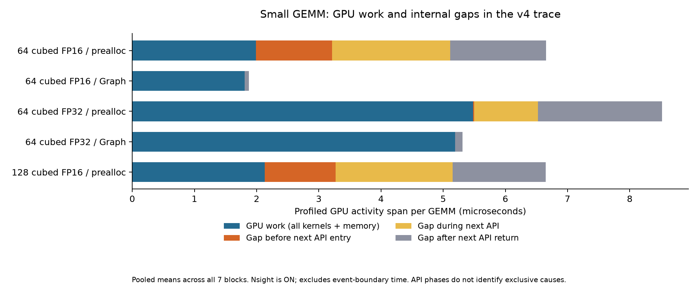
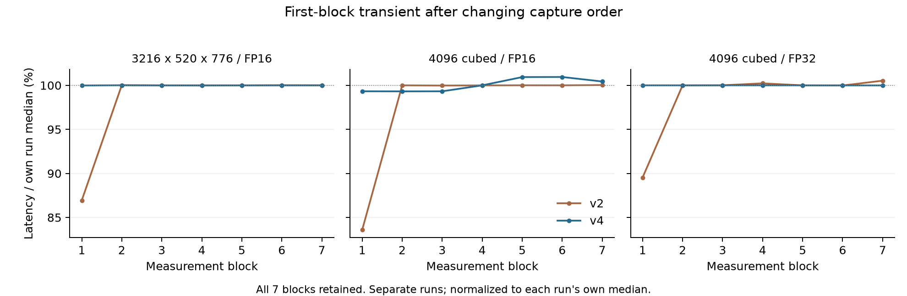

# timing audit v4 결과 검토 — 2026-09-19

**수집과 대기 분해를 완료했다. 이번 실행에서는 큰 GEMM의 첫 블록 변동이 기존 5% 기준 안으로 줄었고, 작은 FP16의 측정 중 제출 지연은 계속 관측됐다.** 안정화 이전의 profiler 시작 경계와 측정 도중 반복되는 제출 간격이 서로 다른 문제임을 보여준다. 첫 블록 삭제나 변동 기준 완화는 하지 않았다.

## 검증 결과

- ZIP: `timing_audit_20260919_201729_y43Okw.zip`
- SHA-256: `e311285d763d617f03b8d8b7974263306c3c3b3d26cca658b78286663107b4cf`
- 원본 157개 파일과 개별 hash를 보존했다. v4 배포 소스 6개, v5 baseline 소스 13개 및 저장 환경 signature의 일치를 확인했다. 첨부 코드는 실행하지 않았다.
- 신뢰하는 로컬 v4 분석기로 재계산한 `analysis.json`은 업로드된 결과와 정확히 같다. SQLite 8개 무결성 검사 통과, 기록된 종료 코드는 전부 0이다.
- 일반 전·NSYS·일반 후 각 8조건의 수치 검사 **24개 통과**. 모든 실행의 원래 timing flags는 비어 있다. 상대 IQR 최대 **1.36%**, 첫·끝 블록 절대 변동 최대 **1.12%**로 기존 5% 기준을 모두 통과했다. 일반 전후 중앙값 차이도 최대 **1.12%**다.
- 준비 범위 8개, 측정 블록 56개를 확인했다. 측정 커널 **1,021,167개**, 준비 커널 **4,572,950개**가 기록된 호출 수·Graph 노드 수·형상별 커널 수와 정확히 맞았다. 준비 검산에는 3회 probe와 모든 안정화·보정 블록도 포함했다.
- 모든 측정 블록에서 GPU 작업 합집합과 내부 간격의 합, 간격의 API 진입 전·실행 중·반환 후 분할 합이 일치했다. 4096³ FP32의 측정 memset은 56개이며 모두 2 KiB zero-fill이다.
- 실행 폴더명 시각 20:17:29부터 ZIP 내 마지막 산출물 시각 20:29:32까지 약 **12분**이다. ZIP 전송 완료 시간까지 포함한 측정은 아니다.

구조 판정은 `PASS_WITH_WARNINGS`, 타이밍 변동은 이번 24개 실행에서 PASS다. Nsight 자체 수집 경고는 아래에 별도로 남겼다. 자동 출력의 `MEASUREMENT QUALITY: REVIEW REQUIRED`는 결과 해석을 요구하는 고정 문구로, 이번 타이밍 기준을 초과했다는 뜻이 아니다.

## 일반 실행과 Nsight의 차이

시간은 7개 블록의 GEMM당 평균에 대한 중앙값이다. 일반 기준은 일반 전후 중앙값의 평균이며 변화율은 반올림 전 값으로 계산했다. 반복 수는 각 실행에서 보정되므로 정확히 같은 호출 수의 실험은 아니다.

| 조건 | 일반 기준 | Nsight | 변화율 |
|---|---:|---:|---:|
| 64³ FP16 prealloc | 4.01 μs | 6.67 μs | +66.2% |
| 64³ FP32 prealloc | 6.31 μs | 8.52 μs | +35.1% |
| 128³ FP16 prealloc | 4.01 μs | 6.65 μs | +65.8% |
| (3216,520,776) FP16 | 80.6 μs | 78.4 μs | −2.74% |
| 4096³ FP16 | 3.27 ms | 3.29 ms | +0.639% |
| 4096³ FP32 | 12.9 ms | 12.7 ms | −1.33% |
| 64³ FP16 Graph | 1.73 μs | 1.88 μs | +8.63% |
| 64³ FP32 Graph | 5.03 μs | 5.32 μs | +5.67% |

v2의 작은 FP16 증가율 약 66%가 v4에서도 재현됐다. 시작 경계를 바로잡는 것으로 측정 도중의 추적 비용이 없어지지는 않는다. 음수 변화율은 “음의 오버헤드”가 아니며 profiler 상태·세션·GPU 상태 등의 차이를 포함한 관측 차이다. 미세하고 빈번한 이벤트에서 추적의 고정 비용이 상대적으로 커질 수 있다는 설명은 [NVIDIA의 Nsight overhead 문서](https://developer.nvidia.com/blog/?p=20916)와 부합한다.

## 측정 중 대기 분해

아래는 **NSYS 실행에서 관측된 내부 GPU 작업 간격**을 다음 작업의 CUDA API 시점으로 나눈 값이다. 모든 연산 커널과 memset·memcpy를 GPU 작업으로 집계했다. 각 열은 블록별 GEMM당 값을 구한 뒤 중앙값을 취했으므로 열 중앙값의 합이 전체 간격 중앙값과 반드시 같지는 않다.

| 조건 | 다음 API 진입 전 | API 실행 중 | API 반환 후 |
|---|---:|---:|---:|
| 64³ FP16 prealloc | 1.22 μs | 1.91 μs | 1.54 μs |
| 64³ FP32 prealloc | 0.0182 μs | 1.02 μs | 1.99 μs |
| 128³ FP16 prealloc | 1.14 μs | 1.88 μs | 1.50 μs |
| (3216,520,776) FP16 | 0 | 0 | 0.949 μs |
| 4096³ FP16 | 0 | 0 | 1.02 μs |
| 4096³ FP32 | 0 | 0.169 μs | 2.22 μs |
| 64³ FP16 Graph | 0 | 0 | 0.0674 μs |
| 64³ FP32 Graph | 0 | 0 | 0.119 μs |

- **작은 FP16 prealloc:** 앞선 GPU 작업이 끝났는데도 다음 launch API에 도달하지 않은 구간이 지속적으로 관측됐다. 64³의 진입 전 공백은 v2 1.31 μs에서 v4 1.22 μs로 비슷한 크기다. 이는 profiler가 켜진 조건에서의 제출 지연이며, 그 원인을 Python 자체·framework·OS·profiler 중 하나로 분리한 결과는 아니다.
- **작은 FP32:** 같은 64³라도 FP16과 구성이 다르다. 호출마다 주 커널과 split-K reduction 커널 두 개가 실행되고, 진입 전 공백보다 API 실행 중·반환 후 간격이 컸다. 작은 형상을 모두 같은 제출 병목으로 단정하지 않는다.
- **Graph:** 두 작은 조건에서 API 진입 전·실행 중 내부 간격은 관측값이 0이었다. 여러 노드가 같은 Graph launch에 연결되어 제출된 상태이므로 남은 노드 간 간격은 API 반환 후로 분류된다. 이는 API 비용 자체가 없거나 실행 전체에 CPU 영향이 전혀 없다는 뜻이 아니다. 첫 GPU 작업 이전과 마지막 작업 이후의 event 경계는 이 집계의 범위 밖이다.
- **큰 GEMM:** 다음 API 진입 전 공백은 0이었다. 4096³의 약 1~2 μs 수준 내부 간격은 ms 단위 실행 시간에 비해 작다. FP32의 2 KiB memset은 GPU 작업으로 포함했으며 대기로 세지 않았다.

64³ FP16의 커널 사이 간격 비중은 NSYS에서 70.1%, Graph에서 3.59%였다. 하지만 prealloc의 간격 전부를 CPU의 늦은 제출로 설명할 수는 없다. 전체 간격 중 API 진입 전 부분의 비중은 모든 블록을 합쳐 약 26.3%였다. API 반환 후에는 scheduling·의존성·Graph 내부 순서·미관측 간섭 등의 원인이 남는다. 이 비중을 일반 실행의 오차율이나 전체 GPU idle 비중으로 사용하지 않는다.

그림은 모든 측정 호출을 합친 GEMM당 평균이다. 위 표의 블록 중앙값과 집계 방식이 다르다. CUDA Event 경계 차이는 포함하지 않았다. 같은 그림의 PDF는 `profiled_gaps.pdf`다.

## 첫 블록 문제는 어떻게 달라졌는가

| NSYS 조건 | v2 첫→끝 변동 | v4 첫→끝 변동 |
|---|---:|---:|
| (3216,520,776) FP16 | +15.0% | +0.0196% |
| 4096³ FP16 | +19.7% | +1.12% |
| 4096³ FP32 | +12.3% | −0.00700% |

v4는 profiler 시작을 준비 과정 앞으로 옮겼다. 시작 API의 CPU 경과 시간은 여전히 첫 조건 약 372 ms, 나머지 약 187~190 ms였지만 그 뒤 안정화·보정을 거친 후 측정했다. 같은 timestamp 계산식으로 추정한 보정 블록 이후 첫 측정까지 간격은 v2 약 187~370 ms에서 v4 약 **40~82 μs**로 줄었다. 이 추정에는 event 초기화 등이 포함된다.

별도 NVTX 경계끼리 비교한 준비 범위 종료→첫 측정 범위 시작 간격은 약 **7.32~12.8 μs**다. 위 timestamp 추정과 범위가 다르므로 두 값을 같은 측정량으로 섞지 않는다.

모든 블록을 보존하고 각 실행의 자체 중앙값으로 정규화했다. 이번 실행에서 시작 경계 변경 후 큰 첫 블록 과도 현상이 기준 안으로 줄었다는 근거다. 정확한 clock·전력 원인까지 확정하거나 모든 재실행에서 해결됐다고 보증하는 결과는 아니다. 과거 v5 REVIEW의 원인도 이번 결과만으로 동일하다고 확정하지 않는다.

## 프로파일링 없는 대조가 말해 주는 것

일반 실행에서 64³ FP16 prealloc은 약 **4.01 μs**, Graph는 약 **1.73 μs**로 Graph 쪽이 약 **57.0%** 짧았다. FP32는 약 **6.31 → 5.03 μs**, 약 **20.2%** 짧았다. 이 비교에는 Nsight가 켜져 있지 않으므로 두 실행 방식의 성능 차이 자체를 Nsight 비용만으로 설명할 수 없다.

다만 Graph는 제출 간격·호출 묶음·실행 시점·캐시 및 GPU 상태가 달라질 수 있다. 시간 차이 전체를 순수 Python 비용으로 단정하거나 NSYS에서 얻은 1.22 μs를 일반 실행 4.01 μs에서 빼서 “순수 GPU 시간”을 만들지 않는다. 입력 생성·출력 할당을 밖으로 뺀 것만으로 제출 대기까지 제거되는 것은 아니다.

## 남아 있는 한계와 다음 단계

모든 SQLite에는 `Not all NVTX events might have been collected.`와 `Not all CUDA events might have been collected.` 경고가 그대로 있다. 요청한 준비·측정 범위와 기대 커널 수, 측정 memset 수는 맞았지만 이 경고를 삭제하거나 모든 CUDA 활동이 완전 수집됐다고 판정하지 않는다. 다른 프로세스의 GPU 간섭까지 배제한 진단도 아니다. 이번 경고의 구체적인 원인은 미확정이다.

**대기 진단 결과는 확보했다. 다음 결정은 예측할 시간의 정의다.** 현재 prealloc CUDA Event 값은 해당 실행 방식의 stream 경과 시간이며 제출 대기를 포함한다. 이를 GPU 커널만의 실행 시간이라고 부를 수 없다. GPU 연산 성능이 연구의 주 대상이라면 프로파일링 없는 Graph 기반 GEMM당 stream 시간을 주 지표 후보로 검토하고, prealloc 시간은 실제 framework 경로의 비교 지표로 별도 유지하는 방안을 권한다. Graph 역시 커널·메모리 작업·노드 간 간격을 포함하므로 “순수 커널 시간”과 동일하게 이름 붙이지 않는다.

본측정 프로토콜과 최종 y값을 확정하기 전 full은 시작하지 않는다. 이번 검토에서 새 진단 패키지나 추가 GPU 실행을 만들지는 않았다. 기존 v5·raw·변동 기준은 보존한다.

재현: 신뢰하는 로컬 `timing_audit_v4/analyze.py`의 결과가 `recomputed/`에 있으며 `verify.py`로 파일 hash·호출 수·간격 합을 검증한다. `verification.json`에 전체 정밀도의 비교값과 검증 기록을, `plot.py`에 그림 재현 코드를 보존했다.
